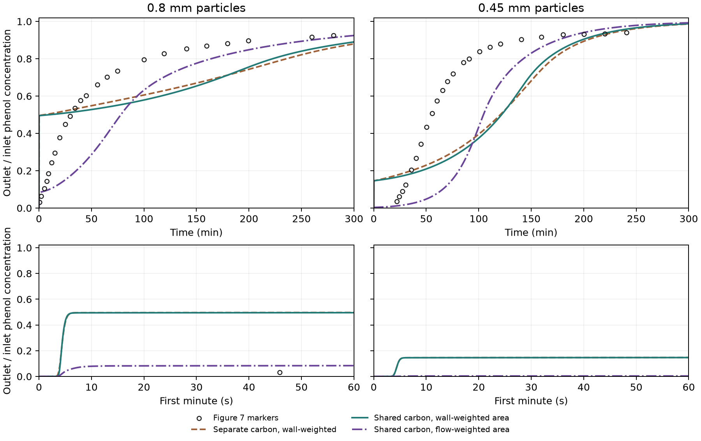

# Wall-weighted phenol transfer into shared carbon

This study keeps the Péclet-matched liquid exchange, the original
wall-exposure weights and the same 7.032455155 g of dry carbon for both
particle sizes. The earlier calculation used those weights to divide
the carbon itself. This calculation uses them to divide film transfer
area while sharing particle loading among the paths in each axial
slice. Both Figure 7 curves were scored after the simulations were
frozen. [Alhamed (2009), Figure 7](https://www.sciencedirect.com/science/article/pii/S0304389409007687)

## How the paths share carbon

Each slice contains its full share of the dry inventory and one
radial loading profile. Its external sphere area is \(A=6M/(\rho_p d_p)\).
For exposure share \(f_i\), path \(i\) receives area \(f_i A\) and has
its own bulk concentration \(C_i\) and film surface concentration
\(C_{s,i}\). With the frozen film coefficient \(k_f\), the signed
transfer to the shared radial state is

```math
J_i=f_i A k_f (C_i-C_{s,i}),
\qquad \sum_i J_i=\frac{d}{dt}(M\bar q).
```

Each path's film flux also equals the radial flux from its surface
loading \(q_{eq}(C_{s,i})\) to the common outer shell. The unchanged
batch particle operator takes the area-weighted sum of those
boundary contributions. This assumes the solid loading is averaged
instantaneously around each radial shell. The model permits signed
film transfer through the shared inventory and has separate liquid
concentrations. In the inert limit the Péclet-matched matrix still
governs all liquid mixing.

The external particle areas are 0.04084 m² and 0.07261 m² for 0.80
and 0.45 mm. The wall-weighted case uses the advection-ranked
exposure shares with the same quantile mapping to the diffusive
exchange classes as the previous test. Zero sampled contact gives
zero direct film conductance for that class. The flow-weighted
control spreads the same total area in proportion to each path's
flow. Both cases have the same sum of film conductances at a given
diameter. [Pre-scoring protocol](protocol.md) ·
[Original wall exposure](../carbon_contact/REPORT.md)

## Figure 7 comparison

| Diameter | Model | Time to 5% (s) | Time to 50% (min) | Curve RMSE |
| --- | --- | ---: | ---: | ---: |
| 0.80 mm | Figure 7 | 101.57 | 30.75 | — |
| 0.80 mm | Separate carbon, wall-weighted | 3.83 | 4.83 in full run | 0.224 |
| 0.80 mm | Shared carbon, wall-weighted | 3.92 | 9.89 in full run | 0.227 |
| 0.80 mm | Shared carbon, flow-weighted | 5.60 | 77.97 | 0.205 |
| 0.45 mm | Figure 7 | 1,412.24 | 55.36 | — |
| 0.45 mm | Separate carbon, wall-weighted | 4.21 | 120.52 | 0.270 |
| 0.45 mm | Shared carbon, wall-weighted | 4.21 | 121.74 | 0.281 |
| 0.45 mm | Shared carbon, flow-weighted | 3,048.93 | 104.48 | 0.323 |

The separate-carbon 0.80 mm focused midpoint estimates were 5.86–6.20
min. For the shared wall-weighted case, two finer runs put the midpoint
at 10.24–10.46 min. The full-duration curve supplies its RMSE. The
0.80 mm early crossing from the paper has a wide image-reading range
of 21.72–205.58 s. Both predicted shared-carbon crossings fall below it.



Sharing the solid loading barely changes the early wall-weighted
response. Both sizes exceed 5% of feed in about four seconds. At 60 s
the outlet is already 49.5% of feed for 0.80 mm and 14.7% for 0.45 mm.
Classes with little or zero conductance still contact the shared
inventory weakly or only after liquid exchange. Flow weighting
suppresses the immediate leakage for 0.45 mm and overpredicts its
time to 5% of feed. It still predicts leakage within seconds for
0.80 mm. All four shared-carbon cases fail the curve RMSE, early
crossing and midpoint screens. The accessible contact pattern for
the experimental bed and the adsorption service metrics remain
unqualified.

## Verification and execution

The 13 Julia assertions check the single-path limit against the
original particle model, identical parallel paths, the inert limit,
and an independently solved two-film linear balance. The maximum
normalized total mass residual in the frozen cohort was 1.08e-12
and the maximum normalized interface flux mismatch was 4.95e-12.
The integrated net film uptake closes against adsorbed inventory.

All four 5% crossings passed numerical refinement. Three midpoint
checks pass. The 0.80 mm wall-weighted outlet sits near half the
feed concentration. An initial crossing moved between the early
and late verification windows, so the refinement check was tightened
to retain crossings that switch windows. The two finest full-run
curves differ by at most 0.000271 of the feed after 24 s. The separate
1,200 s checks differ by 2.024% in midpoint, narrowly above the 2%
criterion. The result remains a midpoint range.

Cohort `20261112T121757Z-1a08a56f` completed 13 full runs, one short
startup check and two separately archived midpoint checks using
Julia 1.11.6. The read-only replay verified 29 sources and 45 cohort
artifacts and reproduced the targeted comparison. No new hydraulic
or DWSIM cases ran. [Run and replay guide](README.md) ·
[Compact numerical record](reference_summary.json)
