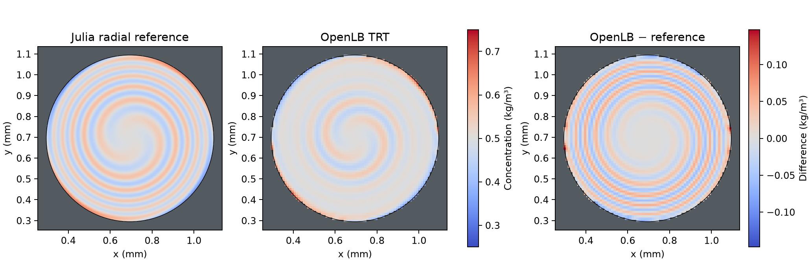
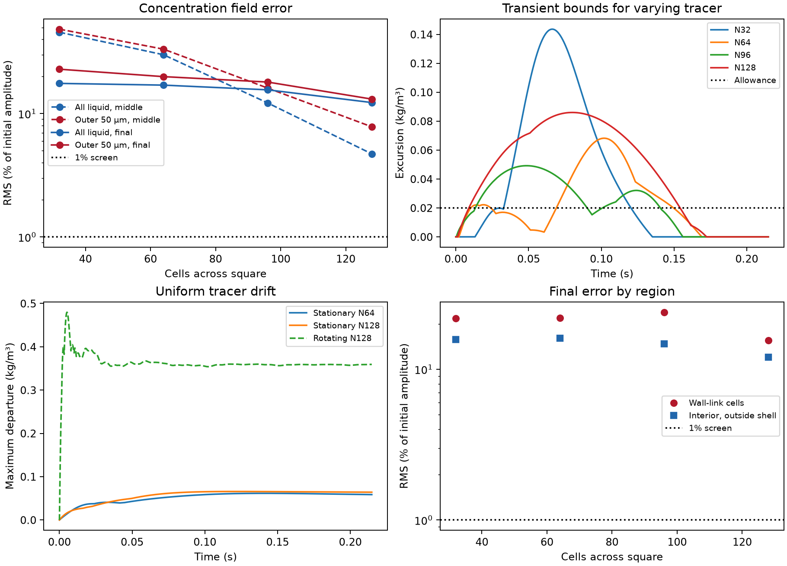

# Stationary curved wall: much smaller drift, still inaccurate transport

The wall velocity was zero at the intended smooth circle. At the same peak
liquid speed as the earlier rotating-wall test, the largest error in a uniform
tracer fell by **86.3%**. The stationary-wall calculation still fails uniform
preservation, the varying-tracer bounds, and comparison with the independent
profile. This is evidence to keep the full-bed transport calculation on hold.

## Controlled comparison

The disk radius is 0.4 mm and the peak speed is 12.94 mm/s. The imposed angular
speed decreases quadratically with radius, so the liquid speed reaches zero
at the stationary surface. A zero velocity at the smooth wall does not set
the velocities of neighbouring cell centres to zero. No momentum equation
is solved here. The previous Bessel initial profile, D=1e-9 m²/s, physical time
step and 0.214764 s observation window are unchanged. The circular wall uses
stock OpenLB cylinder geometry, scalar TRT with the scalar-specific stock
regularization, and full-way BounceBack. The [protocol](protocol.md) has the
exact conditions and acceptance criteria.

The varying concentration winds into spiral layers under differential
rotation. Its reference is the radial finite-volume solution in Julia, with
zero normal solute flux and independent space/time refinements. The selected
4,096-cell radial reference changes by at most 2.95e-5 of the initial amplitude
under the last spatial doubling and by 2.31e-5 under temporal doubling. Both
pass the declared 1e-4 screen. The earlier reference-only attempt was stopped
at 2,048 cells when midpoint spatial change was 1.18e-4. Its outputs are
retained; no native run used that unqualified reference. Eight Julia assertions
check the exact diffusion, rigid rotation and diffusion-free shear limits,
variance decay and range.

## Uniform tracer: wall motion matters, residual drift remains

| N128 case, initial C = 0.500 kg/m³ | Whole-window range, kg/m³ | Largest departure, kg/m³ |
| --- | ---: | ---: |
| Archived rigid rotation | 0.103112–0.979615 | 0.479615 |
| Stationary wall, angular shear | 0.463859–0.565761 | 0.065761 |

The stationary case's largest departure is still 13.2% of the initial
concentration. On N64 its maximum departure is 0.061563 kg/m³; doubling the
grid from N64 to N128 does not remove the residual. The N128 maximum occurs
at 0.120989 s on a fluid cell with a solid link, 0.87 µm inside the intended
smooth circle. The RMS velocity component along wall-crossing lattice links
falls from 6.43 to 0.393 mm/s between the matched controls. This is a
geometrical velocity diagnostic, not a measured wall flux. It shows how a
velocity that vanishes at the intended surface can still have nonzero
components along links from fluid cells into the voxel wall.

## Varying tracer: the spiral is too smeared

RMS values below are percentages of the initial 0.25 kg/m³ amplitude. The
target is 1% at each snapshot; the allowable transient excursion is 0.020
kg/m³. N counts cells across the surrounding square, not the disk diameter.

| N | Halfway RMS, all liquid | Final RMS, all liquid | Final RMS, outer 50 µm | Whole-window range, kg/m³ |
| --- | ---: | ---: | ---: | ---: |
| 32 | 45.67% | 17.57% | 22.90% | 0.205381–0.893600 |
| 64 | 29.99% | 17.01% | 19.94% | 0.181802–0.796785 |
| 96 | 12.20% | 15.58% | 18.02% | 0.217899–0.799191 |
| 128 | 4.71% | 12.29% | 13.10% | 0.238635–0.836006 |

On N128, the worst excursion is 0.0860 kg/m³, above the allowance, at 0.0800 s
on a wall-adjacent cell. The final field is back inside the initial physical
range, but its liquid concentration standard deviation is 0.02827 kg/m³
versus 0.04483 in the reference at the same cell centres: **37% too low**.
The final interior RMS outside the outer shell is still 12.02%. Subtracting
the matched constant-background error for diagnosis changes the final global
RMS only from 12.29% to 12.15%. The varying field therefore has a substantial
error beyond the uniform drift. No subtraction is applied to native results.

## Checks and implications

All seven native runs completed. Maximum relative drift in the closed
liquid-plus-active-wall inventory was 6.36e-13. The thin and full-depth N32
controls reproduce all saved fields exactly; both inventories scale with
depth within 1.29e-13 relative. The replay checked 30 sources and 187
artifacts, plus the archived rotating control. All 2,070 pinned original
OpenLB files are unchanged. The [compact record](reference_summary.json)
retains the exact results and the [run guide](README.md) gives reproduction
commands and the data layout.

Removing the wall speed substantially reduces one source of error. It does
not by itself preserve uniform concentration or resolve the stretched field.
Use both criteria to screen any subsequent stock transport setting on these
small benchmarks before spending another full-bed run. The disk is an interior
curved wall with a prescribed velocity; it does not quantify the contribution
of particle-wall errors in a bed with a computed three-dimensional flow. No
new bed, dispersion, adsorption or DWSIM calculation was launched.
