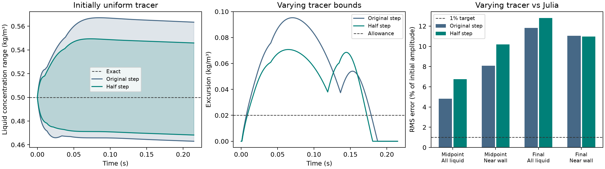

# Stationary curved wall at half the time step

Halving the time step reduced the largest uniform-tracer error by **26.5%**
and the varying tracer's largest excursion outside its initial range by
**25.7%**. The final profile error across the liquid increased from
**11.82% to 12.80%** of the initial concentration amplitude. Both tracers
still fail their acceptance checks.

## Matched conditions

The original and refined cases ran the same OpenLB 1.9r0 binary with stock
D3Q27 regularized TRT and half-way reflection. Both used the same 128-cell
square mesh around a 0.4 mm-radius disk, four axial layers, wall links,
physical velocity field, initial concentration and molecular diffusivity
of 1e-9 m²/s. The time step decreased from 19.01746 to 9.50873 µs and the
step count increased from 11,293 to 22,586. The end time stayed at
0.214764 s. The stock application's lattice velocity and relaxation times
changed with time scaling to retain the physical velocity and diffusivity.
[Original comparison](../stock_transport_candidate/REPORT.md)

The uniform reference is 0.5 kg/m³ throughout. The varying reference is the
same independently converged Julia radial solution at 0.1073725554 s and
0.2147641283 s. A shorter refined run saved the exact first observation,
since the original run had an odd step count.
[Independent Julia reference](../stationary_curved_wall/REPORT.md)

## Results

Profile RMS values are percentages of the initial 0.25 kg/m³ amplitude.
The near-wall region is the outer 50 µm of liquid.

| Quantity | Original step | Half step | Acceptance limit |
| --- | ---: | ---: | ---: |
| Uniform maximum departure (kg/m³) | 0.06714 | 0.04936 | 1e-9 |
| Varying midpoint RMS, all liquid | 4.83% | 6.74% | 1% |
| Varying midpoint RMS, near wall | 8.08% | 10.19% | 1% |
| Varying final RMS, all liquid | 11.82% | 12.80% | 1% |
| Varying final RMS, near wall | 11.04% | 10.96% | 1% |
| Varying maximum excursion outside initial range (kg/m³) | 0.09525 | 0.07074 | 0.020 |

Over the full run the uniform tracer ranged from **0.46820 to 0.54936 kg/m³**
at the smaller step. The varying tracer started within 0.25–0.75 kg/m³.
Its maximum fell from 0.84525 to
0.82074 kg/m³, and its minimum fell from 0.21637 to 0.18932 kg/m³. The
final interior RMS rose from 12.05% to 13.32%, while the final near-wall RMS
fell by 0.08 percentage points. The final concentration variation was still
too weak. The spatial standard deviation was 0.02760 kg/m³ at the half step
and 0.02962 kg/m³ at the original step, versus 0.04483 kg/m³ in Julia.

All three native executions completed in cohort `20261111T144732Z-c53cd814`.
The truncated repeat's inventory and extrema history matched the main run
at every step through the exact midpoint. The archived masks and wall links
matched, the saved velocity and initial concentrations passed their matching
checks, and the maximum relative liquid inventory drift was 1.27e-12.
Read-only replay checked 20 sources and 88 artifacts. Eight Julia reference
assertions and eight existing Python reference and link tests passed. The
vendor integrity check covered all 2,070 pinned original OpenLB files.

The comparison covers one refinement at fixed mesh. It establishes that the
smaller step helped uniformity and peak excursion but did not improve the
final profile overall. The benchmark generated zero full-bed or DWSIM runs.
[Run and replay commands](README.md) · [Compact numerical record](reference_summary.json)
