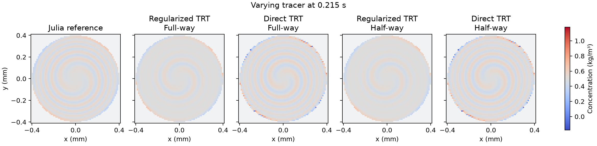
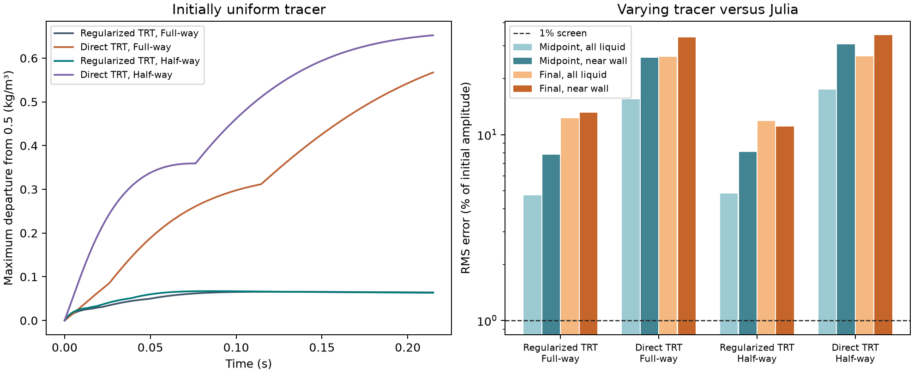

# Stock TRT comparison at a stationary circular wall

All three stock alternatives failed to keep a uniform tracer uniform and
to reproduce the evolving concentration profile. Regularized TRT with
half-way reflection gave the closest final profile among the alternatives.
Its final error was 11.82% across the liquid and 11.04% in the outer 50 µm,
against a 1% criterion in each region. The maximum departure of the uniform
tracer was 0.06714 kg/m³, or 13.43% of its starting concentration.

## Controlled comparison

Each setup transported both an initially uniform 0.5 kg/m³ tracer and an
angular concentration mode with mean 0.5 kg/m³ and amplitude 0.25 kg/m³.
The same circular disk of radius 0.4 mm, prescribed shear, zero speed at the
smooth wall, molecular diffusivity of 1e-9 m²/s, 128 cells across the enclosing
square and four periodic axial layers were used throughout. The comparison
uses the archived Julia radial advection–diffusion solution at 0.107373 and
0.214764 s. Its separate radial and time refinements changed the normalized
reference by at most 2.95e-5 and 2.31e-5, respectively.
[Stationary-wall benchmark](../stationary_curved_wall/REPORT.md)

The two collision options were stock `AdvectionDiffusionTRTdynamics`, with
and without stock `CombinedAdvectionDiffusionRLBdynamics`. Both use D3Q27,
the same first-order equilibrium, odd relaxation time 0.5004843744 and
TRT magic parameter 0.3. Full-way bounce-back returns a population through
a solid cell. The half-way option uses stock `BouzidiPostProcessor` at
registered distances of 0.5, which reflects it during the same step.
The wall for this test remains at the voxel link midpoint.
[OpenLB scalar dynamics source](https://www.openlb.net/DoxyGen/html/d7/d70/advectionDiffusionDynamics_8h_source.html)
and [Bouzidi boundary source](https://www.openlb.net/DoxyGen/html/d3/d53/setBouzidiBoundary_8h_source.html).

## Concentration results

Errors are RMS as a percentage of the original 0.25 kg/m³ amplitude.
The near-wall region is the liquid within 50 µm of the circular wall.

| Stock setup | Uniform range (kg/m³) | Uniform max departure (kg/m³) | Midpoint RMS, liquid / near wall | Final RMS, liquid / near wall | Varying tracer max excursion (kg/m³) |
| --- | ---: | ---: | ---: | ---: | ---: |
| Regularized TRT, full-way (archived) | 0.46386 to 0.56576 | 0.06576 | 4.71% / 7.81% | 12.29% / 13.10% | 0.08601 |
| Direct TRT, full-way | −0.06723 to 0.82659 | 0.56723 | 15.52% / 25.85% | 26.18% / 33.38% | 0.31897 |
| Regularized TRT, half-way | 0.46296 to 0.56714 | 0.06714 | 4.83% / 8.08% | 11.82% / 11.04% | 0.09525 |
| Direct TRT, half-way | −0.15230 to 0.85919 | 0.65230 | 17.48% / 30.66% | 26.44% / 34.23% | 0.42910 |

The uniform departure limit was 1e-9 kg/m³. The engineering allowance for the
varying tracer to leave its initial range of 0.25–0.75 kg/m³ was 0.02 kg/m³.
Half-way reflection reduced the final near-wall error by 2.07 percentage
points with regularized TRT. The final interior error stayed near 12%.
The half-way profile also exceeded the initial concentration bounds by
more than the archived case. Its final spatial standard deviation was
0.02962 kg/m³ versus 0.04483 kg/m³ in Julia, so the concentration variation
was still about 34% too weak. Removing regularization gave negative
concentrations with either reflection timing.

All six cases passed the closed inventory check with a maximum relative drift
of 6.33e-13. Both half-way configurations covered all 8,592 fluid-to-solid
links, including 1,432 that crossed the axial periodic seam. The liquid
snapshots matched across all four axial layers. Total tracer inventory was
conserved even where tracer redistributed incorrectly within the disk.

## Scope and verification

The completed cohort is `20261111T133159Z-7f69a322`. An initial attempt
stopped during analysis because its axial comparison included the temporary
copies in the solid cells. The completed cohort reran all six cases with
the comparison restricted to liquid cells. Read-only replay checked 32
source hashes and 168 archived artifacts. Eight Julia reference assertions,
eight existing Python reference/link tests and the integrity check of 2,070
original OpenLB files passed.

The N=64 follow-up was conditional on an N=128 pass. The three alternatives
remain unqualified for a bed transport closure. This study produced zero
full-bed runs and zero DWSIM runs. [Run and replay commands](README.md) ·
[Compact numerical record](reference_summary.json)
