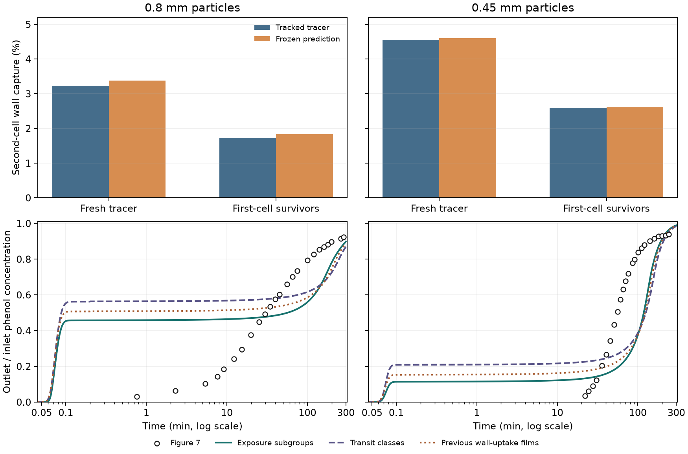

# Wall exposure among first-cell survivors

The previous constant-film reduction overpredicted wall capture
over two synthetic porous cells. This study tests whether the
trajectory composition of survivors can account for the difference,
then transfers the qualified reduction to both phenol breakthrough
cases. The saved OpenLB TRT flow supplies all trajectories.
[Previous wall-uptake test](../wall_uptake/REPORT.md)

## Two-cell holdout

The original 40 Péclet-matched flow classes are defined by the
transit-time ranks of inert diffusing trajectories. Within each
class, four subgroups resolve the advection-only twin transit time.
The first cell supplies each subgroup's survival fraction. The
paired inert trajectories supply subgroup exchange. The summed
carrier flux between any two parent classes remains the original
Péclet-matched flux. Applying first-cell survival changes the
composition of the tracer dose arriving at the second cell.
[Holdout protocol](protocol.md)

The same saved inert transit pairs define the exchange and are
available in both periods. The second-period wall-hit outcomes are
held out until the prediction is frozen. The test therefore measures
transfer to the second-cell uptake outcome on the same synthetic
carrier. The 40 µs case checks time-step sensitivity on the same
geometry and inlet seeds.

| Particle diameter | Tracer population entering cell 2 | Tracked capture at 80 µs | Frozen prediction |
|---|---|---:|---:|
| 0.80 mm | Fresh | 3.229% | 3.375% |
| 0.80 mm | First-cell survivors | 1.723% | 1.831% |
| 0.45 mm | Fresh | 4.552% | 4.601% |
| 0.45 mm | First-cell survivors | 2.601% | 2.604% |

Across both diameters and time steps, the largest error was 0.108
percentage points for capture among first-cell survivors, 0.104
points for cumulative two-cell survival, and 0.278 points for the
flow-weighted class error in fresh second-cell capture. Each was
below its 1-point limit.

The control using only the 40 transit-rank classes also passed.
It gave 1.845% and 2.625% capture among survivors at 80 µs. The
subgroups improved conditional capture at 80 µs for both sizes,
while the parent-only control did slightly better for 0.80 mm at
40 µs. Most of the holdout improvement over the earlier films was
already recovered using first-cell survival in the same transit
classes that define the fixed exchange.

## Column transfer

The column uses the same Péclet-matched exchange between parent
classes, dry carbon mass of 7.032455155 g, liquid volume, and
batch-qualified isotherm and particle diffusivity. The transfer
number is the negative logarithm of the subgroup's observed
first-cell survival. If every marker in a subgroup hit a wall,
half a survivor divided by the subgroup's marker count supplies
a finite endpoint. In the shared-particle model, the subgroup
film conductance is distributed over area inferred from first-cell
wall reflection distances on the 32 grain octants. The total
geometric external area and one radial carbon profile per axial
slice are preserved. The area allocation is a synthetic geometry
proxy. [Column transfer protocol](column_protocol.md)

The all-hit subgroups carried roughly 0.97% of the inlet flow in
each 80 µs run. Giving those subgroups a finite conductance changed
their cumulative perfect-sink survival prediction by 0.020
percentage points or less. The new total conductances were
4.56 × 10⁻⁶ and 1.21 × 10⁻⁵ m³/s for 0.80 and 0.45 mm. The
fastest 90% of the inlet flow accounted for only 0.018% and
0.36% of that conductance, respectively.

## Frozen Figure 7 comparisons

Figure 7 was scored after both sets of column curves were saved.
The 5% and 50% crossings refer to the outlet concentration as a
fraction of the feed concentration.
[Alhamed (2009), Figure 7](https://www.sciencedirect.com/science/article/pii/S0304389409007687)

| Particle diameter | Predicted 5% | Figure 7 5% | Predicted 50% | Figure 7 50% | Curve RMSE in outlet/inlet concentration |
|---|---:|---:|---:|---:|---:|
| 0.80 mm | 3.96 s | 102 s | 56.71 min | 30.75 min | 0.213 |
| 0.45 mm | 4.42 s | 23.54 min | 118.38 min | 55.36 min | 0.286 |

Both cases passed column numerical refinement and failed the
Figure 7 screens. For 0.80 mm, the concentration at one minute
fell from 50.9% in the previous wall-uptake run to 45.8%.
The early plateau is now below the midpoint, so the new 50%
crossing occurs during the later rise. The 5% crossing remains
within four seconds. The 0.45 mm bed reaches 11.5% at one minute
and still crosses 50% more than an hour late.

The parent-only control also predicts early leakage. At one
minute it reaches 56.4% and 21.0% of feed, and crosses 50% at
5.28 s and 125.55 min, respectively. Thus the subgroup split
matters when the model is repeated across an entire bed even
though both state definitions pass the short perfect-sink test.
Relative to the preceding wall-uptake films, the subgroup curve
RMSE falls from 0.233 to 0.213 for 0.80 mm and rises from 0.281
to 0.286 for 0.45 mm.

Transferring the 40 µs wall model on the same column mesh
changes outlet concentration by at most 0.00489 and 0.00149
of feed. The midpoints become 53.01 and 118.25 min. Halving
the wall-tracking time step therefore preserves the main
experimental discrepancies. The selected 80 µs runs close the
phenol balance within 2.53 × 10⁻¹¹ of the dose and the film
flux balance within 2.51 × 10⁻¹³ of its normalization scale.

The saved trajectories account for lower wall exposure among
survivors in this synthetic two-cell test. In the repeated bed
model, much of the fast flow still has little film conductance.
The breakthrough curves retain early leakage and a slow rise
through intermediate concentrations. Adsorption service-time
predictions remain unqualified.

## Verification and reproduction

The wall holdout is in cohort `20261112T150521Z-cc8dc4c0`. Its frozen
prediction has SHA-256
`726bdaf20984dd0f282648bf5ccd7091567ed1c0cae16bfc569de743a127438e`.
The column cohort is `20261112T150829Z-02f78829`. The manifest of
completed curves has SHA-256
`a9354f55745e3055bc66b35d86f325a79da41ba20b2c969c0cd1023b6db5d5bd`.
Read-only replay verified 21 sources and 22 artifacts for the holdout,
and 28 sources and 51 artifacts for the column. Both Python predictor
tests and all 13 Julia shared-carbon assertions passed. The column
runs used Julia 1.11.6.
[Reproduction commands](README.md) · [Reference summary](reference_summary.json)
