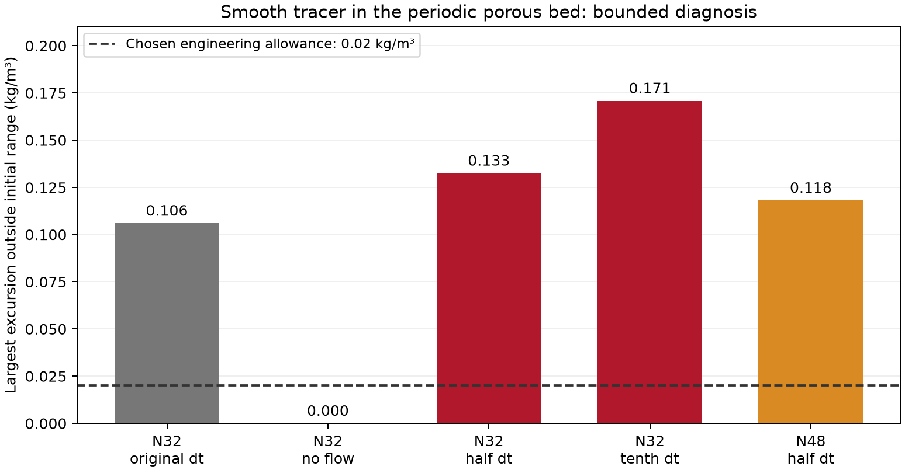

# Bounded transport investigation: conclusion and handoff

10 November 2026. **Stop this numerical investigation and defer the high-Peclet
pore-tracer branch.** Four additional actual OpenLB runs and a read-only source /
data audit found no simple handoff or parameter-setting error. There is enough
evidence to record a limitation of this tested configuration and continue
project work without inventing a transport coefficient.

This does not establish a general OpenLB defect or identify a unique root cause.
The accepted hydraulic/process and batch particle components remain available.
The proposed 5% adsorption service/energy accuracy budget remains unassessed.

## What was checked

Focus on the .80 mm synthetic FCC case. The initial smooth concentration range
is .25–.75 kg/m3; a passive, incompressible, source-free solution should remain
within that range. The engineering screen allows .02 kg/m3 additional excursion.
All ends are periodic, so inlet/outlet behavior is excluded. Geometry, physical
flow and molecular diffusivity stay fixed except for the explicitly stationary
control. Original stock OpenLB code and the existing profile executable are
unchanged. The [prospective protocol](diagnosis_protocol.md) bounds the work.

| Test | Minimum C | Maximum C | Outcome |
| --- | ---: | ---: | --- |
| Previous N32 reference | .14460 | .85602 | Fails |
| N32, water stationary; diffusion only | .25120 | .74880 | Passes |
| N32, half the original time step | .11770 | .88251 | Fails |
| N32, one-tenth time step | .08002 | .92086 | Fails |
| N48, same physical time step as N32 half-step | .13418 | .86812 | Fails |

Concentrations are kg/m3; extrema cover each whole recorded history, rather
than just the final field. The four new cases use the same physical elapsed
window, approximately .2148 s. Half-step and N48 have matching dt to about
2.5e-12 relative. The grid comparison changes spatial resolution and the voxel
approximation to the spheres, using separately converged, matched-flow fields.
It improves the excursion modestly relative to N32 half-step, but does not
qualify the method. Two meshes do not provide a formal convergence/error bound.



## Setup errors sought and not found

- Native and scalar fluid-node IDs, geometry masks and coordinates match; the
  maximum recorded coordinate difference is zero in all three flowing cases.
- Exported/imported physical velocity components match after the recorded
  carrier-viscosity scaling. The coordinate and SI conversion audit passes.
- Source inspection and the stock TRT parameter relation confirm that scalar
  diffusion is assigned to the odd relaxation channel. Reconstructing Dm from
  the two relaxation times, dx and dt gives 1e-9 m2/s in every case. There is no
  detected odd/even swap or accidental diffusivity change.
- Native water-density departure is below .006%. That small density variation
  alone does not explain the much larger concentration-range violations.
- Global kinetic solute mass closes within 2.1e-12 relative across these cases.
  It includes separately reported temporary wall populations. Conservation
  therefore coexists with incorrect local concentration redistribution.

The stationary control retains the same numerical walls and initial profile.
It passes, showing that ordinary diffusion in that geometry alone does not
produce the large excursion over this window. Introducing the native flow is
necessary for the demonstrated failure. A smaller dt does not provide a remedy
at fixed physical parameters and fixed TRT magic parameter; the lattice
relaxation values necessarily change with the conversion.

## Likely explanation and remaining uncertainty

The evidence is consistent with advection generating concentration variations
too sharp for this spatial discretization and stock scalar configuration.
Molecular diffusion smooths very slowly at these water/solute conditions. The
rough distance sqrt(2*Dm*unit-cell-transit-time) is about **14.7 micrometres**,
while the tested grid spacing is **43.4 micrometres** at N32 and **28.9 micrometres**
at N48. These are scale estimates, not an independently derived mesh requirement
or a proof of the precise failure mechanism.

A Cartesian face-interpolation divergence proxy also changes with grid
resolution. It is explicitly **not OpenLB's population mass flux**, and does
not prove that the native fluid solver violates local continuity. No velocity
projection, mass correction or new discretization is introduced. The final
fields are already back inside the engineering bounds, so their wall-proximity
statistics cannot locate the earlier peak violations. A unique wall/flux/
discretization cause remains unresolved.

The broader behavior has precedent: [Hekmatzadeh et al. (2020)](https://doi.org/10.24200/sci.2018.5616.1376)
report oscillations in advection-dominated two-dimensional LB tests. Their
model-specific thresholds cannot be transferred to our 3D/TRT case.
[Feng, Liu and Chu (2026)](https://journals.aps.org/pre/abstract/10.1103/5nx7-bykh)
address high-Peclet scalar oscillations using a specialized realizability-
preserving entropic method. That is supporting context, not validation of this
case or a demonstrated drop-in correction for the installed OpenLB application.
No new collision model was implemented.

## Decision: defer this branch and move forward

The investigation's stopping condition is met: no clear setup defect emerged,
and the boundedness failure persists under the matched refinement. Additional
mesh escalation or development of a new transport method would exceed the
requested small investigation. Preserve this case as a reproducible failing
control and record the high-Peclet pore-to-column dispersion connection as
**deferred**, with no accepted coefficient or service prediction.

Continue from the verified OpenLB → Julia → DWSIM hydraulic resistance and the
batch-qualified Julia particle component. The next practical isothermal study
can compare **explicitly chosen column-contact scenarios**, common to both
particle sizes, with their pumping cost. Such scenarios must remain assumptions,
not pore-measured mixing or experimental column predictions. No material-design
recommendation or completed adsorption validation follows from them. Do not
refit each breakthrough curve, reuse the paper's fitted DL as measured fluid
dispersion, or change the source equilibrium/inventory to obtain agreement.

This handoff scopes the next executable study; it does not claim that new
column scenarios, service metrics or DWSIM runs were executed in this diagnosis.
Reaction and non-isothermal extensions remain deferred.

## Exact commands and retained evidence

From the project root, with the existing completed profile and hydraulic cases:

```sh
source scripts/env.sh
uv run python -m examples.adsorption.transport_accuracy.diagnosis
uv run python -m examples.adsorption.transport_accuracy.diagnosis --check
uv run python -m examples.adsorption.transport_accuracy.plot_diagnosis
uv run pytest tests/adsorption/test_transport_diagnosis.py tests/adsorption/test_transport_accuracy.py -q
uv run python scripts/check_repository.py
```

The diagnosis reuses the exact previous binary after checking its hash. On a
fresh machine, reproduce the prerequisite hydraulic/profile studies first;
there is no silent binary download or unrecorded replacement solver. Run ID:
`20261110T183934Z-2a431270`, under
`results/adsorption/transport_accuracy/diagnosis/runs/`.
The [curated record](reference/diagnosis_reference.json) binds native requests,
source snapshots, field audits, hashes and outcomes. The checker reanalyzes
saved data and launches zero native/DWSIM simulations. Four native runs are new;
the reference case is reused. No Julia adsorption solve, DWSIM execution,
experimental fit, installation or browser change occurred in this investigation.
All 2,070 original distribution files still match the pinned archive verifier.
