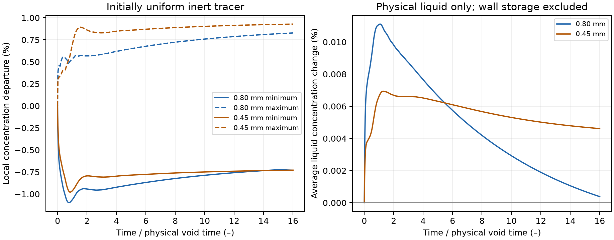
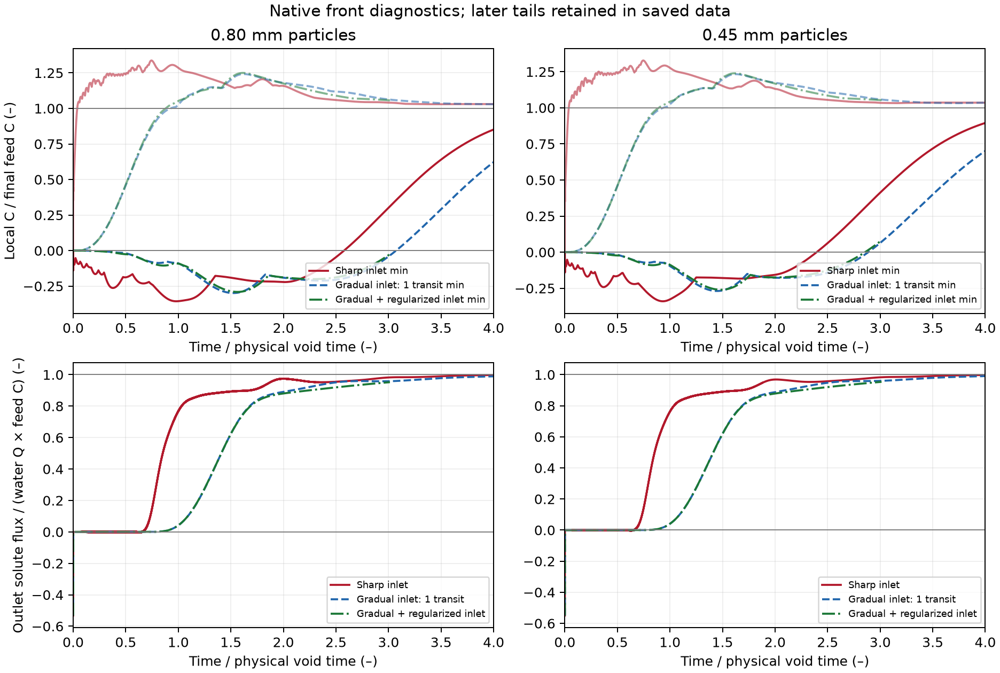
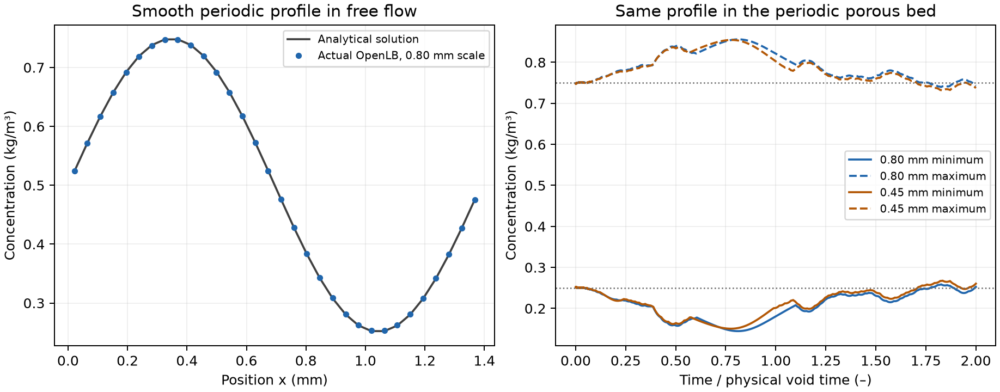

# Engineering accuracy: acceptable uniform drift, unreliable porous transport

Follow-up: the [bounded investigation](DIAGNOSIS.md) executes four additional
native controls. Stationary diffusion passes; smaller time steps and a matched
N48 comparison do not resolve the flow-driven range violations. The handoff
and parameter audit finds no simple setup defect. This high-Peclet transport
branch is now **deferred**, with its failures retained; the fourteen-run
assessment below remains unchanged.

## Engineering conclusion

The earlier **1.1% local uniform-concentration error is acceptable under the new
project engineering screen** for the tested duration and conditions. It should
not by itself be treated as a reason to abandon the calculation. Both particle
sizes pass that screen over sixteen physical void-volume transits, with average
liquid concentration changes below .012%.

However, further actual OpenLB trials reveal a larger problem when concentration
varies through the bed. Sharp and gradual feed changes generate substantial
negative concentrations. Even a smooth initial concentration profile develops
unphysical extrema in a periodic porous domain with **no inlet or outlet**.
The current configuration therefore cannot yet demonstrate the proposed 5%
accuracy in adsorption service time and energy per on-spec volume. That budget
is **unassessed**, rather than a measured 5% process error or a completed pass.

This scoped engineering diagnostic study is complete: **14 actual native runs**,
no new DWSIM runs and no new adsorption predictions. The complete adsorption
milestone remains unfinished. Earlier strict tests, batch evidence, failed
experimental column comparisons and verified hydraulic/process results remain
unchanged.

## Physical and numerical scope

Use the earlier converged synthetic FCC flow fields at particle diameters .80
and .45 mm, nominal voidage .6 and the superficial duty corresponding to
43.8 mL/min through an 11 mm ID column. Actual saved DWSIM water properties at
295.15 K set the native-to-carrier scaling. Free-liquid Dm=1e-9 m2/s remains a
declared phenol/water scenario, not a newly measured property. The microscopic
unit-cell flow is distinguished from the whole-column flow.

All transport trials use the stock combined regularized TRT D3Q27 candidate.
The native velocity and physical diffusion are unchanged. New applications,
builds and results stay outside the original OpenLB tree; all 2,070 original
distribution files covered by the existing archive verifier still match.
No new dynamics, descriptor, geometry class or boundary algorithm was written.

The main [protocol](protocol.md) declares 2% local uniform departure, .1%
maximum average-liquid change and .2 percentage-point late drift as candidate
engineering screens. The earlier one-part-per-million test remains a separate
failed diagnostic. These new limits are chosen accuracy targets, not estimated
experimental uncertainties. Their pass does not establish accuracy of every
other output.

## Uniform concentration: the small error stays bounded

Fill the periodic bed with an inert tracer at 1 kg/m3. With no source, adsorption
or concentration gradient, the intended incompressible model preserves that
concentration. The two new runs last sixteen physical void times, compared with
the earlier two-time observation.

| Uniform test | .80 mm | .45 mm |
| --- | ---: | ---: |
| Largest local departure from 1 kg/m3 | 1.099% | .978% |
| Maximum change in average physical-liquid concentration | .01111% | .00694% |
| Final-quarter variation of recorded extrema | .04089 percentage points | .01466 percentage points |
| New engineering screen | Passed | Passed |

The average is based on physical liquid only. Temporary scalar populations in
solid bounce-back cells are numerical storage and are reported separately.
Conservation of the global kinetic inventory does not imply correct local
transport. The final RMS local departures are also retained in the reference.



## Moving fronts: the error is substantially larger

The next two native runs start with clean liquid and impose a feed of 1 kg/m3,
using the existing stock Dirichlet inlet and zero-gradient outlet. The physical
solution should stay between zero and feed concentration. The results instead
span:

| Input / boundary | .80 mm concentration range | .45 mm concentration range |
| --- | ---: | ---: |
| Sharp feed change | −.3565 to 1.3370 | −.3402 to 1.3280 |
| Gradual feed over half a unit-cell transit | −.3427 to 1.2799 | −.3170 to 1.2697 |
| Gradual feed over one unit-cell transit | −.2985 to 1.2416 | −.2688 to 1.2333 |
| One-transit gradual feed, stock regularized inlet | −.2907 to 1.2496 | −.2603 to 1.2396 |

Values are kg/m3, numerically equal to C/final-feed-C here. The gradual inputs
use OpenLB's existing quintic start-up functor; geometry, flow, Dm and other
transport operators stay fixed. Their [prospective addendum](ramp_protocol.md)
records why they were tried. The separate [stock inlet diagnostic](inlet_protocol.md)
changes only the inlet boundary selection to existing RegularizedTemperature
with TRT and adds extrema-location diagnostics. Its short two-transit post-ramp
window cannot qualify tails or a dispersion coefficient.

All four longer gradual-input cases audit the actual recorded input history.
For linear transport, output mean and variance include the known input's mean
and variance. These are removed separately, using real Julia quadrature and
the independent quintic-ramp values T/2 and T²/28. The adjusted means from the
two ramp durations agree to numerical precision and their variances differ by
about .03%. This demonstrates input accounting and repeatability of those
diagnostics; it **does not validate a response with large negative values**.

The sharp and gradual runs close global kinetic mass and reach their plateau
and tail screens, but fail local concentration and signed outlet-flux screens.
The short regularized-inlet trial additionally has deliberately incomplete tail
evidence. The raw outlet histories also contain an initial negative-flux event
that persists across input schedules; it is retained, not clipped or deleted.
Its exact cause is not established by this study.

Execution note: the finite-front runner computes the nominal window from
control length divided by the full-cell interstitial velocity. Because the
finite control volume drops reservoir planes with a different voxel void
fraction, the recorded sharp-front windows are 15.899 actual V/Q rather than
exactly 16. The periodic uniform windows are 16.000. This small departure from
the protocol's requested finite-volume time convention is recorded explicitly;
it does not remove the large transient bound violations. Actual durations,
volumes, Q and observed transit counts remain in every reference. No frozen
protocol or native record was edited to conceal the difference.



## Isolation: the problem also occurs without inlet or outlet boundaries

Four further native controls start with the smooth, positive profile

```math
C(x,0)=0.5+0.25\sin(2\pi x/L),
```

in a fully periodic domain. There is no inlet, outlet, reaction or adsorption.
For each particle-size scale, one control uses uniform free flow and the other
the actual porous velocity and geometry. Both run for two unit-cell transits.
The [prospective profile protocol](profile_protocol.md) fixes all conditions
before execution. The independent free-flow solution is

```math
C(x,t)=0.5+0.25e^{-D_m(2\pi/L)^2t}\sin[2\pi(x-vt)/L].
```

| Periodic smooth-profile control | .80 mm scale | .45 mm scale |
| --- | ---: | ---: |
| Free-flow RMS error / initial amplitude | .2215% | .2217% |
| Porous minimum, from an initial lower bound .25 | .14460 | .15054 |
| Porous maximum, from an initial upper bound .75 | .85602 | .85463 |

Both free-flow controls pass their 1% analytical screen. Both porous controls
fail even the .02 kg/m3 allowance around the initial .25–.75 range. This
demonstrates a limitation of the current porous velocity/scalar/wall setup,
independent of open boundaries or an abrupt imposed feed. It does not uniquely
identify the defective contribution or establish that OpenLB generally cannot
solve this transport problem. Global mass conservation still holds.



## What can and cannot be used

The small uniform drift can be accepted for this engineering diagnostic. The
moving-front and periodic-profile results prevent accepting the present native
transport closure. A dispersion or service prediction is not extracted from
these failed fields. Source equilibrium, the batch-qualified particle loading
diffusivity and the full bed inventory remain separate and unchanged. No
per-column fit, clipping, active-fraction adjustment or artificial increase in
molecular diffusion is used.

The existing OpenLB → Julia → DWSIM hydraulic result remains valid within its
synthetic, bed-friction-only scope: .45 mm particles require about 3.103 times
the pumping work of .80 mm particles at the same column flow and declared dry
inventory. The adsorption benefit needed to judge that tradeoff remains
unavailable. No process accuracy bound is inferred from the uniform error.

## Next executable requirement

Use the periodic smooth-profile case to investigate the local water/solute
flux consistency and impermeable-wall treatment at the same physical regime.
It removes inlet/outlet ambiguity and supplies a reproducible failing case.
Compare an existing compatible stock transport route or a deliberately changed
discretization against that case and its free-flow analytical control. Qualify
mass, concentration bounds and convergence before returning to the front and
longer-segment tests. An open-boundary zero-input control should separately
audit the initial outlet event.

The .1%–1% uniform error is no longer the sole gate. The demonstrated larger
nonuniform errors are the current obstacle. New laboratory measurements,
unavailable raw data, another adsorption fit or a reacting model are not needed
to investigate them.

## Reproduction and evidence

The [run guide](README.md) gives exact commands and SI contracts. Curated
[reference records](reference/README.md) bind all native and assessment summaries
to source and artifact hashes. Native execution, saved-data checks, analytical
comparisons, Julia replay and figure inspection are distinct activities. No new
browser/interface check or DWSIM execution is claimed.

The full host-graphics Python suite passes **180 tests**. Repository checks
cover 19 examples, 13 paper folders and 161 Markdown files without errors.
All three figures were visually inspected. Saved replay checks all four native
stages and the earlier column_transport evidence; it launches no simulators.
These verification passes do not turn the failed transport controls into a pass.

The principle that accuracy concerns the intended engineering outputs is
described in the [NASA verification overview](https://www.grc.nasa.gov/WWW/wind/valid/tutorial/overview.html).
Implementation references are the installed OpenLB 1.9r0 examples and stock
analyticalF.hh, regularizedTemperature3D.h and advectionDiffusionDynamics.h.
The unchanged source adsorption evidence remains
[Alhamed (2009)](https://doi.org/10.1016/j.jhazmat.2009.05.002), with its separate
extractions and batch/column reports; this diagnostic does not add experimental
validation.
