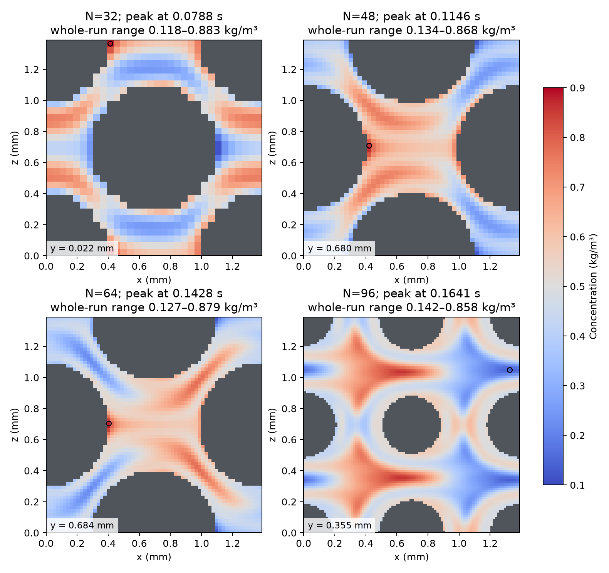
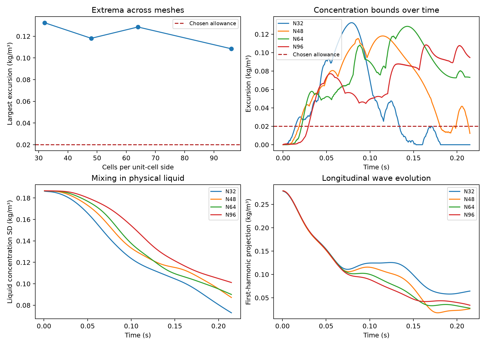

# Resolving transport error in the synthetic particle bed

**Investigation complete; packed-bed transport remains unqualified.** Refinement
fixes the simple shear and flat-wall benchmarks. It reduces the largest packed-bed
excursion by 15.6% from N64 to N96, but the N96 result still reaches
0.141537–0.858273 kg/m³ where the physical range is 0.25–0.75. The finer grid
improves one error measure without establishing convergence of the concentration
field or a corrected transport closure.

## Engineering question

Can the artificial concentration changes be removed by refining the mesh, or
are they caused by velocity transfer, mass loss, particle-wall treatment or
the chosen initial condition? A water-flow mesh need not resolve solute
transport: the application carrier's Schmidt number is approximately 957 for
the declared molecular diffusivity of 1e-9 m2/s. Momentum therefore diffuses
much faster than solute. Flow can create concentration layers considerably
thinner than the features needed for an acceptable pressure-loss calculation.
Over the 0.215 s observation window, the free-diffusion distance √(2 D t) is
about 21 µm for the solute; the analogous viscous distance is about 640 µm.
Even the N96 spacing is 14.5 µm. These distances explain why the two mesh
requirements can differ; they are not measured layer thicknesses or a mesh
acceptance rule.

The geometry is the same synthetic FCC arrangement of 0.8 mm impermeable
spheres used in the earlier hydraulic case, with nominal void fraction 0.6.
The superficial velocity corresponds to 43.8 mL/min through the 11 mm reference
column; the simulated repeating cell has a smaller transverse area. The
scalar case is periodic, without adsorption, inlet, outlet or sources, and
starts from C=0.5+0.25*sin(2*pi*x/L) kg/m3. Its continuum solution must remain
inside the initial concentration range. The additional .02 kg/m3 allowance is
an explicitly chosen engineering screen, not a universal tolerance.

This is numerical verification of a synthetic, nonreacting problem. It is not
an experimental validation of carbon pore geometry or phenol dispersion.
The batch-qualified Julia particle model, source equilibrium, dry inventory
and existing DWSIM calculations are unchanged.

## Four complementary checks

1. Independently converge water flow on each mesh at the same imposed flow,
   then compare scalar transport at matched physical diffusivity, time step
   and elapsed time. Report actual voxel void fraction rather than silently
   treating it as the exact analytical value.
2. Preserve the entire concentration field at the largest excursion. Final
   fields alone miss transient failures. Examine positions, nearby solid
   links, analytical surface distances and physical-liquid mixing measures.
3. Remove particle geometry in a smooth shear control, then test a channel
   with flat impermeable walls and known Poiseuille velocity. Both have an
   independently converged continuum reference.
4. Inspect actual OpenLB water and scalar populations before collision,
   after collision and after streaming. Check the local discrete balance and
   distinguish wall population storage from physical-liquid inventory.

All native lattice operations use existing OpenLB dynamics, descriptors, indicators
and boundary facilities. No vendor file is modified. The [prospective protocol](protocol.md),
[N96 extension decision](resolution96_protocol.md) and component protocols
separate declared tests from observed results. The earlier bounded study and
its stopping decision remain preserved as historical evidence; the user
authorized this expanded investigation.

## Matched particle-bed meshes

Common physical dt=1.90174558e-5 s and actual duration approximately .21476413 s.
No molecular diffusivity, viscosity or physical flow is fitted to the scalar
answer. Pressure gradient is adjusted only to impose the same flow.

The [N96 water field](hydraulics/reference/grid96_reference.json) passed
all six checks after a preserved session interruption and one resumed
pressure trial. Its flow matches the target within 9.2e-8 relative. Relative
to N64, its required native pressure gradient changes by only .556% and
its represented liquid volume by .000753%. This tighter hydraulic agreement
does not establish scalar accuracy. The earlier process results are preserved.

| Cells per side | Actual void fraction | All-time C range, kg/m3 | Largest excursion outside [.25,.75], kg/m3 | Final liquid C standard deviation, kg/m3 |
| --- | ---: | ---: | ---: | ---: |
| 32 | .59375000 | .117696–.882507 | .132507 | .072940 |
| 48 | .59664352 | .134182–.868122 | .118122 | .087213 |
| 64 | .60021973 | .127089–.878543 | .128543 | .090045 |
| 96 | .60022425 | .141537–.858273 | .108463 | .101189 |

The largest local error is not decreasing monotonically. At N96 it falls
15.6% from N64 but remains 5.42 times the .02 kg/m³ engineering allowance.
The final liquid standard deviation changes about 3.25% from N48 to N64,
then 12.4% from N64 to N96. The apparent stabilization of an integrated
mixing measure over one mesh pair does not persist on the finer grid.
The harmonic quantities are
fluid-mask-weighted projections, not fitted dispersion or normalized Fourier
amplitudes; their definition is in the [run guide](README.md).

The extreme values also differ from a volume-wide error. At each mesh's
selected peak, 3.45%, 1.72%, 1.54% and 2.08% of the N32, N48, N64 and N96
liquid, respectively, lie beyond the engineering allowance. A smaller
maximum does not mean a smaller affected volume. On N64 the combined
absolute excess above .75 and deficit below .25, integrated over the liquid,
is .170% of the tracer inventory, increasing to .217% on N96. This measures
bound violations only. It
does not represent loss of tracer, total field error or a bound on outlet
breakthrough and service-time errors.

The first excursion beyond the engineering allowance occurs at .0142, .0185,
.0214 and .0291 s on N32, N48, N64 and N96. Yet N32 ends inside the physical bounds and
N48 inside the engineering allowance, after both have failed earlier. The
N64 and N96 final excursions are .0731 and .0946 kg/m³. These histories distinguish delayed
onset, peak error and late recovery; a final-only check misses this distinction.

The [saved comparison](reference/investigation_reference.json) retains exact
values and parent hashes. Added diagnostic instrumentation reproduces the
original N32 extrema exactly and N48 extrema within 3.1e-14 kg/m3. The stock
OpenMP N32 run reproduces initial-equivalent histories, peak and final fields
bit for bit. Independently repeated hydraulic fields also agree between
serial and stock OpenMP execution. Multithreading changes execution only.

Each panel is a different mesh's own largest-excursion time and transverse
plane; it is not a comparison of simultaneous identical cross-sections.
Grey cells are solid, and the circle marks the extremum setting that peak.
Whole-history extrema and extrema in the selected snapshot are distinguished
in the saved records.

## Spatial refinement fixes the simpler controls

The wall-free control prescribes divergence-free parallel cosine shear at the
declared molecular diffusivity, coarse-bed mean speed and domain scale. A single longitudinal
Fourier mode reduces the independent continuum calculation to transverse
diffusion and phase advection. Spatial and temporal reference convergence are
checked separately; uniform advection also has an analytical solution.

| Cells per transverse side | Wall-free shear RMS error / initial amplitude | Flat-wall channel RMS error / amplitude |
| --- | ---: | ---: |
| 32 | 38.582% | 34.231% |
| 48 | 8.959% | Not run |
| 64 | 2.225% | 2.737% |
| 96 | .363% | .503% |
| 128 | .125% | Not run |
| 128, half time step | .142% | Not run |

The same stock model passes the predeclared 1% RMS profile screen at N96 in
both controls, with no concentration excursion outside [.25,.75]. The flat
N96 maximum pointwise error is 2.26% of amplitude: the 1% criterion concerns
RMS, not every point. Halving the fine shear time step changes the final field
by only .0230% RMS of amplitude. Exact full-depth/thin-depth comparisons
justify the cheaper higher-resolution controls because those cases are
invariant in z. That reduction cannot be used for the three-dimensional bed.

These results demonstrate that particle walls are not required to create the
coarse-mesh error, and that the tested bulk method and flat-wall configuration
can become accurate by spatial refinement alone. They do not establish a
universal requirement of 96 cells. The shear winds the wave into local
transverse variations about 147 micrometres long at the final time: only
3.4 cells on N32 versus 10.2 on N96. This is an explanatory scale estimate,
not a mesh acceptance rule for the particle bed.

See the [shear report](channel/REPORT.md),
[higher-resolution/time confirmation](channel/thin/REPORT.md) and
[flat-wall report](flux_audit/flat_channel/README.md). Their qualified references
are independent verification oracles, not substitute production simulations.

## What happens near particles

On the first three meshes, the severe extrema occur near downstream sphere poles.
At the selected N64
peak, the extreme fluid-node centre lies 1.851 micrometres from the intended
smooth sphere surface, about .0853 grid spacings. The corresponding distances
are .312 and .696 grid spacings at N32/N48. These analytical distances differ
from the effective locations/normals of the voxel bounce-back walls.

The [N32/N48 findings](flux_audit/findings.md) and
[N64 findings](flux_audit/findings64.md) show that the broader smaller errors
extend into the fluid. Proximity is not a causal law: the peak error is not
monotone with analytical surface distance. N64 also has 16 negative individual
populations at different upstream nodes, with no overlap with the 16 most
severe downstream concentration excursions.

The N96 peak moves into the liquid. Both extremal nodes at step 8630, t=.164121 s,
have no adjacent solid link in the D3Q27 stencil. They lie about 95.6 µm, or
6.60 grid spacings, from the intended smooth sphere surface and carry local
speed 19.4 mm/s. All 144 liquid nodes exceeding the physical bounds by more
than .1 kg/m³ in that snapshot are away from solid links. Only .58% of all liquid nodes
beyond the engineering allowance at this snapshot are wall adjacent, compared
with 11.43% of all liquid nodes. The coarse meshes show a strong association
with downstream particle poles; the finer mesh demonstrates substantial bulk
error as well. The bed's curved geometry shapes the velocity and concentration
field, so these observations do not isolate a single wall or bulk term as
the root cause.

Translating both spheres and initial concentration by half a cell leaves the
continuum problem unchanged but changes its coarse voxel representation.
The [grid-phase test](grid_phase/REPORT.md) changes void fraction from .59375
to .600098 and reduces required pressure gradient by 4.59% at the same flow.
The concentration excursion decreases only 8.87% and still fails. Final
mixing changes about 13.0% after normalizing by its own initial value.
Alignment sensitivity is real, but selecting a favourable translation is
not an accepted correction or a material improvement.

Halving the N64 physical time step makes the range worse, .098860–.904832
kg/m3, and changes the final liquid field by 7.67% RMS of the initial .25
amplitude. Spatial and temporal accuracy are therefore not established for
this particle case. A smaller time step does not resolve a thin spatial layer.
The N96 excursion is above both predeclared triggers for a separate half-step
confirmation. [That confirmation](resolution96_time_decision.md) was therefore
not run. This study does not extrapolate the N64 time response to N96.

The initial sinusoid is not compatible with zero normal gradient on a curved
surface. A separate initial-condition diagnosis checks a smooth normal-constant
extension with the same intended wall trace. Even an incompatible initial
condition has a valid weak diffusion solution and must obey the concentration
maximum principle. This control cannot be used to excuse the original failure.

That [initial-condition check](initial_compatibility/README.md) passes all 11
construction checks on N32 and N64. It gives ranges .118327–.881863 and
.125476–.880145 kg/m3 respectively. The largest excursion improves only .49%
on N32 and worsens 1.25% on N64. Removing smooth-sphere initial incompatibility
does not materially remove the peaks. The discrete wall's location and normals
still differ from the intended smooth surface; this does not exclude every
possible discrete-wall initialization effect.

## Conservation and correction attempts

Actual stationary water populations satisfy local collision, streaming and
interface balance to approximately 1e-15 in native density units. Scalar
collision/streaming links also close to roundoff, including at the peak.
Full-way bounce-back temporarily stores populations on solid nodes; the audit
retains that numerical storage separately from physical liquid. No missing
mass or indexing/unit mismatch was found.

The installed scalar-specific regularization keeps the diffusive first moment
and removes even nonequilibrium modes before TRT. The odd relaxation time
therefore carries the declared physical diffusivity. This was checked against
the actual source and diffusion-only reference; changing only the even
relaxation would not alter this regularized bulk update.

A constant initial concentration's first-step disturbance is predicted by
the stock first-order scalar equilibrium stencil and matches the actual
control within 5.6e-16 kg/m3. This is distinct from water-population continuity
and from the earlier approximate velocity-divergence calculation. Exported
velocities are correctly transferred, but that alone does not make the scalar
stencil preserve a constant exactly on a finite particle mesh. The installed
stock velocity coupler also uses the same computeU-to-VELOCITY route.

A [matched full-window constant control](constant_protocol.md), using the
exact same N64 executable, flow field, time step and duration, departs from
C=.5 by at most .005035 kg/m3, approximately 1.01%. Its whole-history maximum
can account for no more than 3.92% of the sinusoidal case's .128543 kg/m3
excursion. The linear numerical update permits a diagnostic separation of
the background leakage: removing only that computed background at the sine's
peak still leaves .124275–.875725 kg/m3. This decomposition is not applied as
a correction or supplied to a process model. The dominant failure concerns
transport of the nonuniform profile, beyond the smaller uniform drift.

At N96 the normalized full-window kinetic inventory residual is 5.89e-12.
Both first-step and second-step population audits pass. The saved peak field
localizes the late N96 event; the additional exact peak-step population
replays were run on N32, N48 and N64.

A [stock second-order-equilibrium candidate](flux_audit/candidate/README.md)
was tested in five real native cases. It leaves the dominant porous and shear
errors essentially unchanged and is rejected as a correction. No collision,
descriptor, limiter, fitted diffusion, clipping or capacity adjustment was
introduced to manufacture a pass.

The separate [stock half-way reflection trial](flux_audit/half_way/README.md)
returns outgoing populations immediately, at the same voxel midlink wall,
instead of storing them for an extra step. The four flat controls qualify this
mechanism test: N96 remains bounded and its overall RMS error is .697% of
amplitude. The first fluid row is less accurate than with the original wall
treatment (3.59% versus .896% RMS). The two particle-bed trials conserve fluid
mass and reproduce the declared inputs, but the excursions grow to .169700
and .176602 kg/m3 on N32 and N64, 28.1% and 37.4% above their original values.
Immediate reflection at the same voxel wall therefore does not fix the peaks.
This does not test a different representation of the curved surface.

## Evidence and practical limits

The [study manifest](reference/study_manifest.json) identifies complete scalar,
hydraulic, control and candidate cohorts with SHA-256 hashes. The complete
checker follows source and result dependencies, binds refined source points
to accepted native fields, checks coordinates/IDs/velocity conversion and
diffusivity, and replays actual population accounting without launching new
simulations. Component checkers separately reanalyse the continuum comparisons.
Full runs, exact commands, sources, logs and interrupted attempts remain under
`results/adsorption/transport_root_cause/`; compact references are retained here.
The final replay checked 30 guarded records, 130 source files and 9,416 artifact
hashes, with no new native runs. The four matched scalar durations and time
steps agree within 8.2e-13 relative; N64 and N96 use the identical executable.
The 49 targeted transport/reference tests and four separate reflection-topology
tests passed. The figures were regenerated from the final evidence and inspected.

Original OpenLB integrity is checked against 2,070 pinned distribution files.
No dependency/lockfile, original OpenLB source, existing example, Julia model,
DWSIM process or browser interface is replaced. There are zero new DWSIM or
adsorption predictions. Software/reference tests and successful simple controls
are not a scientific pass for the particle-bed transport closure.

A formal extrapolated grid error is not reported. Voxel geometry changes and
nonmonotone peak errors do not establish an asymptotic convergence range.
[NASA's spatial convergence guidance](https://www.grc.nasa.gov/www/wind/valid/tutorial/spatconv.html)
explains why multiple meshes and the asymptotic-range check matter. No new
experimental measurements, unavailable raw data or author contact are required
for these numerical diagnoses.

For another attempt, compare transport in a wall-free flow that stretches the
concentration in three dimensions, then isolate one curved impermeable surface.
Use independent references and check both local concentration and mass balance
before returning to a full bed. Any eventual column closure
also needs an accepted outlet and residence-time test at the application flow.
The verified hydraulic duties and batch particle component remain useful in
their existing scopes.
