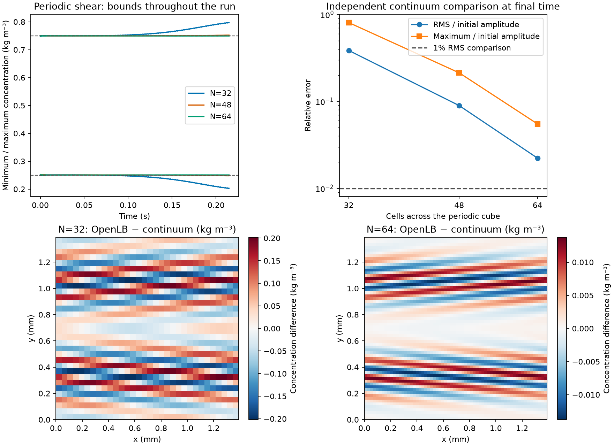

# Periodic shear control: results

The stock bulk transport model develops artificial concentration variations
even without any solid walls when the sheared concentration profile is poorly
resolved. Spatial refinement strongly reduces this error. Curved particle
walls are therefore not necessary for this failure, although this control
does not identify their separate contribution in the FCC simulation.
This is the existing regularized TRT composition with its stock first-order
scalar equilibrium; these results do not cover every OpenLB TRT configuration.

Five actual native OpenLB runs completed in
`results/adsorption/transport_root_cause/channel/runs/20261110T205326Z-c9d87d29/`.
The replay checks current sources, source snapshots, native artifacts and
independent reanalysis. All 2070 original OpenLB files checked against the
pinned distribution match; the pre-existing vendor configuration exception
is unchanged. No DWSIM run, adsorption fit or production closure was added.

| Control | All-time concentration range (kg/m3) | Final RMS / initial amplitude | Result |
|---|---:|---:|---|
| Uniform flow, N32 | 0.2505413 to 0.7494587 | 0.22482% | Passes uniform reference and bounds |
| Constant concentration under shear, N32 | 0.5 within 2.79e-14 | Not applicable | Constant preserved |
| Sinusoidal profile under shear, N32 | 0.2027105 to 0.7972895 | 38.58198% | Bounds and profile fail |
| Same shear, N48 | 0.2476512 to 0.7523488 | 8.95884% | Strict bounds and profile fail |
| Same shear, N64 | 0.2500208 to 0.7499792 | 2.22531% | Bounds pass; 1% profile target fails |

All runs conserve global tracer inventory (maximum relative drift below
1.9e-12) and preserve z invariance. Conservation alone does not establish
an accurate concentration profile. N48's bound excursion fits the separate
0.02 kg/m3 engineering allowance, but that does not rescue its profile error.
No case qualifies a real-material tracer closure or process prediction.

The lower panels use different labelled colour scales: they show how much
the absolute concentration error decreases, rather than assigning the same
colour range to both meshes. Figure source and output hashes are saved in
`results/adsorption/transport_root_cause/channel/figure_sources.json`.

## Independent comparison and physical interpretation

The prescribed velocity is exactly divergence-free, parallel cosine shear
in an all-fluid periodic cube. The [protocol](protocol.md) defines its
single-mode continuum reduction, independently evaluated by a Fourier
diffusion/phase calculation. At the final time its separate Fourier-grid
and time-refinement changes are below 1.8e-13 and 4.1e-8 respectively,
normalized by the initial amplitude. The uniform-flow oracle independently
agrees with the analytical translating/decaying sine within 5.3e-14 kg/m3.
An additional vanishing-diffusion check agrees with exact characteristic
transport. These oracle checks do not use the native OpenLB solution.

Although the velocity is smooth, different layers carry tracer at different
speeds and wind the concentration profile into narrow variations. The
zero-diffusion characteristic solution gives a minimum local transverse
wavelength of about 147.4 micrometres at the final time: only 3.39 cells on
N32, 5.09 on N48 and 6.79 on N64. The diffusion length over this observation
period is about 20.73 micrometres. These are explanatory scale estimates,
not a universal mesh-size rule. Resolving velocity does not guarantee that
the resulting concentration gradients are resolved.

All resolutions use the same physical H, mean velocity, D=1e-9 m2/s, dt and
actual observation time. D remains the declared application scenario value,
not a measurement extracted from Alhamed's paper. The requested duration
0.214764128309 s rounded up by one step through the predeclared ceil rule;
actual duration is 0.21478314576454161 s (11294 steps). The independent
reference uses that actual time. This 0.009% timing difference from the
earlier porous control is explicit; no mesh in this series has a different
observation time.

## Scope and follow-up

The control retains the bulk stock regularized TRT/D3Q27 model and physical
velocity/diffusivity scales, but has no solid boundary, cross-stream flow,
inlet or outlet. It does not reproduce the sharper or differently oriented
velocity variations of the FCC bed. Its all-fluid mean velocity matches the
coarse FCC interstitial velocity; its total flow is not the FCC column flow.
The result proves a bulk underresolution mechanism exists, and cannot assign
a fraction of the FCC error to that mechanism or rule out wall effects.

The separately guarded [thin-z follow-up](thin/README.md) tests whether
higher x-y resolution reaches the profile target at lower cost, after an
explicit full-cube equivalence check. A successful shear control alone
cannot qualify an FCC dispersion coefficient or an adsorption prediction.

The initial native build failed on two diagnostic calls that passed temporary
cell handles to an API requiring lvalue handles. Those application calls were
corrected before the five simulations; the failed build log/source snapshot
remain in the earlier run folder. No numerical operator or vendor file was
changed to address that compilation error.

Commands are in [README.md](README.md). Seven targeted Python tests currently
pass, covering the oracle and physical control contracts; the native runs
and hash-checked replay provide the separate solver evidence. The native
build used the existing OpenLB 1.9r0 / GCC 15 toolchain and no dependencies were
installed or lockfiles changed for this control.
