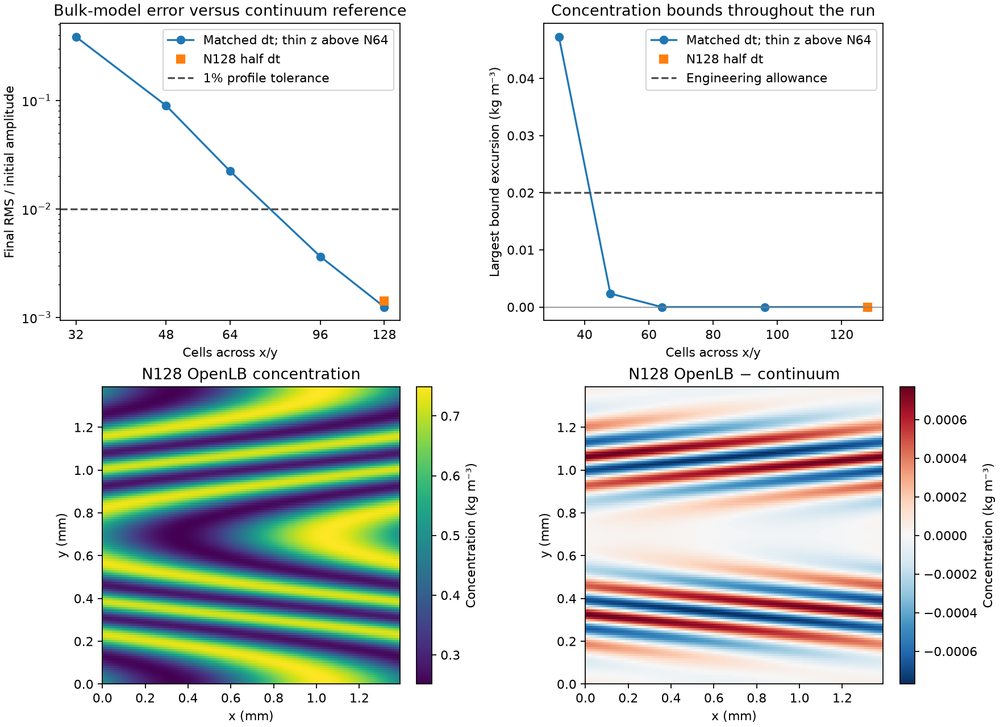

# Higher-resolution periodic shear: results

Higher spatial resolution fixes the specified wall-free shear benchmark
without changing diffusivity or collision dynamics. The stock first-order
regularized TRT/D3Q27 model meets the concentration bounds and independent
1% profile target at N96 and N128. This is a controlled bulk-transport result,
not qualification of the three-dimensional FCC tracer or an adsorption model.

Four actual native OpenLB runs completed in
`results/adsorption/transport_root_cause/channel/thin/runs/20261110T211453Z-27c6512d/`.
The final replay checked 25 source files, 80 native/build/snapshot artifacts
and the parent artifacts, and independently repeated the numerical analysis.
All 2070 original OpenLB files checked against the pinned archive match.
No DWSIM execution, fitted parameter, limiter, clipping or added diffusivity
was used. The parent full-cube and follow-up together contain nine actual
native executions; the thin32 case deliberately repeats the N32 x-y problem.

## Equivalence before reducing cost

The analytic velocity and concentration are independent of z. The new
application retains the stock three-dimensional stencil and operators while
using four periodic z layers. This changes physical depth and total inventory;
the concentration solution per unit depth should remain unchanged.

Thin32 exactly matches the full N32 cube's initial, peak and final
concentration sections, every-step minima/maxima and peak step. Coordinates
and velocity also match. All saved z-variation diagnostics are zero. The
maximum difference between normalized inventory histories is 1.49e-13;
initial inventory scales with the declared depth ratio 4/32 to 1.78e-14
relative error. This passes the frozen equivalence gate before finer cases.

This reduction is valid for this homogeneous direction only. It cannot be
applied to a genuinely three-dimensional FCC pore geometry without changing
the problem. The physical slab depth is explicitly saved in every raw record.

## Spatial and temporal checks

All runs use H=0.0013891725543141453 m, U=0.012937295182166382 m/s,
shear fraction 0.75, the same D=1e-9 m2/s scenario and actual observation
time 0.21478314576454161 s. The parent physical dt is
1.90174557964e-5 s. The half-dt case doubles the number of steps to 22588;
its observation time matches exactly. No fitted time shift is applied.

| x-y resolution | Final RMS / initial amplitude | Largest bound excursion (kg/m3) | Comparison |
|---|---:|---:|---|
| N32, full cube or equivalent thin slab | 38.58198% | 0.04728954 | Fails bounds and profile |
| N48, full cube | 8.95884% | 0.00234877 | Fails strict bounds and profile |
| N64, full cube | 2.22531% | 0 | Bounds pass; profile target fails |
| N96, thin slab | 0.363357% | 0 | All control checks pass |
| N128, thin slab | 0.124585% | 0 | All control checks pass |
| N128, thin slab, half dt | 0.142084% | 0 | All control checks pass |

The N128 full/half-dt fields differ by 0.0230362% RMS of the initial
amplitude, below the predeclared 1% time-sensitivity criterion. Their maximum
difference is 0.0573739% of amplitude. Halving dt slightly increases the error
against the independent reference in this case; it does not offer the large
improvement provided by spatial refinement.

N96, N128 and half-dt N128 remain inside the analytical [0.25, 0.75] kg/m3
range throughout. Their global inventory drifts are 6.24e-13, 6.05e-13 and
1.26e-12 respectively. The sampled maximum lattice speeds are 0.0297474,
0.0396672 and 0.0198336, all below the frozen 0.05 bound. All reference-grid
and reference-time convergence checks pass. Source data and full precision
values are retained in the guarded summary.

The lower-left panel shows how different flow speeds wind the tracer into
narrow concentration variations. The lower-right panel shows the remaining
N128 error in physical concentration units. Figure source hashes are saved
in `results/adsorption/transport_root_cause/channel/thin/figure_sources.json`.

## What this resolves

The N32 model resolves its prescribed smooth velocity exactly at nodes, yet
does not resolve the concentration variations created by that velocity.
This is a direct example of why a hydraulically adequate grid can still be
inadequate for low-diffusivity solute transport. Refinement alone brings the
same stock bulk model close to a separately converged continuum reference.

The evidence does not establish a universal N96 requirement or formally
estimated convergence order. Different geometry, velocity gradients,
observation time and boundaries can require a different mesh. The FCC
velocity field varies in all three directions and its wall coupling must
still pass its own tests. No tracer dispersion coefficient or adsorption
service prediction is approved by this diagnostic.

See the [frozen protocol](protocol.md), [parent report](../REPORT.md),
[captured reference](reference.json) and [launch commands](README.md).
