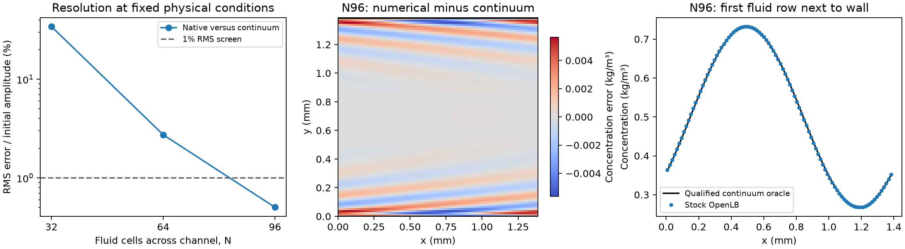

# Flat-wall transport: refinement resolves this controlled case

The existing OpenLB scalar configuration can transport the concentration wave
accurately next to **straight, impermeable walls** when the spatial grid is
fine enough. No dynamics, diffusivity or velocity correction was needed.

| Fluid cells across channel | Whole-history C range, kg/m3 | Final RMS / initial amplitude | First fluid row RMS / amplitude |
| --- | --- | ---: | ---: |
| 32 | .244511–.755489 | 34.2307% | 17.7435% |
| 64 | .250024–.749976 | 2.7372% | 2.9315% |
| 96 | .250006–.749994 | **.5033%** | **.8961%** |

At N96 the concentration remains inside the original .25–.75 range and both
global and first-row RMS errors are below 1% of the imposed .25 kg/m3
amplitude. The constant control preserves .5 within 1.11e-13 kg/m3. The
diffusion-only control agrees with the independent analytical sine decay to
.2258% RMS/amplitude. Physical-liquid and closed kinetic inventories pass all
six completed cases; diffusivity remains 1e-9 m2/s.

The N96 final-field maximum pointwise error is 2.2564% of initial amplitude; the stated 1%
pass concerns RMS accuracy, not every individual point. Remaining error is
largest near the walls, as the figure shows.

These are results for the documented time step and .2147831458 s observation
window. They establish that the tested full-way walls are not inherently unable
to handle this resolved planar control. They do **not** qualify the curved FCC
geometry, open-boundary tracer, long-time dispersion or adsorption service.
The result also shows why acceptable concentration bounds alone are
insufficient: N64 is bounded but misses the 1% profile criterion.



## Physical and numerical wall conventions

Lx=H=1.389172554 mm; prescribed Poiseuille velocity is
`ux=6*U*(y/H)*(1-y/H)`, U=.01293729518 m/s. The fluid has N cells with centres
at `(j+.5)*dx`, dx=H/N, and walls at y=0,H. Solid nodes are half a grid spacing
outside each wall. This follows the midlink convention described by
[OpenLB's maintainer](https://www.openlb.net/forum/topic/bounceback-boundary/).
x/z are periodic and y is nonperiodic. The velocity is prescribed, so this is
a scalar transport check rather than a new hydraulic-flow validation.

The exact liquid-plus-active-wall inventory counts fluid concentration and only
the wall populations that arrived from fluid and will reflect into it on the
next step. It restores OpenLB's shifted population weights. Unused exterior
wall populations are excluded. Initial numerical wall storage divided by
physical liquid inventory is 1/(3N): 1.0417%, .5208% and .3472% at the three
grids. Physical liquid volume is `H*H*z_depth`; full solid rows are never counted
as liquid. Both the analytic volume and active-wall capacity are independently
checked against native initial inventories. No effective H was fitted.

The stock D3Q27/CombinedRLB/TRT/full-way BounceBack implementation is unchanged.
Thin z uses four periodic layers. A fresh flat-channel N32 comparison against
32 z layers gives identical initial/peak/final concentration cross-sections and
all-step extrema; normalized inventory differences are below 2.1e-13, with the
correct 4/32 depth scaling. The reduction is therefore checked for this
z-invariant control and cannot be applied to the 3D FCC bed.

## Reference, retained attempts and verification

The independent continuum reference uses one x Fourier mode and Neumann
diffusion in y. Even periodic extension over 2H enforces the wall condition.
The qualified reference compares 2048/4096 transverse points on H and
2048/4096 time steps, preserving the 1e-4 maximum change/amplitude criterion.
It also checks reflection symmetry, the derivative at both walls and the
analytical zero-flow solution. This oracle is solely for verification.

The original controller stopped after five successful native cases when its
coarser reference missed the spatial screen at N64 (1.1232e-4 versus 1e-4).
Those native fields and sources remain intact. The separate qualified
continuation reanalyzes them with a finer oracle and runs only the missing N96
case. It does not repeat completed simulations or relax an accuracy screen.

There are **six completed native cases and two earlier interrupted native
attempts**. The interrupted files are retained; their native exit statuses are
unavailable. A narrow approved process/cwd check found no orphan simulations.
The completed native cohort is `20261110T212641Z-c0b585ff`; qualified
continuation is `20261110T213218Z-a0021dff`. The checker verifies 29 source
files, 48 continuation artifacts and 117 parent artifacts, then reanalyzes
every result without launching simulations. All 2,070 original OpenLB
distribution files remain unchanged. Ten flat-reference tests and eight local
flux tests pass.

From the project root, preserving the recorded parent native cohort:

```sh
source scripts/env.sh
uv run python -m examples.adsorption.transport_root_cause.flux_audit.flat_channel.continuation --check
uv run pytest tests/adsorption/test_transport_flat_channel.py tests/adsorption/test_transport_flux.py -q
uv run python -m examples.adsorption.transport_root_cause.flux_audit.flat_channel.plot
```

Running `...flat_channel.continuation` without `--check` reproduces the qualified
assessment and missing N96 case using the explicit, hash-verified parent.
`run.py` and `reference.py` preserve the original stopped controller;
`analysis_qualified.py`, `reference_qualified.py` and `continuation.py` preserve
the successful assessment separately. All actual executable commands, output
working directories, physical inputs and executable hashes are in each
`request.json`. The original [protocol](protocol.md) and
[qualified-reference continuation](continuation_protocol.md) describe the
prospective tests. No DWSIM or adsorption run was performed here.
