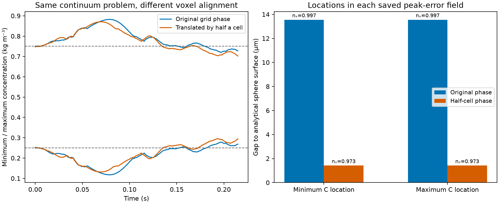

# Half-cell translation: alignment matters, but it does not fix transport

Translating the same spheres and initial concentration by half a cell changes
the coarse-grid result appreciably, while leaving a large unphysical
concentration excursion. This establishes voxel-alignment sensitivity; it
does not identify a favourable alignment as a valid correction.

Five actual native executions completed: three independently converged
shifted hydraulic pressure-root iterations, one complete scalar run and one
read-only peak-audit prefix. Outputs are in
`results/adsorption/transport_root_cause/grid_phase/runs/20261110T213713Z-06d80a4b/`.
Replay checks 39 source files and 735 artifacts, including archived native
binaries, source snapshots and actual population data. All 2070 original
OpenLB files checked against the pinned distribution remain unchanged.

## Same continuum problem, changed voxel representation

The translation is +21.7058 micrometres in x, equal to dx/2 on N32. The
initial scalar is shifted consistently as sin[2 pi(x-delta)/H], and Fourier
diagnostics use the same phase. The postcheck reads the actual initial
native populations and confirms this profile within 5.6e-16 kg/m3 over all
32768 nodes. Analytical sphere classification agrees with every exported
fluid/solid label. No geometry was reconstructed or calibrated to a paper.

Both cases retain the same continuum diameter, nominal void fraction 0.6,
physical flow, diffusivity, time step and observation period. Translation
changes the represented staircase surface and fluid volume:

| Quantity | Original alignment | Half-cell alignment |
|---|---:|---:|
| Represented void fraction | 0.593750 | 0.600098 |
| Native pressure gradient at fixed flow (Pa/m) | 2422.926 | 2311.808 |
| Physical liquid volume in repeating cell (m3) | 1.5917403e-9 | 1.6087572e-9 |
| All-time concentration range (kg/m3) | 0.117696 to 0.882507 | 0.131389 to 0.870755 |
| Largest excursion beyond [0.25,0.75] (kg/m3) | 0.132507 | 0.120755 |
| Peak-error step | 4145 | 3668 |

The required pressure gradient changes by -4.586%, and the apparent
operating-point permeability changes by +4.806%. These are numerical
alignment effects in this comparison, not improvements to a new material.
The shifted hydraulic flow matches its target within 3.96e-6 relative and
passes the unchanged stationarity, mass-flux, Mach, density and porosity
checks. The two actual superficial velocities differ by only 2.81e-6 relative.

The scalar excursion falls by only 8.869% and still fails the bounds screen.
The final liquid concentration SD changes by -13.13%, and the first
streamwise Fourier amplitude by -14.99%. Initial SD differs by only about
0.10%; after normalizing each final SD by its own initial value, the change
remains -13.04%. This cannot be interpreted as a physical improvement in
mixing, because the continuum problem was merely translated.

## Peak locations and actual conservative fluxes

At both extrema in the saved peak-error field, the nearest analytical
sphere gap changes from 13.551 micrometres (0.3122 dx) to 1.411 micrometres
(0.03250 dx). The outward normal's x component changes from 0.997 to 0.973:
the locations remain near downstream poles. The field's minimum is within
4.4e-6 kg/m3 of the all-time minimum; its maximum is the all-time maximum.

The shifted extrema are closer to the mathematical surface, but their
excursions are slightly smaller. Surface gap alone therefore does not
explain the failure. The altered discrete geometry, velocity distribution
and scalar/wall coupling cannot be separated by this single translation.

Actual water and scalar population balances pass local collision, streaming,
link-balance, interface antisymmetry and global periodic-flux checks. The
scalar audits cover steps 1, 2 and peak step 3668. The separate prefix
reproduces the full peak field and common inventory history exactly.
Maximum relative kinetic-mass error is 6.11e-13. Full-way BounceBack wall
population storage remains explicit, and conservation is not equated with
concentration accuracy.

The read-only first-order equilibrium stencil remains nonzero. Its maximum
one-step relative constant-concentration change is 1.1912e-4 originally and
1.3612e-4 after translation; this diagnostic is not the water's population
flux or a long-time constant-preservation result. It does not establish a
simple monotonic relationship with the observed peak excursion.

## Consequence for the investigation

The coarse FCC transport is sensitive to how its identical physical surfaces
fall on the mesh. A nonmonotone refinement trend can therefore coexist with
the independently demonstrated bulk underresolution mechanism. This one
phase comparison is not an uncertainty estimate, a convergence proof, or
evidence that the shifted alignment is accurate. It does not approve an
effective dispersion coefficient, adsorption prediction or new DWSIM case.

The completed shear controls remain unchanged. Stock TRT and stock geometry,
forcing and boundary operators were reused here; no dynamics, diffusivity,
limiter or fitted parameter was changed. Three targeted analytical geometry
tests pass. Exact commands are in [README.md](README.md), with the
[frozen protocol](protocol.md), [captured replay](reference.json) and
[initial-profile check](initial_profile_reference.json).
