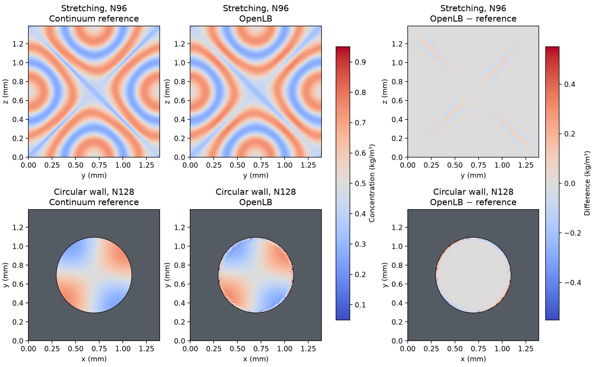
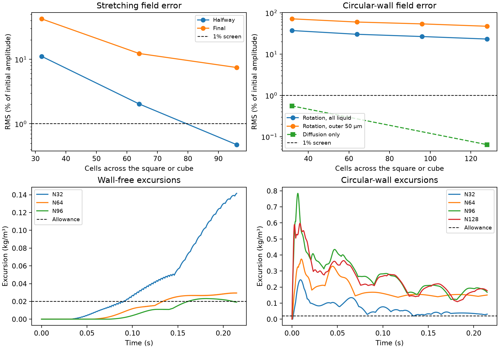

# Separating three-dimensional stretching from curved-wall transport

**Both checks complete.** The wall-free case reproduces large late errors
under three-dimensional stretching, and the rotating circular wall distorts
even a uniform concentration. Both retain the bed's stock OpenLB scalar TRT
configuration, time step and molecular diffusivity. Neither qualifies another
packed-bed prediction.

## What the controls separate

The periodic cube has no surfaces. Three velocity components move the tracer
in all three directions, while the two transverse shears stretch its original
streamwise wave in both transverse directions. The velocity is prescribed and
exactly divergence free. Independence of the velocity from x allows an exact
single-mode reduction in x; the remaining continuum problem still depends on
both y and z, and the native simulation uses the full 3D cube. This tests bulk
transport under more complicated deformation than the earlier parallel shear.

The curved case has one circular impermeable wall and no end faces. Rigid
rotation transports an angular concentration pattern without stretching it.
Its known diffusion decay and rotation provide a stronger test than merely
checking whether concentration stays bounded. The no-flow pair uses the same
geometry and initial pattern; the constant rotation control can expose a wall
effect without an initial concentration gradient. The liquid is inside a
cylinder, so its curvature is not a replication of the liquid outside bed
particles. The [protocol](protocol.md) gives the assumptions and exact scales.

## Independent reference checks

The stretching reference solves the reduced continuum equation by symmetric
splitting of Fourier diffusion and exact shear translations. Its selected
grid has 512 points in each transverse direction and 512 subdivisions per
half-window. Spatial refinement at that time step changes the final envelope
by 7.3e-10 of amplitude; temporal refinement changes it by 4.28e-5. Both
pass the prospective 1e-4 screen. The coarser 128-to-256 comparison does
not pass at the final time, so it is not used as the reference.

The continuum gradient scale `0.25/max(|∇C|)` falls from about 221 µm at
initialization to 39.0 µm halfway through and 12.1 µm at the end. This
illustrates the sharpening of the concentration field; it is not a measured
boundary-layer thickness or a universal mesh criterion. The N96 spacing is
14.5 µm. At the end, the two transverse gradient RMS values are both about
12,047 m⁻¹ when scaled by initial amplitude, confirming variation in both
transverse directions.

The disk comparison is analytical, using a Neumann Bessel mode with an
exact angular phase shift and diffusion decay. Its derivative vanishes at
the intended smooth radius. The NumPy power series is independent of the
standard-library Bessel function used for native initialization. Four tests
check uniform translation, backward characteristics, the zero-flux root and
the advection–diffusion equation itself. All four passed.

Each native field is compared at the actual cell centres. RMS errors are
divided by the initial 0.25 kg/m³ amplitude; the 1% screen therefore represents
0.0025 kg/m³ RMS. Peak excursions are checked at every time step. Disk liquid
and active numerical wall inventory are counted separately, and the fixed
outer 50 µm shell is reported independently of the whole liquid.

## Wall-free stretching result

The uniform-flow control gives 0.225% final RMS error and stays within the
physical bounds. The constant-concentration case under the full stretching
flow deviates from 0.5 kg/m³ by at most 1.36e-13 kg/m³. The numerical inventory
drift is at most 8.11e-13 relative across all five cases. The large errors below
therefore arise when a spatially varying field is transported.

| Cells across cube | Halfway RMS / initial amplitude | Final RMS / initial amplitude | Whole-window C, kg/m³ | Largest excursion, kg/m³ |
| --- | ---: | ---: | ---: | ---: |
| 32 | 11.15% | 42.44% | 0.108384–0.891616 | 0.141616 |
| 64 | 2.03% | 12.31% | 0.220447–0.779553 | 0.029553 |
| 96 | 0.474% | 7.46% | 0.226787–0.773213 | 0.023213 |

The fine mesh passes the 1% RMS criterion at midpoint. Later the gradients
sharpen and the same mesh misses it. Its worst excursion occurs at 0.180666 s
and exceeds the 0.020 kg/m³ allowance. By the final snapshot the excursion
is back inside the allowance, while the spatial RMS error remains high.

At the final time the exact liquid concentration standard deviation is
0.167866 kg/m³. The N32, N64 and N96 values are 0.110798, 0.160526 and
0.165578 kg/m³, respectively. The fine mesh is only 1.36% low on this bulk
measure, but has 7.46% RMS field error and a maximum pointwise discrepancy
of 0.147 kg/m³. An integrated mixing measure can agree even when concentration
is misplaced locally.

On N96, final RMS error is 11.88% of initial amplitude in the tenth of the
liquid with the sharpest reference gradients, versus 6.79% in the rest.
The error maps show the largest discrepancies along the thin stretched
features. These comparisons are on the sampled native grid; they do not
establish a universal cell-size rule.

This establishes that three-dimensional stretching can create substantial
transport error at these physical scales with no solid wall and with a
preserved uniform background. It does not prove that every error in the
particle bed has the same cause.

## Single circular wall result

The exact rotation carries the same concentration pattern through 1.106
turns in the observation window. It cannot sharpen the pattern. The smallest
initial inverse-gradient scale is about 177 µm, compared with 10.9 µm cell
spacing on the finest disk grid. The exact mode retains 98.76% of its initial
contrast over this interval; the N128 rotating run retains 88.08% in the
projection onto that mode and lags the exact pattern angle by 1.84 degrees.
The near-wall field errors are larger than either integrated diagnostic.

| Cells across square | Rotation final RMS, all liquid | Rotation final RMS, outer 50 µm | Rotation final RMS, interior | Whole-window rotation C, kg/m³ |
| --- | ---: | ---: | ---: | ---: |
| 32 | 37.08% | 71.24% | 17.54% | 0.115591–0.995431 |
| 64 | 30.12% | 59.61% | 9.96% | 0.038631–1.124634 |
| 96 | 26.56% | 53.75% | 5.29% | 0.018702–1.534491 |
| 128 | 23.09% | 47.10% | 3.16% | 0.039050–1.347907 |

Refinement reduces the shell and interior RMS errors but does not give a
monotonic reduction in the peak excursion. On N128, the largest transient
value occurs at 8.77 ms and 0.87 µm from the intended smooth radius. The
largest final pointwise error occurs 0.28 µm from that radius. These are
distances to the analytical circle; the discrete wall is represented on
lattice links. The actual voxel area differs from the smooth disk area by
0.105% on N128, much less than the concentration field discrepancy.

With rotation disabled, the same initial field remains bounded. At N32 the
final diffusion-only error is 0.554% RMS overall and 0.674% in the outer shell.
At N128 those errors fall to 0.0640% and 0.121%, respectively. This isolates
a strong sensitivity to advection along the curved voxel wall. Tangency to
the intended circle does not imply tangency to each discrete face.

The N32 four-layer and 32-layer runs give exactly the same concentration at
all saved points and identical step extrema. The inventory scales with depth
within 1.03e-13 relative, including active-wall storage. This justifies the
thin reduction for the axially uniform disk, never for the 3D stretching case.

The matched N128 constant rotation begins at 0.5 kg/m³ and reaches
0.103112–0.979615 kg/m³. Its maximum occurs at 5.21 ms, 5.92 µm from the
intended smooth wall. The closed kinetic inventory drifts only 5.80e-13
relative; the physical liquid inventory varies by 0.189% because the stock
full-way wall stores some populations between updates. Large local errors
are compatible with small changes in total liquid inventory.

In a diagnostic superposition at the final time, the constant background
accounts for 35.0% RMS of the companion wave's initial amplitude in the
outer shell. Removing only that background from the error leaves 31.5% RMS,
compared with 47.1% for the unaltered result. These RMS values are not additive.
Both uniform-background distortion and wave transport contribute. The
diagnostic subtraction is not used as a correction.

The upper row is a y-z section at the N96 x centre closest above the box
midpoint. The lower row is an x-y disk section, with the intended radius
outlined. Difference panels use the reference sampled at the native centres;
both rows share each color scale. Grey marks the disk exterior.

The histories distinguish the late growth of the wall-free error from the
first 6–11 ms peak events in the rotating disks. Both tests can fail while
the integrated mass stays correct.

## Consequence for the packed bed

Bulk stretching and advection along the voxel representation of a curved
wall are separate sources of error in these controls. The finer bed's extrema
away from solid links are consistent with a bulk contribution; these tests do
not identify the fraction due to each mechanism in that bed. In particular,
the disk has nonzero tangential velocity at a rotating wall, whereas the bed
has fixed no-slip particles and liquid outside their surfaces. The magnitude
of the disk error must not be transferred to the bed.

Before another full bed, the next useful curved control is angular shear
with velocity vanishing at a stationary circular wall and an independent
radial reference. A proposed stock treatment should preserve a uniform
tracer there and reproduce the varying profile. It should also pass the
separate wall-free stretching check over the full observation window.
The verified pressure losses and batch uptake results remain usable in their
existing scopes. These calculations add no column dispersion, adsorption
prediction or DWSIM duty.

## Saved evidence

Thirteen native simulations completed: five in the periodic stage and eight
in the curved stage. The two replays checked 26 sources per stage and 122 and
188 artifacts, respectively. All four independent reference tests passed.
The maximum closed inventory drift across the cases was 8.11e-13. The
archived executable is identical between stages; 2,070 original OpenLB
distribution files passed their integrity check. No original source was
edited. The [compact record](reference_summary.json) retains the exact
values, parent hashes and diagnostics; the [run guide](README.md) gives the
commands and binary data layout.
