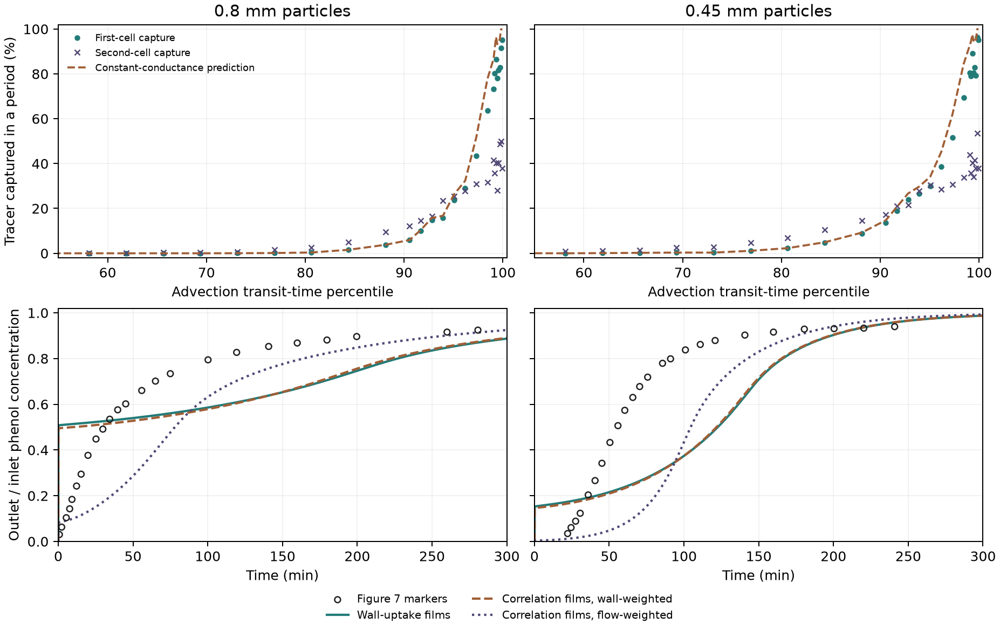

# Path-specific films from an absorbing-wall test

This study replaces the correlation-based film coefficients with a
fluid-side estimate on the saved TRT carrier field. The original
Péclet-matched exchange matrices, external area shares, shared dry
carbon mass of 7.032455155 g, batch loading diffusivity and isotherm
remain the inputs to the column model. Both predictions are evaluated
against Figure 7 with frozen coefficients.
[Alhamed (2009), Figure 7](https://www.sciencedirect.com/science/article/pii/S0304389409007687)

## Absorbing wall and reduction

The first sampled contact with a solid face counts as capture at a
perfect sink. The unchanged reflector then continues the marker to
record the unreacted transit time and a second-period test. Capture
does not change the counterfactual inlet-twin rank. Exterior inlet
and outlet reflections carry no uptake. Captured markers contribute
zero survival after their first contact. We rerun the two archived
Péclet-matched cases at both 80 µs and 40 µs. This checks the sensitivity
of the discrete encounter observer to time step.
[Reflected diffusion and wall encounters](https://journals.aps.org/pre/abstract/10.1103/PhysRevE.100.062110)

For each path class, the captured fraction \(p_i\) and surviving
occupation ratio \(a_i\) estimate uptake flux and the mean liquid
concentration available to drive uptake. The occupation ratio is the
sum of marker time before capture or exit divided by the sum of
their unreacted transit times. With an absorbing surface, the
per-period conductance in the target column is

```math
K_i=Q_i\,p_i/a_i.
```

The ratio \(p_i/a_i\) is a dimensionless transfer number. It recovers
the known number for an exponential removal process at fixed transit
time. The constant-conductance plug approximation then predicts
survival \(\exp(-p_i/a_i)\) per period. We compare that prediction
with first- and second-period captures and propagate it through the
fixed exchange matrix for the two-period survival test. The second
period's reset diagnostic gives each inert arrival unit weight. The
full two-period survival retains only markers with no hit in either
period. This distinguishes single-period capture from the survivor
distribution through repeats.

To use the conductance in the existing shared-carbon model, each
class's bed conductance is divided by its fixed external area to
obtain the path film coefficient. A class with zero captured markers
gets zero inferred conductance in this sample. If a sector still has
area, its radial boundary is reflecting for that class. The carbon
inventory remains shared per axial slice. These are effective films
for the synthetic carrier and geometry, with the earlier assumption
that advection and diffusive classes align by flow quantile.
[Pre-scoring protocol](protocol.md)

## Wall-uptake test

Each condition followed 65,536 flux-weighted markers. The first-hit observer
reproduced the archived inert transit durations and solid-contact flags.
Halving the time step from 80 µs to 40 µs changed first-period capture by
0.10 and 0.055 percentage points for the 0.80 and 0.45 mm cases, respectively.
The summed conductance changed by 3.0% and 3.9%. Both time-step checks passed
the protocol limits of 0.5 percentage points and 15%.

| Particle diameter | First-period capture | Bed film conductance from wall uptake (m³/s) | Correlation-based conductance (m³/s) | Two-period capture, tracked | Two-period capture, reduced model |
|---|---:|---:|---:|---:|---:|
| 0.80 mm | 3.38% | 4.15 × 10⁻⁶ | 1.85 × 10⁻⁶ | 5.04% | 6.13% |
| 0.45 mm | 4.60% | 9.81 × 10⁻⁶ | 4.24 × 10⁻⁶ | 7.08% | 8.50% |

The constant films overpredicted cumulative capture by 1.09 and 1.42
percentage points at 80 µs, above the 1-point limit. For fresh unit-weight
markers at the second-period inlet, the flow-weighted absolute
path-level errors were 2.11 and 2.89 percentage points. Those errors
remained above the 1-point limit at 40 µs for both sizes. Among markers
that escaped capture in the first period, only 1.72% and 2.60% were
captured in the second. The surviving population had lower wall
exposure than the fresh unit-weight population, which had second-period
capture of 3.23% and 4.55%.

Wall uptake was concentrated in the longest-transit classes. At 80 µs,
19 of 40 classes for the 0.80 mm particles and 13 of 40 for the 0.45 mm
particles had zero sampled first-period uptake. A finite ensemble and
discrete wall sampling limit what zero observed hits establish about
those classes. The results characterize the tested synthetic geometry.

## Column prediction against Figure 7

The same frozen films were used at each column resolution. The total
carbon inventory, Péclet-matched liquid exchange, and batch-qualified
particle inputs were carried over. The Figure 7 data were used only to
score the frozen predictions. The predicted concentration crosses
5% and 50% of the inlet at the times below.

| Particle diameter | Predicted 5% | Figure 7 5% | Predicted 50% | Figure 7 50% | Curve RMSE in outlet/inlet concentration |
|---|---:|---:|---:|---:|---:|
| 0.80 mm | 3.83 s | 102 s | 5.84 s | 30.75 min | 0.233 |
| 0.45 mm | 4.18 s | 23.54 min | 122.61 min | 55.36 min | 0.281 |

The 0.80 mm 5% estimate is especially sensitive to reading the earliest
Figure 7 points. Its digitization envelope is 22–206 s, still later than
the prediction. The 0.80 mm outlet reaches 50.9% of feed at one minute.
The prior wall-weighted correlation-based case had a plateau just below
50%, so a small change around that level moved the predicted midpoint
from roughly ten minutes to seconds. The overall curve errors stayed
similar across the two film models. The 0.45 mm outlet reaches 15.4% of
feed after one minute, then approaches the midpoint too slowly. Its
midpoint with correlation-based films was 121.74 min.

Both wall-uptake predictions passed the column discretization checks and
failed the Figure 7 comparison. Relative to the incoming phenol dose,
the selected runs closed their mass balances within 1.0 × 10⁻¹² and the
film flux balances within 5.6 × 10⁻¹³. The wall test identifies strong
transfer in slow paths and weak early interception along fast paths. The
two-period holdout also shows that one constant film per path with the
inert exchange law is insufficient to transfer that uptake across repeats.
Adsorption service predictions remain unqualified.



## Verification and reproduction

Run cohort `20261112T143948Z-126af769` retains the four marker archives,
the reduced coefficients, six full column solves, one fine startup
solve, the frozen predictions, and the Figure 7 score. The frozen
prediction manifest had SHA-256
`2f1e8bc79dff56cb92a10213b594f1f1048c9a433e7ae68a98186562405f0de2`
before scoring. Julia 1.11.6 passed nine first-hit assertions and Python
passed two conductance-estimation tests. Bridge checks reproduced the
old solver for equal films and verified conservation with variable
films, zero film and inert flow. Read-only replay verified 36 sources
and 59 artifacts. The tracked summary records the principal numerical
values. [Reproduction commands](README.md) · [Reference summary](reference_summary.json)
