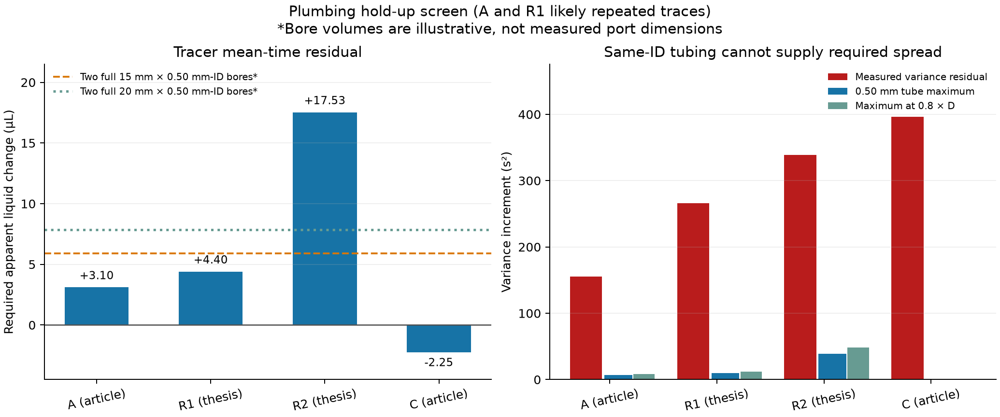
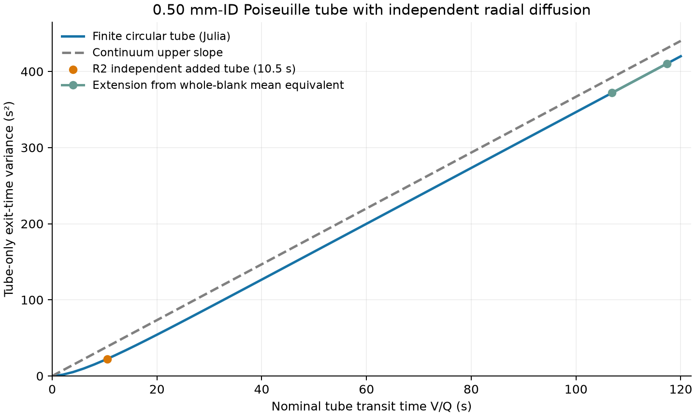

# Can the reactor connections explain the extra tracer hold-up and spreading?

**Decision (24 November 2026).** The papers document 0.50 mm-ID tubing,
but do not independently establish the change in wetted inlet/outlet
volume between the bypass and reactor measurements. An extra tube length
could explain the mean delay in isolation. It cannot explain the much
greater measured exit-time variance at the same nominal flow and liquid
inventory. This conclusion survives the baseline, tail-window,
travel-memory and diffusivity sensitivities tested below. This rules out
the ordinary developed straight-tube length hypothesis under these
assumptions; the actual fixtures and detector are not qualified.

## 1. Apparatus evidence

The [Bajić design source](../../../literature/sources/bajic2017/README.md)
and [Strniša assembly description](../../../literature/sources/strnisa2018/plumbing_geometry.toml)
both give PFA tubing with internal diameter 0.50 mm, PEEK fittings and
15 mm thick upper PMMA plates with inlet and outlet holes. The narrow
microchannels have a rectangular planform. The triangular distributors
and pillars described in those articles concern the wider geometries,
not the basic narrow specimens. The Bajić paper uses a different particle
preparation; its wider-channel dye images are not a new quantitative RTD.

[Panjan's thesis](../../../literature/sources/panjan2018/plumbing_geometry.toml)
instead describes 20 mm plates, without giving the tube ID or actual
wet port bores. The common 0.50 mm diameter is therefore a scenario for
the thesis runs, although directly reported for the Strniša article.
In the thesis bypass the tubes are connected without the reactor. No
relative connection lengths or separately measured fixture void volumes
are reported. The 4 µL detector chamber has a nominal hydraulic time of
2.4 s at 100 µL/min and is already part of the measured blank response.

The volume ledger in the compact reference compares every Bajić Table 1
empty channel volume against nominal rectangular `L × W × depth`. Even
the wide channel values agree to the reported rounding (maximum absolute
difference 0.0408 µL); the wider design dimensions refer to the central
rectangle. That arithmetic agreement is evidence of a nominal-volume
convention, not a separate water measurement of the triangular regions,
tubes or fittings. Strniša explicitly estimates empty volume from
dimensions and particle volume from a mass/density convention. Neither
paper gives a separate wet volume to add to R2.

## 2. Mean delay and volume requirement

At the reported 100 µL/min, define the discrepancy between the earlier
blank-subtracted observed tracer moments and the retained interbead model
as `Δt = t_obs − t_bed` and `Δσ² = σ²_obs − σ²_bed`. This decomposition
assumes an otherwise unchanged linear measurement chain; it is a test of
the missing-plumbing hypothesis, not a proven attribution of the error.

For a straight tube with mean fluid velocity `U` and radius `R`, its
mean transit time is `V/Q = πR² L/Q`. Consequently, a change of wetted
tube length that accounts for **only** the first moment would require
`ΔV = Q Δt`, and `ΔL = ΔV/(πR²)`.

At this flow the 0.50 mm tube holds 1.9635 µL per centimetre and has a
mean speed of 8.49 mm/s. With the prior nominal water-like PBS properties
and glucose diffusivity `D = 7.1 × 10⁻¹⁰ m²/s`, its Reynolds number is 4.65
and its diameter Péclet number is 5,978. Developed laminar flow with
radial diffusion is a useful model of an ordinary straight line. For
the mean-volume test we do not assume a measured actual tube length.

## 3. Independent finite-length circular-tube calculation

The continuum velocity is `u(r) = 2U[1 − (r/R)²]`. The nonreactive tracer
enters with uniform concentration (flux-weighted injection), sees a
reflecting wall, and can diffuse radially. Axial molecular diffusion is
neglected in this high-axial-Péclet scenario. The long-time axial molecular
contribution to the variance/time slope would be only about
`1.97 × 10⁻⁵ s`, versus 3.668 s from the radial velocity differences.
This is a scale check, not a claim to resolve every entrance or stagnant
near-wall effect.

Using axial distance `x` as the evolution coordinate, the radial
generator is `G = (D/u) ℒ_r`, where `ℒ_r h = (rh′)′/r`. The invariant
distribution of the injected flux is proportional to `u(r) r dr`.
The distance process is reversible in this distribution. A marker's
first-passage age through length `L` is the integral of its local
inverse axial speed. The mean is exactly `L/U`. For the centered
inverse-speed covariance `C(x)`, the age variance is

```math
V_t(L) = 2\int_0^L (L-x) C(x)\,dx.
```

The covariance is a nonnegative sum/integral of decaying modes because
the generator is reversible. Thus the variance is increasing and its
slope with length is bounded by the infinite-distance covariance
integral. The radial Poisson problem for that integral is

```math
-D\mathcal{L}_r h=1-u/U=2r^2/R^2-1,
\qquad h=\frac{r^2}{4D}-\frac{r^4}{8DR^2}+\mathrm{constant}.
```

With flux weighting, twice the inner product of centered inverse speed
and `h` is `R²/(24 D U)`. Therefore increasing the nominal transit time
by `m ≥ 0` in the same straight tube gives the necessary bound

```math
0\leq V_t(L+Um)-V_t(L)\leq m\frac{R^2}{24D}.
```

An independent added straight segment has the same upper bound on its
own variance because `V_t(0)=0`; a shorter tube cannot create an
increase of variance by itself. The finite-length Julia solution uses
radial annular finite volumes, analytic annulus-averaged velocity,
conservative reflecting radial diffusion, and eigenmodes in the flux
weights to evaluate the actual covariance integral. It does not assume
that the added short tube is already in the asymptotic dispersion regime.

**Numerical verification:** 25 Julia test assertions pass (plug-flow,
mean, covariance, limit and radial-refinement tests). For 32 to 512 cells,
three diffusivity values and the retained nominal times, maximum relative
mean error is zero in the recorded run; the largest relative variance
change from 256 to 512 cells is 0.00291%, and the largest finest-grid
relative error in the continuum asymptotic slope is `4.47 × 10⁻¹¹`.
No previous field or calibration is changed. The long-line scenario
assigns the entire measured blank mean to a straight tube before
extending it: this is a deliberately generous equivalent baseline,
not a measured blank tube length. The analytic bound does not require
even that assumption.

## 4. Results

The earlier [actual TRT/Julia A and C predictions](../strnisa_tracer/REPORT.md)
and [Panjan reduced R1/R2 scenarios](../panjan_tracer_audit/REPORT.md)
provide the baseline bed moments. A and R1 probably reproduce the same
experiment, so are alternative readings, not independent repeats. For
R2 the nominal baseline uses two independent A-derived transit sections
scaled to the reported 35 µL inventory (mean 21 s); the fully retained
travel-memory variant provides a distinct sensitivity with the same mean.

For the nominal unshifted-baseline readings:

| Reactor | Extra mean time (s) | Equivalent extra liquid (µL) | Equivalent 0.50 mm-ID length (mm) | Missing variance (s²) | Upper bound: tube-length change (s²) |
| --- | ---: | ---: | ---: | ---: | ---: |
| A | 1.86 | 3.10 | +15.8 | 155.1 | 6.82 |
| C | −1.35 | −2.25 | −11.5 | 396.4 | 0 |
| R1 | 2.64 | 4.40 | +22.4 | 265.8 | 9.67 |
| R2 | 10.52 | 17.53 | +89.3 | 338.8 | 38.57 |
| R2, full memory | 10.52 | 17.53 | +89.3 | 319.6 | 38.57 |

R2 could in principle have 89 mm of additional tubing, but an independent
segment of that length contributes only 22.46 s² of variance in the
finite Julia model. The maximum possible increase from extending a
developed straight tube of the same ID is 38.57 s², about 11% of the
nominal missing 338.84 s²; the generous blank-equivalent extension is
numerically close to that upper bound. For C, shortening to match
the mean would *reduce* the generous blank-equivalent line's variance
by 4.95 s² rather than increasing it. A single independent, completely
mixed additional 17.53 µL zone in R2 would contribute `(10.52 s)²`,
also too little in the nominal case. That last comparison is illustrative,
not a bound for arbitrary recirculating or stagnant geometries.



The model was tested on all eighteen retained reading cases (including
the 2/5-pixel baseline variants and a matched 240 s shorter thesis
window) at `0.8D`, `D`, and `1.2D`. **None of the 54 cases passes the
necessary same-ID variance screen.** In the most favorable retained R2
full-memory / short-window alternative, the needed variance is still
102.89 s² and the optimistic lower-diffusivity tube bound is just
40.10 s². These are scenario sensitivities, not measured probabilities
or reconstructed uncertainty bars.



## 5. Could the holes or fittings provide the extra volume?

No bore diameter or effective wetted length is reported. For illustration,
if both holes were straight, fully wetted and the same 0.50 mm ID as the
tubing, two 15 mm paths would hold 5.89 µL; two 20 mm paths, 7.85 µL.
Even the latter is less than R2's mean-equivalent 17.53 µL. Actual
fitting insertion depths or cavities could change this comparison.

Spreading 17.53 µL uniformly over two full 20 mm cylindrical paths in
the thesis would require 0.747 mm ID if they alone supply the mean
increment. The necessary straight-tube variance bound for that larger
bore is 86.06 s², or 107.58 s² at `0.8D`, still less than 338.84 s².
Conversely, at nominal D a uniform circular segment matching both the
positive mean and the missing variance would require at least 1.482 mm
ID by the necessary slope screen, with no more than 10.16 mm total
length at the required volume. That is **not** a predicted actual port
size, nor is passing this necessary condition sufficient to match the
observed curve. Abrupt cross-section changes, inlet pockets, slow
exchange and a different measurement response require distinct physical
models and independent input evidence. Their contributions cannot be
deduced from nominal plate thickness.

## 6. Consequence for the larger objective

The discrepancy cannot presently be explained by mesh resolution or
ordinary straight-tube hold-up alone. The prior numerical qualifications
are preserved: the carrier transport passes conservation checks, but
the experimental incremental tracer spreading is not predicted. Bajić
does not supply the missing noncommon wet volumes or detector transfer.
Do not insert a fitted arbitrary cavity, change the reported liquid or
catalyst inventory, or tune the earlier A-derived retention law against
the held-out longer pulses just to match their tails.

The next useful benchmark is one with independently determined bed
liquid volume, specified inlet tracer signal or a documented apparatus
correction, and complete outlet transport curves at two lengths or flow
rates. Known inert particles can validate the fluid-dispersion step
before introducing intraparticle partitioning or reaction. The current
Strniša/Panjan case should remain a documented unresolved transfer rather
than require inaccessible measurements or indefinite refinement. No new
porous flow field or reaction calculation was run for this audit.

An independent published candidate is [Berkowitz et al. (2009),
Laboratory experiments on dispersive transport across interfaces: The role
of flow direction](https://agupubs.onlinelibrary.wiley.com/doi/full/10.1029/2008WR007342).
Section 2 and Fig. 2 describe well-characterized single-liquid salt-tracer
tests with 1 and 4 mm glass spheres, mass-based porosity, defined pulse
volumes/times, three flow rates and repeats in both flow directions.
The authors explicitly account for tubing/inlet dead volume. They also
report separate 20 cm homogeneous-packing measurements. The detailed
correction and full homogeneous curves must be checked before selecting
the case; the larger composite-column geometry would require a separately
verified scale translation. This is a screening lead, not a qualified
replacement for the Strniša biocatalytic microreactor.

The subsequent source assessment selected pulse width under flow reversal
as the experimental target and extracted both homogeneous dispersivity
estimates. The Figure 2 data also expose a discrepancy in absolute
peak time. [Berkowitz tracer assessment](../../../literature/sources/berkowitz2009/README.md)

Reproducibility details: [commands](README.md), [protocol](protocol.toml),
[reference summary](reference/summary.json), [finite numerical moments](reference/tube_moments.csv).
The actual run used Julia 1.11.6, CPython 3.12.9 and NumPy 2.5.4 on the
existing macOS arm64 project environment. New Python evidence tests and
the Julia analytical tests pass. The process/reaction acceptance item
for this example remains open.
