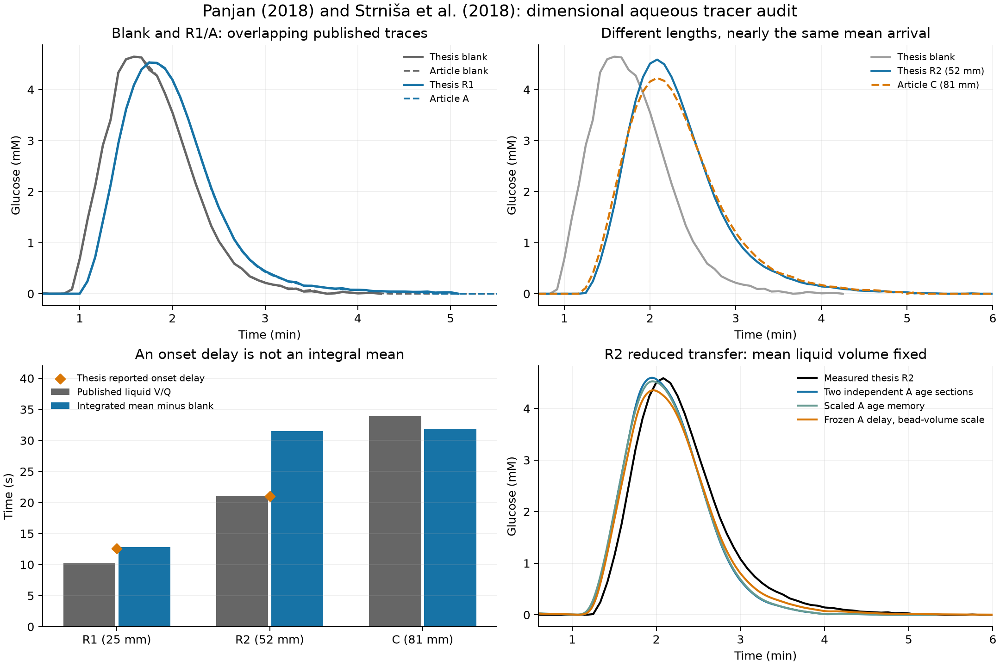
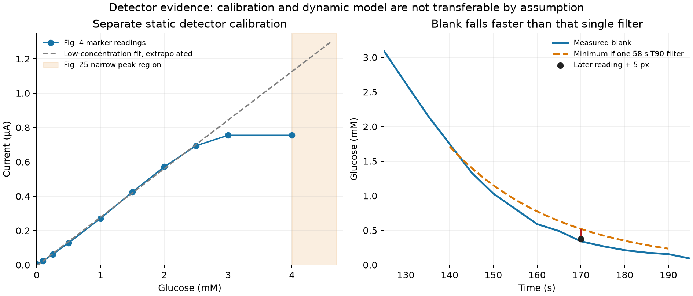

# Do Panjan's additional tracer curves resolve Strniša's mixing discrepancy?

**Bottom line.** The thesis adds a useful middle-length response, not
independent replications of the short response and blank. Its 52 mm R2
pulse has almost the same integrated mean delay as the article's 81 mm
reactor C, despite the much smaller stated liquid volume. The preserved
A-derived delay model predicts R2's variance closely in one scenario,
but still fails mean time and pulse shape. A single 58 s first-order
detector response is also inconsistent with the extracted blank's decay.
These results constrain the problem to the interpretation of liquid
inventory, transport/contact and the measurement chain; they do not
uniquely identify an experimental error or its physical location.
Reaction remains disabled.

## 1. Evidence and figure-reading method

[Panjan (2018)](https://oulurepo.oulu.fi/bitstream/handle/10024/36333/isbn978-952-62-1819-9.pdf?isAllowed=y&sequence=1),
Sections 4.1.1, 4.3.1 and 4.4.1, printed pp. 71–72, 75–79, gives
the same type of monolayer packed microreactor and detector setup as
[Strniša et al. (2018)](https://doi.org/10.1016/j.cej.2018.05.028).
Panjan used 0.1 M PBS, 100 µL/min and a valve injection of 10 µL
containing 50 mM glucose (nominal 0.500 µmol). The detector chamber
volume was 4 µL. The no-reactor configuration reconnects the inlet
and outlet tubing directly. The thesis does not provide numeric
temperature for this tracer study, connector volumes or the electrode
calibration applied to its individual curves. It gives N=3, but
does not supply individual replicate RTDs or numerical curve errors.

| Thesis reactor | Length × width × depth (mm) | Reported liquid volume (µL) | Reported delay (s) | Volume/flow (s) |
| --- | ---: | ---: | ---: | ---: |
| R1 | 25 × 3 × 0.4 | 17 | 12.6 | 10.2 |
| R2 | 52 × 3 × 0.4 | 35 | 21.0 | 21.0 |
| R3 | 52 × 16 × 0.4 | 266 | 156.6 | 159.6 |
| R4 | 52 × 29 × 0.4 | 583 | 249.0 | 349.8 |

The thesis uses the volume values in its V/Q comparison; do not infer
exact bead-envelope porosity for wide geometries from the quoted box
dimensions alone. The [source extraction](../../../literature/sources/panjan2018/README.md)
retains the original figure coordinates, calibration axes and reading
notes for all five traces. Figure 25 is on printed p. 78 (PDF p. 80).
Read the native 1442 × 846 image with the symbol spacing of 5 s and
concentration scale 5 mM per 703 pixels. Approximate centre readings
were independently overlaid on the plot. Unresolved marker positions
are not treated as additional measurements. The narrow pulses are
closed to zero over one display interval at their near-baseline ends,
with separate window and background reading sensitivities; the wide
pulse windows are not completed with a fabricated tail.

## 2. Cross-publication identity and dimensional moments

Compare raw concentrations at the same marker time index, rejecting
overlap-marked points and concentrations at/below 0.05 mM from the
identity screen. No horizontal shift, peak or area normalization, or
concentration scaling is fitted.

| thesis / article comparison | Clear matched points | RMS difference (mM) | Maximum difference (mM) |
| --- | ---: | ---: | ---: |
| blank / blank | 14 | 0.0071 | 0.0125 |
| R1 / A | 20 | 0.0133 | 0.0272 |
| R2 / C | 19 | 0.1652 | 0.3248 |

The combined two-pixel allowances of the distinct centres in the two
native figures are 0.0284 mM. The first two pairs agree within this
reading precision, including matching details on the rise and peak.
Their raw curves are consistent with republication of the same
measurement; count them once for independent validation. This is not
proof of exactly identical underlying trials. R2 is a distinct
published pulse, although the source group and instrumentation are
related. The R1 and A tail markers and plotted windows differ, so keep
their separate moment readings rather than averaging them.

For each narrow pulse, integrate the dimensional glucose concentration
to recover its apparent dose and calculate the concentration-weighted
mean and variance. If blank and reactor use one unchanged linear
measurement loop, differences in those moments give the additional RTD
contribution. The blank already includes apparatus and input pulse;
do not subtract its mean alone then interpret the remaining variance
as fluid dispersion.

| Narrow pulse, zero-axis reading | Apparent dose (µmol) | Complete mean (s) | Complete variance (s²) | Mean increment (s) | Variance increment (s²) |
| --- | ---: | ---: | ---: | ---: | ---: |
| Thesis blank | 0.5056 | 106.88 | 749.60 | — | — |
| Thesis R1 | 0.5109 | 119.72 | 1,024.46 | 12.84 | 274.86 |
| Thesis R2 | 0.5208 | 138.40 | 1,107.70 | 31.52 | 358.10 |
| Article C (previously extracted against its own blank) | 0.5228 | 138.97 | 1,204.85 | 31.91 | 435.71 |

R2 and C differ in their blank-subtracted mean by only 0.40 s. Their
reported liquid inventories, 35 and 56.5 µL, would imply 12.9 s
difference at the common 100 µL/min. The published geometric
correspondence is additionally supported by Strniša Table 2's reactor B
(52.2 × 3.0 × 0.4 mm, reported void volume 35.3 µL). This is a separate
source geometry/inventory statement, not evidence of an additional
independent R2 replicate or an assigned liquid storage capacity.

### Tail and baseline reading sensitivity

| Scenario | R1 mean / variance increment (s / s²) | R2 mean / variance increment (s / s²) |
| --- | ---: | ---: |
| Zero-axis, near-baseline closure | 12.84 / 274.86 | 31.52 / 358.10 |
| No terminal closure | 12.81 / 269.78 | 31.53 / 360.47 |
| Common 2-pixel baseline removal | 12.39 / 234.51 | 31.13 / 322.77 |
| Common 5-pixel baseline removal | 11.65 / 156.67 | 30.61 / 278.86 |
| Zero-axis, common 240 s truncation | 11.64 / 102.67 | 29.75 / 141.41 |

Even the 240 s truncation retains 99.14% and 98.57% of the digitized
R1 and R2 areas. The second moment is highly sensitive to this small
late mass, so precise absolute dispersion should not be inferred from
plot tails alone. Nevertheless R2's integrated mean is still almost
30 s, far above 21 s. Neither common pixel offsets nor eliminating
a substantial part of the late observation window resolves that mean.
These are figure-reading/window sensitivity checks, not experimental
uncertainty estimates or chosen corrections.

## 3. Leading-edge delay is not a mean residence time

The thesis explicitly defines its delay from the initial increase
in signal relative to the no-reactor response (p. 78), without giving
a numerical threshold. That quantity differs from the area-weighted
mean. Use the last upward threshold crossing on the principal rising
limb to avoid interpreting an early baseline fluctuation as arrival.
For the zero-axis digitization:

| Absolute concentration criterion | R1 delay relative to blank (s) | R2 delay relative to blank (s) |
| --- | ---: | ---: |
| 0.05 mM | 8.10 | 22.86 |
| 0.10 mM | 6.94 | 21.76 |
| 0.20 mM | 8.16 | 23.11 |
| 0.50 mM | 9.24 | 24.85 |
| 1.0 mM | 9.94 | 26.59 |
| 2.0 mM | 9.91 | 27.65 |

The 0.1 mM R2 crossing is close to the printed 21 s leading-edge
delay, even though the mean increment is 31.52 s. R1's printed
12.6 s cannot be reproduced uniquely by these plotted marker
thresholds. The actual onset rule and higher-frequency data are not
reported; 5 s displayed samples and the overlapping near-baseline
region do not support an exact threshold reconstruction. The detection
limit 0.006 mM in the separate calibration is smaller than one pixel
of the published RTD figure. Do not replace the first moment with the
onset or assume the identical printed 0.21 min in the two publications
uses the same definition.

## 4. Check whether the detector can be represented by the reported step time

The instrument's separately characterized response in Fig. 4 and
Table 1 (printed pp. 42–44) is not an identified impulse kernel for
Fig. 25. The table gives T90 = 58 s, resolution 0.004 mM and linear
range up to 3 mM; the nearby text gives linearity to 2.5 mM and possible
nonlinear extension to 4 mM. Re-reading Fig. 4, the illustrative
low-concentration slope is 0.283 µA/mM, and the markers at 3 and 4 mM
are both approximately 0.755 µA, rather than the 1.127 µA expected
by extrapolating the low-concentration line to 4 mM. The narrow Fig. 25
concentration peaks are 4.53–4.64 mM. Section 4.1.1 says the outlet
pulse was chosen within the sensor range, and Strniša reports linear
calibration up to 5 mM. These descriptions do **not** establish that
Fig. 25 used the exact same static calibration as Fig. 4. No inverse
calibration of the pulse is justified.

There is a stronger check on a candidate first-order response. For a
positive sensor input $u(t)$, any single linear time constant $\tau$
satisfies $\tau\,dy/dt=u-y$, hence for $t_2>t_1$:

$$
y(t_2)\geq y(t_1)\exp[-(t_2-t_1)/\tau].
$$

An ideal single-exponential 58 s T90 would imply
$\tau=58/\ln(10)=25.19$ s. Test this candidate directly on the blank
with the earlier concentration decreased and the later concentration
increased by five native y pixels (0.0356 mM), using declining points
at least 15 s apart and later signal at least 0.20 mM.

At 140 s the measured blank is 1.750 mM, at 170 s it is 0.341 mM.
Even with both reading allowances, a 25.19 s filter must give at least
0.521 mM at 170 s, but the later reading's upper allowance is only
0.377 mM. The necessary single-exponential time-constant upper bound
on that interval is 19.81 s (T90 <= 45.61 s), not 25.19 s. This is
an inequality test, not a newly fitted detector time constant. It
rejects a universal first-order representation of the separate 58 s
step measurement on the thesis blank. Different calibration, actual
sensor dynamics or setup may be responsible. It neither disproves
the measured step result nor shows that all dispersion is instrumental.

## 5. Fixed-volume reduced test from actual saved TRT marker ages

The earlier [Strniša numerical study](../strnisa_tracer/REPORT.md)
used stock OpenLB TRT and conservative Julia tracer transport for A/C.
Its A_H16 marker recovery was 100% and the mean/variance were 10.128 s
and 8.960 s². The present run verifies the original marker and handoff
hashes and archives a 0.05 s weighted impulse preserving the actual
mean and mass. No flow field is recomputed. The volume-based mean
reference for R2 is 21 s, which any fully sampled conservative passive
interbead transport model at 35 µL and 100 µL/min must reproduce.

Test two deliberately reduced R2 scenarios derived from A: two
uncorrelated, independently mixed transit sections, each scaled to
half of 21 s; and one scaled A response retaining its normalized age
memory. Their mean is 21 s by construction; their variances are 19.26
and 38.52 s². They are not a rigorous numerical bound on all possible
geometries. These are reusable approximate transit rules, not an
actual stock TRT solution of the 52 mm geometry. Use each source's
own measured blank and preserve the initial A-calibrated delay
parameters exactly. Apply the same independently reported bead-volume
scaling rule, not a separate R2 fit. The prediction function has an
independent test forbidding access to the R1 or R2 concentration curves;
the full response arrays are saved before calling the scorer.

| R2 model | Mean increment (s) | Variance increment (s²) | Mean error | Variance error | Whole-loop cumulative discrepancy |
| --- | ---: | ---: | ---: | ---: | ---: |
| Volume-only plug | 21.00 | 0.00 | −33.37% | −100.00% | 11.27 pp |
| Prior TRT, independent age sections | 21.00 | 19.26 | −33.37% | −94.62% | 11.16 pp |
| Prior TRT, retained age memory | 21.00 | 38.52 | −33.37% | −89.24% | 11.10 pp |
| Frozen A extra mixed volume | 22.86 | 22.72 | −27.46% | −93.65% | 8.43 pp |
| Frozen A common rare pauses | 22.86 | 174.35 | −27.46% | −51.31% | 9.73 pp |
| Frozen A bead-volume-scaled pauses | 25.00 | 353.00 | −20.66% | −1.43% | 8.24 pp |

The last scenario predicts variance remarkably closely but misses
the first moment by 6.51 s and fails the curve-shape screen. Its
complete-loop variance is within 0.46%, further illustrating why a
good fit to a single statistic is not a physical qualification. None
of the R2 scenarios passes the previously declared mean, variance
and cumulative screens across the baseline readings. The prior A/C
test remains unchanged. No new fitted mechanism is adopted.

### Conservation-based diagnosis before another native field

The extra liquid equivalent implied by the central moments is:

| Case | Apparent liquid volume from mean (µL) | Reported/represented liquid inventory | Difference (µL) |
| --- | ---: | ---: | ---: |
| R1 | 21.40 | 17.00 (thesis) | +4.40 |
| R2 | 52.53 | 35.00 (thesis) | +17.53 |
| C | 53.19 | 55.44 (prior represented transit at target flow) | −2.25 |

For C the previous simulated mean times the specified flow gives the
55.44 µL time-equivalent; the prior voxel inventory was 55.344 µL.
The small difference does not affect the sign of its residual.

Under a common linear blank, R2 requires liquid-equivalent retention
over and above its reported liquid inventory. At the quoted geometry
the nominal box volume is 62.4 µL and the bead-envelope volume is
27.4 µL. The missing mean would correspond to an additional 64%
of that envelope being accessible, if attributed purely to reversible
equilibrium internal storage. This is a required scenario, not a
measured porosity. The independently sourced 0.22 and 0.40 pore
fractions of related support used in the previous study give R2 means
24.62 and 27.58 s and modeled variance increments 143.87 and 245.82 s²
under the same illustrative diffusion-storage assumptions. Neither
qualifies; those unrelated specimens are not physical upper bounds
on Panjan's actual beads.

For a fixed nonnegative added mean, the 5% mean screen requires an
additional 2.00–3.28 s for R1 but 8.94–12.09 s for R2. Even scaling
by their nominal bead-envelope volume ratio 2.108 leaves incompatible
intervals (required equivalent R1 delay >= 4.24 s, allowed <= 3.28 s).
They remain disjoint at 2 and 5 pixel background removal. The actual
previous C result requires *less* apparent volume, not more. These
signs and incompatible magnitudes demonstrate why either a universal
extra delay or a common added storage proportional to particle volume
cannot simultaneously explain the central curves under the unchanged
blank/volume assumptions. They do not prove that internal porosity or
dispersion is negligible in the real reactor.

## 6. Wider reactors: no complete residence-time distributions

R3/R4 have different flow-distribution geometries and nonzero tails
at the plot end. Integrate only the visible signals between 5 and
420 s:

| Case | First / last observed glucose (mM) | Partial apparent dose (µmol) | Partial dose at 5-pixel background (µmol) |
| --- | ---: | ---: | ---: |
| R3 | 0.725 / 0.413 | 0.525 | 0.503 |
| R4 | 0.000 / 0.925 | 0.580 | 0.565 |

R3's initial signal descends before the new main peak. R4's visible
partial dose already exceeds the nominal 0.500 µmol, even after the
background sensitivity, and the tail is unresolved. These are
apparent plotted-signal integrals, not proof of chemical mass creation
or a measured tracer recovery. The pulse sequence, signal baseline and
unreported tail/volume definitions preclude a complete RTD or use of
these wider curves as independent validated dispersion benchmarks.

## 7. Decision and next executable step

The additional thesis strengthens the earlier diagnosis. More mesh
refinement at the same 35 µL reported interbead volume cannot fix a
10.5 s mean-time discrepancy. It may still improve a prediction of
the hydrodynamic variance, but that is not presently the limiting
qualification. Do not start reaction, reinterpret the 58 s detector
as a universal filter, fit R2's pore volume to the pulse, or treat
the near-duplicate short traces as independent validation.

Next audit separately documented inlet/outlet chambers, fittings and
liquid inventory. The thesis cites [Bajić et al. (2017)](https://doi.org/10.1016/j.procbio.2016.09.021)
as reactor design precedent; check that article for dimensions or
separate pulse controls, not for transferring its different particle
preparation. If defensible noncommon volumes or detector/measurement
changes can be justified independently, test a finite-inlet/outlet
scenario with stock TRT and conservative tracer while preserving
traceable inventories. If published evidence does not separate the
apparatus from the reported bed liquid volume, select an alternative
published inert tracer benchmark with a specified input/blank response
and independently established liquid volume. No new laboratory data
or inaccessible replicate records are a condition of this project.

## Reproducibility

Actual local work on 24 November 2026 used the existing managed
CPython/NumPy environment, the supplied PDF and the saved A_H16 impulse
from the verified stock TRT/Julia run. Seven Python analytical/evidence
tests passed. The full saved forward predictions and reference checks
are documented in the [run guide](README.md); see the compact
[summary](reference/summary.json) and [prediction samples](reference/predicted_narrow_samples.csv).
No source OpenLB files, prior flow field, previous calibrated
parameters or prior reaction example are changed.
