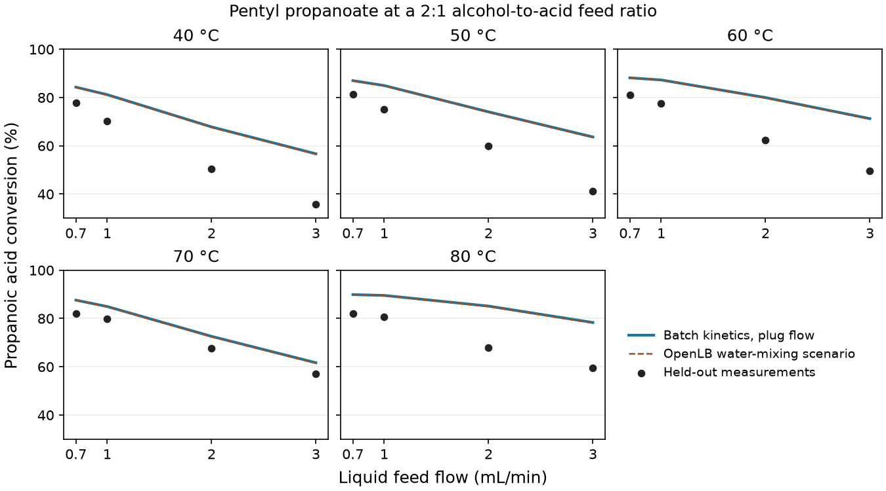

# Can batch lipase kinetics predict a continuous esterification bed?

The test uses propanoic acid and pentan-1-ol at a 2:1 inlet molar ratio
with immobilised lipase Lipozyme 435. One mole of acid and one mole of
alcohol form one mole each of pentyl propanoate and water. Each experiment
has a fixed, jacket-controlled temperature. The observations used to
fit reaction rates, check bed mixing and score the reactor model come
from three distinct sets of experiments.
[Batch study](https://doi.org/10.1021/acs.iecr.6c02375)
· [Continuous and tracer study](https://doi.org/10.1021/acs.iecr.5c02780)

## Batch fit

The [extraction](../../../literature/sources/lorenzo2026/README.md) contains
121 rows from assays 1–4 and 9–12, including eight initial conditions.
Printed and composition-derived conversion values differ by up to 4.66
percentage points. The model uses the 113 post-start printed values as
the response, with equal weights. All four 40 °C loadings share one
rate per unit catalyst mass. The catalysts in the fit are weighed as
the immobilised preparation, including its support.

For acid conversion `X` and reaction progress from a dry 2:1 feed, the
mole fractions are `(1-X)/3` for acid, `(2-X)/3` for alcohol and `X/3`
for each product. The reversible rate per kilogram of catalyst is

```text
r = k(T) [2 - 3 X + (1 - 1/Kx(T)) X²] / 9       [mol/(kg s)]
```

Each setpoint fits one `k`, with its apparent `Kx` taken from the matching
batch in the paper's Table 2. Those `Kx` values share the batch evidence
and incorporate liquid nonideality. The fit assumes the apparent rate
scales with immobilised catalyst mass. The apparent rate includes any
transport limitations present in the batch assays. No additional
intraparticle effectiveness factor is applied. The separate smooth
temperature sensitivity fits `log(k)` and `log(Kx)` as linear functions of
reciprocal absolute temperature, using the same batch observations.

| Temperature (°C) | Source apparent Kx | Fitted k (mol/kg/s) | Batch RMSE (percentage points) |
| ---: | ---: | ---: | ---: |
| 40 | 4.53 | 0.12967 | 2.84 |
| 50 | 5.58 | 0.16397 | 2.57 |
| 60 | 6.01 | 0.21693 | 2.14 |
| 70 | 6.28 | 0.15199 | 2.08 |
| 80 | 7.30 | 0.28822 | 1.36 |

The setpoint fit gives 2.46 percentage points overall RMSE, with a
maximum error of 6.73 points. The smooth temperature sensitivity gives
3.78 points overall RMSE. The nonmonotone fitted temperature trend
and the imperfect mass scaling at 40 °C limit the interpretation of
these coefficients as intrinsic kinetics. The measured reaction
enthalpy of −5.62 kJ/mol is from separate calorimetry at 25 °C and a 1:1
feed ratio.

## Reactor prediction

Batch exposure is elapsed time multiplied by immobilised catalyst mass
divided by the initial acid amount. In plug flow the same exposure
coordinate is the catalyst inventory divided by inlet acid molar flow.
The fixed inventory is the printed 6.0 g and the inlet acid concentration
is 3.3 mol/L. The calculation uses the catalyst mass directly, so it
requires no conversion from the ambiguous catalyst volume or water-based
void fraction. It evaluates all 20 combinations of 40–80 °C and 0.7, 1, 2,
and 3 mL/min before opening the experimental conversion CSV.

The reported conversion `1 - C_acid,out / C_acid,in` from
titration is compared to the predicted molar conversion assuming
negligible volumetric flow change. Only measured markers from Figure 3c
and Supporting Figure S1 enter the error metrics. The [source record](../../../literature/sources/lorenzo2025/README.md)
gives the digitization checks and the concentration measurement error.

For the mixing sensitivity, the normalized pulse-free tracer variance from
the OpenLB flow and Julia transport is converted to an axial Péclet number
through the Danckwerts moment relation

```text
variance / mean² = 2/Pe - 2(1 - exp(-Pe))/Pe²
```

Julia solves the steady balance with inlet solute flux set by the feed,
zero diffusive flux at the outlet and a uniform catalyst inventory.
Applying a water-derived dimensionless dispersion number at every reaction
flow is a scenario assumption.

## Water-tracer mixing check

The [water benchmark](mixing/README.md) uses stock OpenLB 1.9r0 D3Q27 TRT
flow through a synthetic periodic packing of 593 µm beads. It follows
8,192 blue-dextran markers on a balanced face field through a 140 mm
equivalent travel length. Blue dextran probes interbead flow. Sodium
azide can enter the beads and belongs to a separate measurement.
The representative packing uses the authors' water-tracer-derived
interbead void fraction of 0.64. The agreement in mean time is therefore
a consistency check on liquid inventory and throughput.

| Blue dextran at 1.2 mL/min | Mean (min) | Variance (min²) |
| --- | ---: | ---: |
| Published finite-pulse result | 19.07 | 27.83 |
| TRT flow and Julia tracer, instantaneous injection | 15.02 | 1.85 |
| TRT flow and Julia tracer, with a 7 min rectangular inlet pulse | 18.52 | 5.93 |

The finest native flow is within 0.103% of the target throughput.
The balanced plane-flow error is below 2 × 10⁻¹⁴ relative and all simulated
markers arrived. Refining from N48 to N64 at the matched 0.10 s tracer
step changed the pulse-free variance by 1.07%. Halving the step on N64
changed it by 0.82%. The predicted finite-pulse tracer distribution is
still **79% too narrow by variance**. The predicted normalized cumulative
outlet distribution deviates by up to 18.3 percentage points from the
digitized curve.

Under independent convolution, any inlet profile contained in the
assumed 7 min interval can contribute at most 12.25 min² of variance.
Even that limit gives 14.10 min² with this simulated bed. The experiment
does not report the actual inlet pulse profile. The periodic model omits
the tube wall, entrance and outlet regions and any external plumbing.
This comparison leaves their separate contributions unresolved.
[Tracer record](mixing/reference.json)
· [Figure A1 extraction](../../../literature/sources/lorenzo2025/README.md#catalyst-and-water-tracer-data)

## Held-out conversion results

All three predictions reproduce the fall in acid conversion with
increasing flow at each temperature and overpredict all 20 observations.
The largest gaps occur at the higher flows. For example, at 60 °C and
3 mL/min the measured acid conversion is 49.7%, while the water-mixing
scenario gives 71.1%.

| Prediction | RMSE (percentage points) | Mean overprediction (percentage points) | Largest error (percentage points) |
| --- | ---: | ---: | ---: |
| Setpoint kinetics, plug flow | 13.35 | 11.86 | 22.56 |
| Setpoint kinetics, OpenLB water-mixing sensitivity | 13.21 | 11.72 | 22.39 |
| Pooled batch kinetics, plug flow | 13.49 | 12.75 | 21.18 |



The OpenLB water simulation gives a pulse-free relative variance of
0.00818 and a moment-equivalent axial Péclet number of 243.37 for the
reactor sensitivity. This changes the predicted conversion by at most
0.205 percentage points. Doubling the reacting grid from 2,048 to
4,096 cells changes conversion by less than 0.00019 percentage points.
The maximum normalized acid balance residual is 1.32 × 10⁻¹¹.

The batch rate and the simulated degree of mixing do not transfer
quantitatively to this reactor. The mixing effect reported here is
specific to the synthetic water-flow result. The study has not isolated
the contributions of actual bed flow distribution and apparent catalyst
activity in the reaction liquid. The retained tests measure those two
discrepancies without adjusting either model to the conversion data.
[Retained comparison](reference/bed_comparison.csv)
· [Run record](reference/summary.json)
