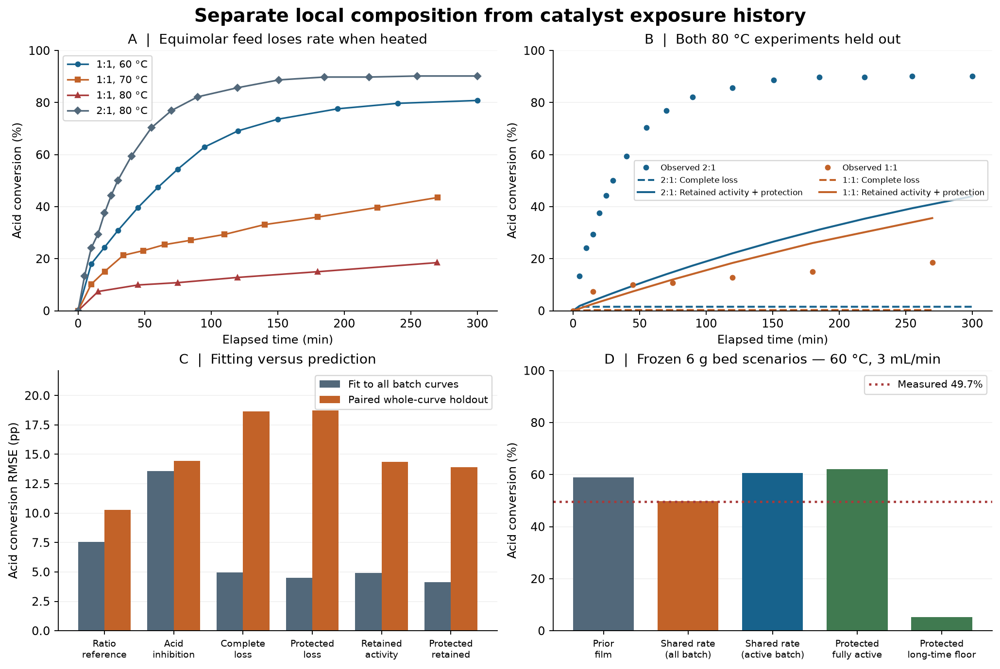

# Does composition-dependent kinetics explain the pentyl propanoate rate-transfer gap?

**Bottom line.** The complete batch dataset establishes that high acid
concentration and high temperature change the apparent enzyme kinetics:
equimolar batches become slow at 70–80 °C, while the alcohol-rich
batches remain reactive. The newly tested state-dependent and
time-dependent models cannot independently predict all of those
conditions. Stronger protection by excess alcohol and a residual
active fraction are plausible, and help describe the measured batch
curves, but their parameters are not determined by the available batch
holdouts. A simple activity loss inferred from the equimolar batches
would also tend to make the 2:1 packed bed unstable, or, with strong
alcohol protection, would be too small to explain its observed lower
conversion. Keep the six gram inventory and the preceding rate model;
do not adopt a new correction selected by the reactor score.



## 1. Complete the independent batch evidence

The [2026 paper and supplement](../../../literature/sources/lorenzo2026/temperature_series.md)
now supply all 225 rows (including starts) of sixteen Lipozyme 435
experiments, of which 209 are positive-time responses. The final
50 transcribed rows are assays 13–16 at equimolar feed and 50, 60,
70 and 80 °C. All were verified directly against SI Table S2.
Assays with Amberlyst-15 are not enzyme experiments.

| Nominal feed, alcohol:acid | Temperature | Catalyst mass relative to initial acid |
| --- | --- | --- |
| 1:1 and 2:1 | 40 °C | 2.5, 5, 10, 20% (eight assays) |
| 1:1 and 2:1 | 50, 60, 70, 80 °C | 10% (eight assays) |

At 60 °C the equimolar batch reaches 80.8% conversion. At 70
and 80 °C it reaches only 43.5% and 18.5%, respectively, after
approximately 270 min. The nominally 2:1 batch at 80 °C
reaches 90.2% after 300 min. Lorenzo and Ortega discuss this
as loss of activity with high acid/temperature; it is not a
measured new thermodynamic equilibrium.

We keep the apparent equilibrium separate from the rate. Use the
authors' reported Table 2 apparent Kx values (assays 3, 7, 9–14)
and a log-linear inverse-temperature interpolation **separately
for each nominal feed**. Exclude each Kx from a validation fold
whenever its originating assay is held out. The 1:1 70 and 80 °C
source observations have no measured Kx. Extrapolating the
40–60 °C active 1:1 fit would give active-enzyme equilibrium
conversions of 81.9% and 83.3%; these are explicitly counterfactual
kinetic-driving benchmarks, not observed high-temperature plateaus.

### Why composition alone cannot explain loading-dependent progress

For a function of instantaneous composition and temperature,
with no other dependence on catalyst mass, the batch balance is

```
dX/dt = (m_cat/n_acid,0) * q(X, R, T)
```

where q is a per-mass rate. Replacing the time coordinate by
catalyst mass times time gives the same curve for all loadings
at the same feed. This remains exactly true even for nonlinear
acid, alcohol and product inhibition. We verify this property
against an independent reversible solution in Julia.

The observed 1:1 loading curves do not obey it:

| 10%-acid loading time | 20%-acid loading time | Nominal exposure (loading × minutes) | Observed high-load minus low-load conversion |
| ---: | ---: | ---: | ---: |
| 19.9 min | 10.0 min | 199 vs 200 | −2.4 percentage points |
| 60.0 min | 30.0 min | 600 vs 600 | +4.2 percentage points |

The sign also reverses in both separately reconstructed
conversion responses. Thus a rate law depending only on current
composition cannot resolve the loading problem. Different initial
states, conditioning, activity histories or contact limitations
may account for differences at equal catalyst exposure. The sign
change does not uniquely identify any mechanism.

## 2. Test inhibition and catalyst-state hypotheses separately

[Van Hecke et al. (2024)](../../../literature/sources/vanhecke2024/README.md)
provide independent same-acid evidence: solventless geranyl
propionate with Novozym 435 has a strongly nonlinear apparent
acid-inhibition term of power 3.5 and a half-rate concentration
of 1.70 mol propionic acid/kg liquid. That is a different alcohol,
much lower loadings and, for the forward calibration, water
scavenging. Use it as a fixed analogue shape sensitivity, not an
intrinsic target enzyme constant. Separately allow the pentyl
batch data to determine the acid-inhibition strength. The
[2019 retained-activity experiment](../../../literature/sources/ascorbyl2019/README.md)
shows that N435 can retain activity after partial loss in a
different solvent. It motivates but does not quantify a
potential stable activity population for the present chemistry.

### Local reversible rate

The existing one-reaction stoichiometry gives A, B, E, W
amounts proportional to 1−X, R−X, X, X, with R the initial
alcohol:acid molar ratio. The independent concentration basis
is moles/kg starting liquid (conserved for this idealised batch).
Let c_ref = 1/(M_acid + 2 M_pentanol), the 2:1 initial acid
molality, about 3.99 mol/kg. Define z_A = c_A/c_ref,
z_B = c_B/(2 c_ref), z_P = c_W/c_ref = c_E/c_ref.
Use the apparent reversible driving force F and a positive,
reduced composition factor G:

```
F = ((1-X)*(R-X) - X^2/Kx)/(1+R)^2
G = (1+b_A(T)+b_B)/(1+b_A(T)*z_A^n+b_B*z_B^2) * exp(g_P*z_P)
q = k(T)*F*G*a
dX/dt_min = 60 * M_acid * (loading_pct/100) * q
```

q is mol/(kg immobilised preparation s); X is fractional
acid conversion. The normalization defines k(T) at the
unreacted, fully active 2:1 reference. The acid term is
inspired by the independent inhibition data, and the alcohol
term by the dual-substrate inhibition in published reduced
Ping-Pong kinetics. The new model is not an exact replay of
the many coefficients in the authors' full 2026 correlation.
The product state is lumped (E and W evolve together); it cannot
identify a separate water activity, ester inhibition or
hydration. Multiplying the net driving term preserves the same
equilibrium. Always keep actual catalyst mass in the balance.

### Activity that depends on exposure time

Test independently of the preceding substrate terms:

```
dH/dt_min = h(T) * z_A^m * (2*A/B)^p
H(0) = 0
g(t) = 1 - deficit * exp(-t/tau)
a(t) = g(t) * [f + (1-f)*exp(-H(t))]
```

H is cumulative damage hazard (dimensionless); h is min⁻¹
at the 2:1 reference feed; g is a hypothetical initial
conditioning/recovery factor and f is a hypothetical
resistant or retained apparent activity fraction. Both
active-rate k and thermal damage h have separate shared
inverse-temperature slopes. The default acid-exposure
power m = 3.5 is a *scenario*, not the measured
reversible-inhibition power reinterpreted as a time constant.
The protection exponent p accounts for possible mitigation
by excess alcohol. It is motivated by the initial-ratio
dependence in the published apparent denaturation term;
we do not transfer that term as dynamic activity. For the
protection-free and complete-loss cases p and f are zero.
Shared initial deficit is zero where recovery is excluded.
The actual catalyst inventory never changes. No per-assay
activity, reuse factor or bed parameter is fitted.

We compare progressively more complex cases, including a
ratio-specific empirical reversible reference (different
apparent k and slope for each feed), common static reversible
models, acid/dual-substrate/product models and dynamic models.
The targeted alcohol-protection and residual-population
cases address the initial batch-model failure and late-tail
failure respectively, so even their whole-condition
results are **secondary diagnostics**, not a completely new
blind external validation.

## 3. Withhold entire operating conditions

Each fold hides both 1:1 and 2:1 experiments at one temperature
or one 40 °C catalyst loading. Eight paired folds cover the
sixteen assays. Use only the remaining batch curves to fit
one shared rate law; exclude the corresponding apparent
equilibrium measurements. Equal total weight per curve is
the primary comparison. Test different weights, measured
initial ratio, and acid- and ester-derived conversions
(which differ from some printed values). Fit the fourteen
other curves alone in a separate challenge prediction of
both hot equimolar runs. Also perform paired holdouts within
the active fourteen-run domain independently. No reactor
observation appears in any of these objectives.

| Candidate | Fit to all batch curves (RMSE, pp) | Paired whole-curve holdout (pp) | 2:1 held-out error (pp) |
| --- | ---: | ---: | ---: |
| Ratio-specific empirical reference | 7.55 | 10.28 | 5.05 |
| Common reversible | 14.15 | 14.55 | 8.27 |
| Fixed geranyl acid-inhibition analogue | 19.96 | 21.06 | 14.78 |
| Fitted common acid inhibition | 13.59 | 14.45 | 6.88 |
| Acid/alcohol/product state model | 13.02 | 15.12 | 8.03 |
| Temperature-dependent reversible acid inhibition | 12.98 | 14.26 | 6.80 |
| Complete irreversible acid-exposure loss | 4.97 | 18.63 | 24.41 |
| Acid inhibition plus recovery | 13.59 | 14.45 | 6.88 |
| Acid loss and recovery | 4.76 | 18.53 | 24.61 |
| Acid loss with alcohol protection | 4.52 | 18.75 | 24.34 |
| Protected loss and recovery | 4.44 | 18.76 | 24.54 |
| Loss with retained activity | 4.92 | 14.35 | 18.12 |
| Loss with protection and retained activity | 4.12 | 13.92 | 18.01 |

None passes the batch-only qualification rule. The complete
loss model fits the hot equimolar data much better than a
static rate and suggests a real time-dependent phenomenon.
But when both 80 °C assays are withheld, it predicts only
1.5% final conversion for the alcohol-rich batch that reaches
90.2%; the inferred thermal-damage slope is at its broad
numerical limit. Free alcohol protection collapses to zero
in that fold, illustrating its lack of identification.
Allowing retained activity improves that prediction to
44.0%, still far below the measurement. Some nonlinear
activity fits are also not stationary within the defined
optimizer tolerance or have weak/boundary parameters;
their diagnostic predictions are retained and not certified.
Lower/upper acid and hazard powers and the source-composition
sensitivities do not qualify a shared new law.

### Targeted alcohol-protection sensitivity

The published study explicitly notes the stabilizing effect
of excess alcohol. With p imposed rather than fitted, repeat
the entire eight-fold prediction test. These imposed powers
are independent diagnostic scenarios, not measured time-law
coefficients:

| Fixed p scenario | All sixteen held-out RMSE (pp) | 2:1 held-out RMSE (pp) |
| --- | ---: | ---: |
| p = 4, protected complete loss | 8.36 | 5.92 |
| p = 8, protected complete loss | 7.96 | 5.44 |
| p = 4, protected retained activity | 10.58 | 12.84 |
| p = 8, protected retained activity | 7.14 | 5.29 |
| Ratio-specific reference | 10.28 | 5.05 |

Strong prescribed protection can prevent the catastrophic
80 °C alcohol-rich extrapolation, but no protected scenario
improves prediction of the target 2:1 set over the reference.
The p=8 retained-activity case predicts about 89.0% for the
80 °C alcohol-rich run and 31.4% for the equimolar run
(observed 90.2% and 18.5%). This is a useful indication,
not validation of p or a basis to select a packed-bed factor.

When both hot equimolar curves are excluded from fitting,
their errors remain large (e.g. 43.53 pp for the complete
loss or protected retained-activity candidates). The damage
kinetics cannot be inferred reliably from active batches
alone. Even within the fourteen active conditions, the
ratio-specific reference's 2:1 held-out error is 5.05 pp,
the common reversible model's is 5.01 pp, and the
acid/alcohol/product model's is 5.33 pp. There is no
substantial improvement on the target feed.

### Late tails distinguish complete loss from retained activity

The hot equimolar mixtures still react slowly at the end
of the run. Between about 180 and 270 min, the observed
conversion rises by 7.5 points at 70 °C and 3.5 points at
80 °C. A model with complete irreversible loss predicts
0.95 points and essentially zero, despite fitting the same
curves. Strong protection plus a fitted residual activity
floor predicts 3.64 and 5.81 points. The full fit gives
f = 0.0438 (about 4.4% residual **apparent** activity).
There is no direct activity assay showing this fraction;
it is an explanation we tried, not a measured property.

## 4. Transfer only frozen chemical rate scenarios to the six gram bed

Use the already checked central Wilson–Geankoplis liquid-film
estimate, tabulated internal effectiveness, stationary packed
bed volume and earlier axial-dispersion boundary convention.
These are controlled comparisons: fixed internal effectiveness
is not newly validated for every changed kinetic law.
Compute liquid-surface reaction using the existing film root
and the new mass-specific rate; the same catalyst mass enters
the source term exactly once. Actual mass is 6 g, corresponding
to 333.05 g/L interbead liquid.

All nineteen all-/active-batch static or fully active cases,
the previous reference and the two residual long-time
limits are frozen before scoring the twenty 2:1 reactor
measurements. No candidate is selected from this table.

| Reactor scenario | Conversion at 60 °C, 3 mL/min | RMSE over 20 reactor conditions (pp) |
| --- | ---: | ---: |
| Previous central film reference | 59.0% | 9.58 |
| Common reversible, fit including hot equimolar batches | 49.9% | 5.53 |
| Common reversible, fit to the fourteen active batches | 60.5% | 8.75 |
| Ratio-specific reference | 61.1% | 9.03 |
| Fitted acid inhibition, all batches | 54.4% | 7.35 |
| Protected retained-activity law, fully active | 62.1% | 9.94 |
| Protected retained-activity law, hypothetical long-time floor | 5.2% | 55.77 |
| Measured | 49.7% | — |

The apparent improvement of the all-batch shared reversible
law is misleading: it suppresses the active 2:1 rate as a
compromise to fit the deactivated 1:1 experiments. Its 2:1
batch prediction error at genuinely withheld conditions
increases to 8.27 pp. Removing the inactive curves eliminates
most of this apparent reactor improvement. It would be
incorrect to adopt the 5.53-point reactor result as a
validated explanation.

### Catalyst age is not the liquid residence time

A packed-bed bead does not travel from inlet to outlet with
the fluid. If acid damages the catalyst, the inlet beads
remain exposed to incoming acid. The batch acid concentration
instead declines as ester forms. We therefore do not apply
the batch activity trajectory as a function of axial liquid
age. Examine conditional fully wetted stationary catalyst
exposure for 30–180 elapsed minutes. At any fixed temperature
and active 2:1 equilibrium, local acid bounds the hazard
between its inlet and equilibrium values. The
[clock screen](reference/stationary_clock_screen.csv) records
those activity limits and uniform-activity steady calculations
at both ages. These are **frozen uniform scenarios**, not
spatially resolved transient predictions. The true wetting,
starting catalyst age, reaction field and exposure history
were not measured.

With the simple complete-loss fit, catalyst continuously
exposed to inlet-strength acid at 60 °C retains about 42%
of its 30-min activity at 180 min. Assuming that exposure
uniformly would drop the 3 mL/min predicted conversion
by 24.6 points. At 80 °C the retention in that scenario
is only 0.055%. In contrast, strong protection plus residual
activity retains about 99.8% at 60 °C and 85.2% at 80 °C
at inlet composition. The 60 °C uniform-exposure conversion
changes by just 0.045 points; it does not explain the
roughly ten-point rate-transfer discrepancy there.

The [2025 reactor article](https://doi.org/10.1021/acs.iecr.5c02780)
describes stable 2:1 operation including high temperatures;
its unidentified-condition three-hour trace from the
[earlier conditioning audit](../pentyl_propanoate_conditioning/REPORT.md)
varies about 1.22 conversion points from 30 to 180 min.
The assumed strong continuing damage throughout the bed
is difficult to reconcile with stability, whereas strong
protection makes too little catalyst loss at moderate
temperature. The long-time residual fraction is far from
the early high-activity state and is not assumed reached
after three hours. The experiment does not support choosing
an arbitrary catalyst age or exposed fraction to match the
conversion.

## 5. Engineering decision and next independently checkable step

This audit separates two effects that should not be conflated:

- High-acid/high-temperature batch activity loss is real as
  an apparent kinetic observation; the rate-law parameters
  and catalyst state that cause it remain non-unique.
- The alcohol-rich packed bed's lower steady conversion is
  not resolved by any of the tested transferable batch-rate
  corrections. Equilibrium, activity loss, wetting history
  and contact/mass availability must not be folded into an
  empirical multiplier selected from reactor residuals.

There is a particularly useful next experiment **already
published in the same 2025 paper**. Figure 3b and Supporting
Figure S1 give the twenty *1:1* packed-bed conditions
(5.3 mol/L of each reactant; five temperatures, four flow
rates; SI Table S2 assays 45–64, verified in the published
supplement), not the 2:1 conditions we have used so far.
The
authors describe milder high-temperature activity loss in
that bed than in the equimolar stirred reactor. Extract them
as an additional, independent reactor comparison; do not fit
either set of packed-bed conversions. Use separately
identified equimolar fluid/particle properties and the same
actual 6 g inventory, then ask whether the frozen batch
models predict the contrast between 1:1 and 2:1 flow
operation. This is a stronger test of the contact/conditioning
hypotheses than introducing another rate factor.

If additional published evidence is needed, prioritize
time-resolved residual activity during acid/pentanol exposure
at fixed feed composition and temperature, or fixed-feed
continuous reactor experiments that vary catalyst quantity
at controlled contact/residence conditions. Different-solvent
endpoint activities cannot establish the missing time law.
No new lab measurement is a prerequisite. Until a new
mechanism passes independent testing, do not propagate it as
a validated OpenLB-to-Julia-to-DWSIM process model.

Numerical estimation, analytical checks, film/axial balance
and the reproducibility comparison are documented in the
[run guide](README.md). No new OpenLB simulation or DWSIM
validation is claimed for this milestone.
