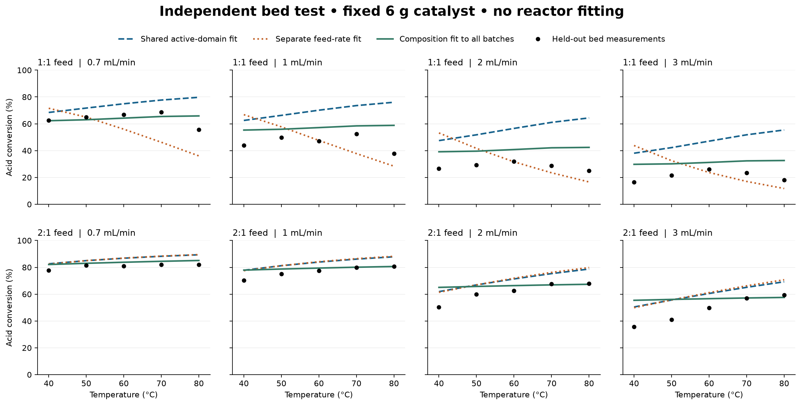
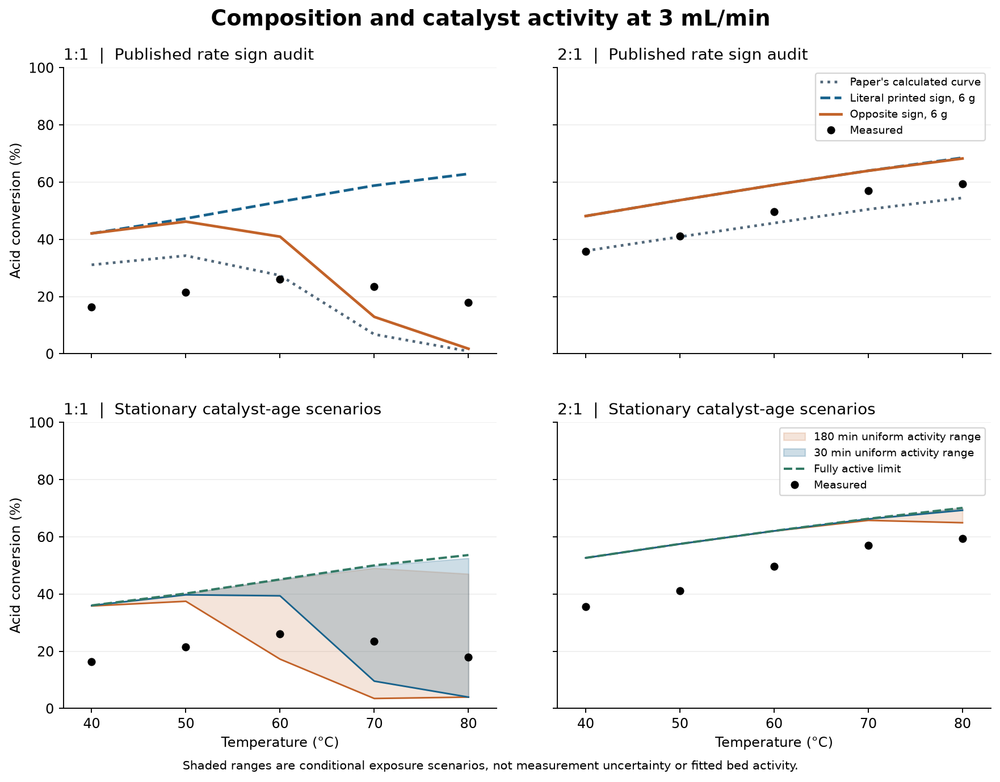

# Equimolar packed-bed holdout and published-rate sign audit

**23 November 2026 — numerical checks passed; predictive validation remains open.**

## Engineering conclusion

The additional 20 packed-bed experiments establish two distinct discrepancies.
The batch-derived rate is too high at moderate temperatures, especially for an
equimolar acid/alcohol mixture. At high temperature, a direct transfer of the
batch's acid-sensitive loss of activity can instead be much too pessimistic.
The continuous bed's conversion is consistent with retaining more apparent
activity than the hot stirred-batch behaviour implies. Reducing the amount of active catalyst everywhere cannot
solve both problems with the same catalyst mass and kinetic law.

An additional source-consistency check makes this distinction clearer. Taking
the sign of the published temperature-dependent denaturation coefficient
literally produces the opposite trend to the authors' calculated Figure 6b.
Reversing only that sign substantially improves the replay of the batch data
and their plotted calculations, but still does **not** predict both reactor
feeds. This is evidence for an equation/parameter sign-convention ambiguity,
not proof of a particular transcription error or a validated new kinetic law.

All 40 reactor observations remain outside calibration. Neither the full 6 g
of catalyst nor any batch fit parameter was adjusted to a reactor observation.

## 1. Measurements and operating boundary

The [2025 reactor article](https://doi.org/10.1021/acs.iecr.5c02780), Section
2.3, and its [supplement](https://doi.org/10.1021/acs.iecr.5c02780.s001),
Table S2 and Figure S1, describe matching experiments at 40, 50, 60, 70 and
80 °C and total volumetric flow rates of 0.7, 1, 2 and 3 mL/min. The new
[equimolar extraction](../../../literature/sources/lorenzo2025/conversion_1to1.csv)
contains open-circle experiment markers from Figure S1 for assays 45–64.
We independently read Figure 3b, whose colored markers are more crowded.
Nineteen cross-read differences are below 0.5 conversion points; a partial
red marker at 50 °C and 2 mL/min differs by 0.76 points. The unobscured S1c
marker is the primary reading. The PDF hashes, marker centers, calibrations,
reported measurement basis and uncertainty are in the
[extraction record](../../../literature/sources/lorenzo2025/equimolar_extraction.json).
The graph-reading allowance is ±0.5 points, not experimental uncertainty.
The authors estimate the effluent **concentration** error at less than 5%;
individual conversion uncertainties are not available.

| Quantity | 1:1 alcohol/acid | 2:1 alcohol/acid |
| --- | ---: | ---: |
| Feed propanoic acid (mol/L) | 5.3 | 3.3 |
| Feed pentan-1-ol (mol/L) | 5.3 | 6.6 |
| Measured catalyst inventory (g) | 6.0 | 6.0 |
| Conditional liquid-volume catalyst concentration (g/L) | 333.05 | 333.05 |
| C0-based internal effectiveness (Table B1), 40–80 °C | 0.893–0.998 | 0.852–0.884 |

The column diameter (16 mm), length (140 mm) and representative bead diameter
(593 µm) are unchanged. The 28.15 mL bed and water-derived interbead voidage
of 0.64 give 18.02 mL of nominal interbead liquid and calculated residence
times of 25.74, 18.02, 9.01 and 6.01 min. The authors' internal effectiveness
factors are **calculations** rather than measured intrabead rates; retain
them as a separate controlled input. Reaction-mixture voidage and physical
properties at the setpoints remain unavailable.

The new measurements quantify the trade-off in acid conversion:

| Temperature (°C) | 1:1 at 3 mL/min (%) | 2:1 at 3 mL/min (%) |
| ---: | ---: | ---: |
| 40 | 16.4 | 35.7 |
| 50 | 21.6 | 41.1 |
| 60 | 26.0 | 49.7 |
| 70 | 23.5 | 57.1 |
| 80 | 18.0 | 59.4 |

At the slower 0.7 mL/min, the equimolar maximum is 68.6% at 70 °C, falling
to 55.7% at 80 °C. Alcohol excess increases measured conversion by 13.5–42.7
percentage points across all twenty matched conditions. More conversion is
not always more product per hour, because the equimolar feed carries more
acid per litre. With the constant-volume, dry-feed single-reaction balance,
the measured outlet conversion implies 35.8 versus 42.6 g ester/h at
60 °C and 3 mL/min, and the 2:1 feed yields more nominal ester per hour in
12 of 20 matched cases. These are concentration-based throughput scenarios,
not independently measured product mass flows or DWSIM predictions. Feed
material balances and solvent recovery must be included in a later process
comparison.

## 2. Frozen transfer of the batch fits

Use the [previous all-batch and active-domain fits](../pentyl_propanoate_composition/REPORT.md)
without any numerical optimization in this example. The active-domain
training set excludes the 70 and 80 °C equimolar batch experiments. The
ratio-reference case uses its separately fitted empirical 1:1 coefficient
for that feed, rather than silently using the alcohol-rich coefficient. The
other candidates share their original composition-dependent rate parameters.
Each uses its own frozen apparent equilibrium law from the batch source;
the 1:1 constants above 60 °C are extrapolated fully active scenarios rather
than measured equilibrium values.

The rate and film calculations use the existing Julia axial-dispersion
solver and existing film surface-concentration balance. The conditional
liquid-volume reaction source is

```text
r_liquid = 0.06 C_cat a q_mass(X_surface, T, ratio, Kx)
```

where `q_mass` is mol/(kg immobilised catalyst s), `C_cat` is g/L interbead
liquid, `a` is frozen fractional activity, and `r_liquid` is mol/(L min).
The internal effectiveness factor is applied once. We use the previously
checked low-Re Péclet number 115.28 and the fixed-concentration inlet
actually printed in Eq. 4. It allows a small inlet backdiffusive reaction
product flux, retained separately rather than counting it as effluent
production. The no-film cases and internal-effectiveness sensitivity do
not alter the total catalyst mass.

External transport is calculated using the dimensionless Schmidt number
`Sc = μ/(ρD)` and the [Wilson–Geankoplis correlation](https://doi.org/10.1021/i160017a002).
With that correlation `Re Sc = u d_p / D`, so the uncertain density and
viscosity cancel from the coefficient when diffusivity is fixed. We explicitly
adjust film capacity for the higher equimolar acid concentration and use
the earlier neat-pentanol/dilute-diffusion property scenario for lack of
measured mixture transport data. The 2:1 case uses exactly the earlier
assumptions. The assumed equimolar nominal dry density follows the reported
feed molarities (859.8 kg/m³); it is not a measured hot-mixture property.

### Held-out conversion results

RMSE below measures the typical magnitude of the conversion error in
**percentage points**, e.g. 40% predicted rather than 50% measured is a
10-point error. Complete pointwise scores are retained for all 22 cases;
selected cases show the important contrasts.

| Frozen scenario | 1:1 (20) | 2:1 (20) | All 40 |
| --- | ---: | ---: | ---: |
| Prior literal Table S3 law with film | 29.29 | 9.58 | 21.79 |
| Separate empirical feed rates, all batch | 13.95 | 9.03 | 11.75 |
| Shared reversible rate, active batch only | 24.01 | 8.75 | 18.07 |
| Shared reversible rate, all batch | 16.52 | 5.53 | 12.32 |
| Acid/alcohol/product composition law, all batch | 10.62 | 7.23 | 9.09 |
| Protected residual-activity law, fully active | 23.37 | 9.94 | 17.96 |

The all-batch composition law appears closer to the 40 reactor points, but
its previous paired whole-curve batch prediction had RMSE 15.12 points
(versus 10.28 for the reference), and 8.03 points on the 2:1 batches
(versus 5.05). It still fails the independent batch qualification. Selecting
it on its reactor score would use the held-out experiments for model
selection. It is **not adopted**.

At 3 mL/min and 60 °C, the shared active-domain law predicts 47.1% versus
26.0% measured for 1:1; 60.5% versus 49.7% for 2:1. At 80 °C it predicts
55.4% versus 18.0% and 69.2% versus 59.4%, respectively. This supports a
rate or catalyst-contact discrepancy at moderate temperature as well as
additional composition/temperature-dependent activity loss. The separate
all-batch 1:1 empirical rate decreases with temperature even from 40 °C,
whereas measured 1:1 bed conversion initially rises. It conflates intrinsic
temperature dependence with damage or inhibition in the batch experiments.



### Film and intrabead sensitivities

Varying molecular diffusivity by a factor of two in either direction changed
central-model conversion by at most 0.84 points across both feeds and the
five predeclared model scenarios. Removing the liquid film entirely
increased conversion by at most 1.45 points. Removing the extra internal
effectiveness factor increased conversion by at most 4.69 points (3.11 for
the equimolar feed). These are transparent sensitivity calculations, not
experimental uncertainty limits. Ordinary film resistance with these
assumptions does not account for the low-temperature discrepancy, and
removing the additional internal correction generally increases the
overprediction. Unmeasured strong wetting/partition/intrabead effects are
not disproved by these limited scenarios.

## 3. Can the batch activity history transfer?

The time that a stationary bead has contacted the reaction mixture is not
the residence time of the liquid. The reactor paper reports approximately
three-hour cycles and steady operation after approximately 30 minutes, but
does not specify the catalyst age corresponding to each plotted point or
the bead's preceding history. For all seven frozen activity laws, we used
30 and 180 minutes as **prespecified exposure scenarios**. The uniform
inlet-composition and counterfactual equilibrium-composition exposure
endpoints bound the assumed damage rate across the range of positive
reaction progress; they do not establish the actual spatial activity of a
working bed at that time.

For the protected residual-activity law and 1:1 feed, both age scenarios
cover all eight hot observations in their uniform-activity intervals, but
at 80 °C and 3 mL/min even the 180-minute interval spans 4.0–47.1% conversion
around a measured value of 18.0%. A wide bracket is not an accurate
prediction. At 30 and 180 min the same rule covers respectively 0 and 4 of
12 lower-temperature 1:1 measurements. For the 2:1 feed neither age covers
any of the twenty measurements. At 60 °C and 3 mL/min it predicts
62.0–62.1% after 180 minutes compared with 49.7% measured. Complete-loss
models without alcohol protection have wider activity intervals, but were
already falsified by high-temperature alcohol-rich batch holdouts and would
allow drastic time-dependent loss inconsistent with the reported stable
2:1 bed operation. Do not select an age to reproduce any curve.

## 4. Independent diagnosis of the published denaturation sign

The newly added equimolar case exposes a problem with using the 2025
paper's printed coefficient table and equation together. The equation S1
on SI page 5 specifies

```text
Kd(T) = Kd_ref C0_acid^Kd1 / (C0_alcohol/C0_acid)^Kd2
        × exp[-Kd_exp (1/T - 1/T_ref)]
```

and Table S3 on SI page 6 gives `Kd_exp = -28091`. For absolute temperature
in kelvins, the printed pair makes the numerical `Kd` decrease with rising
temperature: at 1:1, from about 5.28e3 at 40 °C to 0.204 at 80 °C. In
contrast, the actual calculated curves in Figure 6b show a large decrease
in conversion at elevated temperature, consistent with an increasing
denaturation/inhibition contribution. The literal source-law replay at
full mass instead predicts increasing conversion. This sign conflict is
independent of any proposed pore-scale transport deficiency.

Test the opposite sign of the same magnitude (+28091) in the existing
published model, without any other parameter changes. The numeric `Kd`
then rises to approximately 1.37e8 at 80 °C for the 1:1 feed. It is a
parameter in an algebraic rate denominator, not a measured first-order
catalyst deactivation constant. Although a sign-convention inconsistency
is strongly indicated, the source does not supply its executable kinetic
code or the full normalization convention. The printed and alternate
scenarios are therefore both retained; no original source is silently
corrected.

We extracted the authors' calculated solid lines separately from the
experimental markers: [Figure 6b values](../../../literature/sources/lorenzo2025/author_conversion_1to1.csv)
and the existing [Figure 6c values](../../../literature/sources/lorenzo2025/author_conversion_2to1.csv).
The [sign audit protocol](source_sign_protocol.json) records figure raster
coordinates, line-center regressions, ±0.5-point reading resolution and
the tested parameter convention. In addition to the 40 reactor conditions,
both signs were checked on all sixteen 2026 batch curves, with the published
nominal charges and no rate fitting. The 2025 source model was fitted to
related batch experiments, so the batch replay tests consistency rather
than constitutes a newly independent validation.

| Comparison (RMSE, conversion points) | Literal printed sign | Opposite sign, same magnitude |
| --- | ---: | ---: |
| 1:1 batch, all positive-time points | 19.79 | 6.02 |
| 1:1 batch, 70–80 °C | 44.81 | 7.88 |
| 2:1 batch, all positive-time points | 4.20 | 4.23 |
| 1:1 source-calculated Fig. 6b curves (not observations) | 41.83 | 10.40 |
| 1:1 packed-bed measurements | 29.29 | 23.58 |
| 2:1 packed-bed measurements | 9.58 | 9.56 |

The sign scenario restores the qualitative hot equimolar collapse of the
published model. Comparing against measurements still paints a different
picture. In the 1:1 bed at 3 mL/min, the opposite sign predicts 42.1%,
41.0%, 12.9% and 1.8% at 40, 60, 70 and 80 °C instead of the measured
16.4%, 26.0%, 23.5% and 18.0%. The sign check fixes neither the moderate
temperature overprediction (mean +20.97 points for 40–60 °C) nor the hot
underprediction (mean −23.03 points for 70–80 °C). A uniform reduction of
rate or active mass would exacerbate the latter.

The paper's **own** digitized predictions also overpredict at moderate
temperature (+10.18 points mean for 1:1 at 40–60 °C) and underpredict at
high temperature (−29.96 points at 70–80 °C). Its 1:1 RMSE is 22.32 points;
the source 2:1 curve RMSE is 4.07. Its Section 4 explicitly discusses the
transfer difficulty caused by stronger batch activity loss than in the bed.
Thus the corrected-sign scenario is useful for interpreting the source,
not a solution to the physics or to the earlier unexplained rate/concentration
basis. The latter still has an estimated 10.40-point mismatch to the
authors' 1:1 calculated curves at the actual inventory. We have not reverted
to the historical whole-bed volume proxy (which would apply less than the
actual 6 g in the interbead balance).



## 5. Verification and next step

The Julia wrapper uses the preceding verified film and packed-bed solvers.
For both feeds, independent analytic reversible plug-flow solutions,
feed-specific coefficient selection, zero activity, film mass balance,
dimensionless film correlation and prior result continuity pass all 50
direct assertions. Four new Python tests and seven earlier loading/composition
tests passed. All 440 original 2:1 central predictions and 280 stationary
clock conditions replay **exactly**, including both activity endpoints.

| Numerical check | Maximum observed error | Limit |
| --- | ---: | ---: |
| Conversion change, 512 → 1024 axial cells (fraction) | 3.83e-5 | 1e-4 |
| Normalized reaction/flux balance | 4.97e-10 | 1e-9 |
| Sampled liquid-film balance (mol/L/min) | 1.38e-12 | 1e-10 |
| Sampled positive reaction slope / film capacity | 0.233 | 0.99 |
| Sign-audit batch step halving (fraction) | 1.18e-14 | 1e-5 |

The cold independent run repeated exactly all 880 central bed predictions,
560 catalyst-age condition intervals, 800 transport sensitivities, 450
source-law batch progress values (including time zero) and 80 source-sign
bed predictions. All numerical output ledgers and summaries matched
byte-for-byte or identical structured values. [Compact verification](reference/summary.json)
and [source sign evidence](reference/sign_summary.json) retain hashes, scores
and assumptions.

**Next executable step:** replace the uniform activity intervals by a
mass-conserving transient bed calculation that accumulates catalyst exposure
locally at its fixed axial position, using the already frozen batch laws.
This distinguishes time since the bead first saw acid from liquid residence
time, and lets upstream acid exposure and downstream converted liquid act
on the appropriate catalyst. Check the known 30–180 min operating window,
different initial conditioning scenarios only when documented, and
convergence and balances before comparing both complete 20-point datasets.
Hold all 40 points out. Treat the unknown initial bead state as a separate
scenario, and do not infer one by matching these curves. The source's generic
stability trace has unspecified conditions and cannot validate individual
time histories. If neither the local history model nor a physically supported
contact model can account for the remaining low-temperature discrepancy,
prioritize published independent continuous measurements at several catalyst
inventories or fixed-temperature retained-activity histories. Unavailable
experimental metadata is not a requirement to perform new experiments.

No new OpenLB or DWSIM calculation is warranted by this kinetic holdout:
the previous pore/mixing work stays intact, but the reacting pore-scale to
process-scale example is **not yet predictively qualified**. The results
cannot be used as a validated converter or commercial process optimum.
