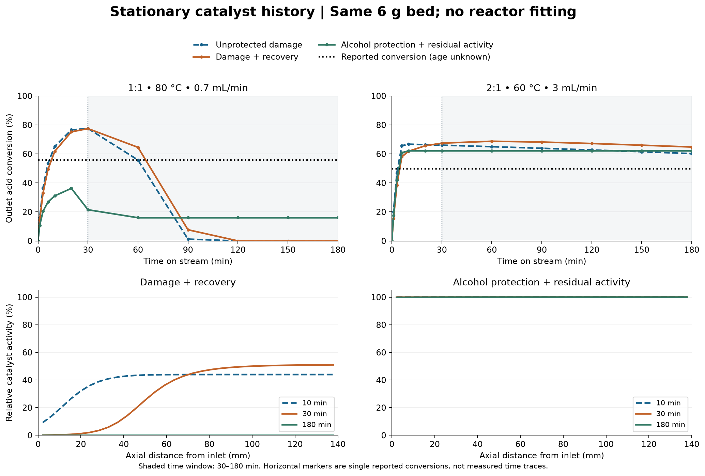
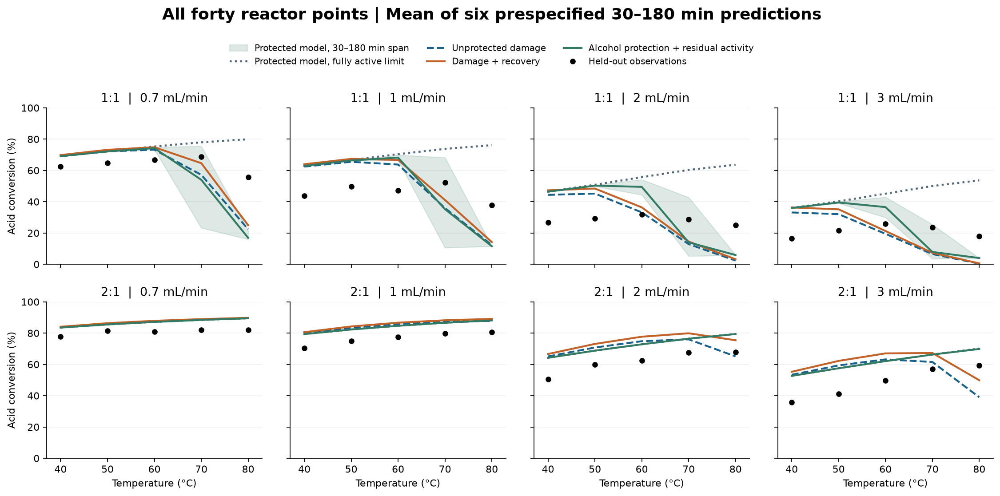

# Does spatial catalyst exposure resolve the pentyl propanoate bed prediction?

**24 November 2026 — all numerical checks passed; kinetic transfer remains unqualified.**

## Bottom line

We can now calculate where and when the reaction occurs in the packed bed
as the stationary catalyst accumulates local acid exposure. The frozen
unprotected batch laws predict a moving reaction zone and, in some hot
equimolar cases, almost complete loss of production by three hours.
Alcohol-protected laws predict stable operation for the alcohol-rich feed,
but that stability leaves the earlier excessive conversion essentially
unchanged. The catalyst-history calculation therefore explains **why a
uniform activity correction is inadequate**; it does not supply a validated
common kinetic law for both feeds.

The start of the experiment matters for the damage-sensitive cases. A small
change in instantaneous liquid-film concentration can also have an appreciable
effect on the accumulated damage. These effects cannot be assigned to the
real bed without independent information on its initial liquid/catalyst state
or a qualified exposure law. No experimental conversion was used to choose
one of these scenarios or an observation time.

## 1. Controlled conditions and evidence

This extension uses the complete 40-reactor-case holdout from the
[equimolar comparison](../pentyl_propanoate_equimolar/REPORT.md). The
[2025 reactor paper](https://doi.org/10.1021/acs.iecr.5c02780) and
[supplement](https://doi.org/10.1021/acs.iecr.5c02780.s001) describe a
16 mm bore, 140 mm bed, representative bead diameter 593 µm and a weighed
6.0 g catalyst inventory. We retain 18.02 mL interbead liquid (voidage 0.64
derived from aqueous tracers), the previous film correlation, Table B1
internal-effectiveness factors for each feed and temperature, and the
controlled axial Péclet number of 115.28. Neither the reacting-liquid
porosity, diffusivity nor independent pore-interior exposure was measured.

| Alcohol/acid feed | Acid (mol/L) | Alcohol (mol/L) | Catalyst (g) |
| --- | ---: | ---: | ---: |
| 1:1 | 5.3 | 5.3 | 6.0 |
| 2:1 | 3.3 | 6.6 | 6.0 |

Each feed is evaluated at 40, 50, 60, 70 and 80 °C and 0.7, 1, 2 and 3
mL/min. Liquid residence times are approximately 25.74, 18.02, 9.01 and
6.01 min. The catalyst, however, stays in the bed for the full operating
period. Section 2.3 describes roughly three-hour cycles, steady operation
after about 30 min, and samples beginning at 10 min and then at 30-min
intervals. The plotted conversions do not identify the age and prehistory of
each catalyst charge. We retain predictions at 30 and 180 min individually
and the arithmetic mean of **prespecified samples** at 30, 60, 90, 120, 150
and 180 min. This mean is a comparison scenario, not a measured averaging
procedure or an inferred age.

All seven catalyst-state laws use the already frozen all-batch parameters
from the [composition audit](../pentyl_propanoate_composition/REPORT.md),
fitted exclusively to the 16 assays of the
[2026 batch article](https://doi.org/10.1021/acs.iecr.6c02375). Their paired
whole-curve predictive qualification failed previously; this extension does
not refit them. The apparent equilibrium constants for 1:1 above 60 °C are
still extrapolated fully active equilibria, not measured hot-batch plateaus.
The separate published-sign replay remains historical evidence and is not
used as a time-dependent catalyst activity law.

## 2. Transient model and independent checks

Use axial coordinate `y=z/L` and liquid residence time `tau=V_liquid/Q` in
minutes. With constant volume flow and the dry, single-reaction, conserved
stoichiometric manifold, let `X` be ester equivalents per mole of initial
acid in the liquid. Then all four components follow the same extent:

```text
C_acid = C_A0 (1-X)          C_alcohol = C_B0 - C_A0 X
C_ester = C_water = C_A0 X
J = X - (1/Pe) dX/dy
dX/dt = -(1/tau) dJ/dy + r_liquid/C_A0
```

For each fixed cell, separate the catalyst exposure state from the liquid:

```text
dH(z,t)/dt = h(T, X_local(z,t))
a(z,t) = recovery(t) [f + (1-f) exp(-H(z,t))]
r_liquid = eta_I * 0.06 * C_cat_g_L * a(z,t) * q_mass(T,X_surface)
capacity * (X_surface-X_bulk) = r_liquid
```

Here `H` is dimensionless integrated damage, `h` has units min⁻¹, and
`q_mass` has units mol/(kg immobilised catalyst s). The exact preceding
`CompositionKinetics` functions define `h`, the reversible rate, `f` and
recovery. The 0.06 factor converts g to kg and seconds to minutes; `eta_I`
appears once in both the film and liquid reaction balances.
Only `X` is advected. There is no transport or reset of `H` with liquid
residence time. All catalyst remains in its assigned cell, keeping the
total weighed 6 g inventory even when the active fraction decreases.

The film root reuses `BeadFilm.surface_progress`. The cell-centered axial
flux is the same exponentially fitted one used by the earlier steady
solver. The Eq. 4 fixed-concentration inlet permits product backdiffusion
(retained explicitly); the outlet has zero concentration gradient.
The new two-stage implicit, second-order SDIRK time integration advances
local damage and liquid concentration together at the stage times. The
tridiagonal liquid solve independently satisfies each conservation
residual. No clipped accepted state is used to repair a mass balance.

For the entire time history, check the independently integrated physical
ledger in mol of ester equivalents:

```text
product in liquid(t) - initial product in liquid
  + product leaving outlet + product backdiffusing out the inlet
  - total reaction-generated product = 0
```

The tests also verify that integrated damage in every cell lies between
elapsed age times the minimum and maximum physical hazard over the same
composition range used in the previous uniform-activity endpoint screen.

### Initial-state and exposure scenarios

The exact contents of the reactor before pumping premix, and the preceding
catalyst wetting/age, are unreported. The stirred-batch protocol heats beads
in pentanol before acid addition. Directly assuming that the bed beads saw
the same history would introduce an unsupported parameter. We therefore
make these separated, predeclared conditional calculations:

| Scenario | Physical interpretation | Histories |
| --- | --- | ---: |
| Fresh premixed-fill, bulk exposure | Entire interbead liquid initially on unreacted feed composition; zero prior H; original batch recovery | 280 |
| Fresh fill, surface exposure | Same, hazard evaluated at the film surface instead of bulk composition; three representative damage laws | 120 |
| Fully recovered start | Remove only the initial recovery deficit for the two laws with a nonzero fitted deficit; no inferred prior damage | 80 |
| Equilibrium-product prefill | Entire initial liquid at the fully active equilibrium composition but zero prior H; deliberately generous mathematical initial product inventory, not an actual documented prefill | 80 |

The prefill sensitivity keeps its initial product inventory in the mass
ledger. It does not use the initial outflow as evidence of catalyst
productivity. The two starting-liquid scenarios lie on the same dry-feed
stoichiometric manifold; an alcohol-only/water-containing initial fill
would need additional independent species transport and conditioning
information. No measured catalyst condition is presumed from these
scenarios.

The numerical problem is stiff, especially in the hottest equimolar
cases. Before opening the new comparison ledger, a pilot changed a
sampled outlet conversion by 0.2112 percentage points between 256 and
512 cells for the hot, slow equilibrium-prefill case. We allowed mesh
refinement beyond 512 and smaller initial time steps; accuracy thresholds
were not relaxed. Each final result repeats a time halving at a matched
fine mesh and a mesh doubling at a matched fine time-step schedule. All
condition histories were completed. The direct tests additionally compare
an independent analytic constant-hazard history, reversible closed-liquid
progress integrated over analytically known activity, high-Pe liquid
startup, and the old steady solver for the same discrete axial equations.
Finite-difference derivatives of the coupled film balance, zero reaction
and nonzero initial product inventory are checked separately.

## 3. What the calculated exposure does to the catalyst

A fresh equimolar feed is particularly acidic. If the batch-fitted damage
law transfers directly, the inlet beads age rapidly. Further downstream,
acid already reacted upstream lowers the local exposure, so those beads
retain activity longer. Eventually the upstream catalyst stops protecting
the downstream catalyst from fresh acid. A reaction zone moves toward
the outlet.

For the **1:1, 80 °C, 0.7 mL/min** damage-plus-recovery (`acid_both`) case:

| Time on stream | Outlet conversion | Mean activity, inlet quarter | Mean activity, outlet quarter |
| ---: | ---: | ---: | ---: |
| 10 min | 61.71% | 27.18% | 43.95% |
| 30 min | 77.43% | 1.72% | 50.74% |
| 60 min | 64.52% | approximately 0% | 44.80% |
| 180 min | approximately 0% | approximately 0% | approximately 0% |

Activity is a relative rate state, not lost catalyst mass. At 10 min the
reaction-rate-weighted center of net ester production is at about 41% of
the bed length. It has reached 78% at 60 min and 94% at 90 min; by
150 min new production is negligible (<1e-6 of the fresh acid feed on a
molar basis), so a reaction location is no longer meaningful. The source
reports 55.7% conversion at this operating condition, **not** a measured
time course of this moving front. The apparent agreement at an intermediate
conversion must not be treated as predicting the observed point, because
the corresponding experimental catalyst age is unknown. The prespecified
sample mean is only 24.94%.

For comparison, with the frozen protected residual-activity law at
**2:1, 60 °C, 3 mL/min**, almost no loss develops anywhere in the bed.
Mean activity changes from 99.996% at 30 min to 99.976% at 180 min, and
outlet conversion changes from 62.079% to 62.074%. The measured conversion
is 49.7%. The very stable trajectory is not an improvement of the 2:1
kinetic prediction.



## 4. Whole-reactor comparisons, without fitting

The complete 40-condition comparison is shown below. RMSE values are in
**percentage points of acid conversion**, not relative error. The
fully-active limit is the previously frozen steady prediction for the same
law. The dynamic columns use the 30–180 min six-sample scenario mean.

| Frozen law (fresh filled; local bulk hazard) | 1:1 fully active | 1:1 dynamic | 2:1 fully active | 2:1 dynamic |
| --- | ---: | ---: | ---: | ---: |
| Unprotected damage | 26.43 | 16.65 | 12.62 | 10.89 |
| Recovery-only candidate (fitted zero deficit) | 13.51 | 13.51 | 7.35 | 7.34 |
| Unprotected damage + recovery | 30.18 | 16.74 | 15.10 | 11.90 |
| Alcohol-protected damage | 23.77 | 18.98 | 10.07 | 10.04 |
| Protected damage + recovery | 26.10 | 19.11 | 11.73 | 11.26 |
| Unprotected damage + residual activity | 26.55 | 15.94 | 12.81 | 11.09 |
| Protected damage + residual activity | 23.37 | 18.61 | 9.94 | 9.91 |

The different time-on-stream choices change the answer strongly for the
damage laws. For example, unprotected damage plus recovery has a 1:1 RMSE
of 18.68 points at 30 min and 25.98 at 180 min, versus 16.74 for the
prespecified mean. The protected residual law gives 1:1 RMSE 18.18, 22.82
and 18.61 points, respectively. These are all predictive comparisons at
fixed settings, not selectable fitted ages. The zero-deficit activation
candidate is effectively static, so its somewhat lower errors are not
evidence that spatial catalyst aging solves the problem; it previously
failed the batch predictive qualification as well.

At 3 mL/min, the protected residual-activity law illustrates the unresolved
moderate- and high-temperature discrepancy:

| Feed | Temperature | Measured X | Predicted X at 30 min | Predicted X at 180 min |
| --- | ---: | ---: | ---: | ---: |
| 1:1 | 40 °C | 16.4% | 36.02% | 35.94% |
| 1:1 | 60 °C | 26.0% | 42.94% | 29.95% |
| 1:1 | 80 °C | 18.0% | 3.99% | 3.99% |
| 2:1 | 40 °C | 35.7% | 52.65% | 52.65% |
| 2:1 | 60 °C | 49.7% | 62.08% | 62.07% |
| 2:1 | 80 °C | 59.4% | 70.04% | 69.69% |

At lower temperature, the input per-mass reaction rate/contact remains
too high; the predicted catalyst is essentially active. At high temperature
with an equimolar feed, the assumed damage instead becomes too severe,
leaving the fitted 4.375% stable fraction. Consequently a uniform catalyst
derating cannot correct the opposing errors. The source's measured
relative stability of continuous versus stirred operation remains a
separate indication that the batch damage history may not directly transfer.
Neither the 2025 algebraic denaturation-sign scenario nor these clock laws
establish an independently measured damage mechanism.



### Consistency with the reported 2:1 stable operation

The earlier digitization of Supporting Figure S2 gives seven propionate
points at 10, 30, 60, 90, 120, 150 and 180 min for the 2:1 feed; its
temperature and flow remain unspecified. The observed span over 30–180
min is 1.215 points; a reading-only allowance of 0.243 points per endpoint
expands that span to 1.701 points. This allowance is **not** experimental
uncertainty, and cannot identify a matching operating condition.

Compare the simulated span over those same six ages across the complete
2:1 condition grid:

| Frozen law | Maximum simulated 2:1 span (pp) | Cases within 1.701 pp (of 20) |
| --- | ---: | ---: |
| Unprotected damage | 67.47 | 12 |
| Unprotected damage + recovery | 61.49 | 10 |
| Alcohol-protected damage | 0.20 | 20 |
| Protected damage + recovery | 2.68 | 10 |
| Unprotected damage + residual activity | 66.57 | 12 |
| Protected damage + residual activity | 0.36 | 20 |
| Static (zero deficit) | 0.021 | 20 |

The generic trace alone cannot rule out a law because its specific
conditions are unknown. Nevertheless, the unprotected laws allow large
time-dependent loss at some 2:1 conditions, consistent with their prior
failure of hot 2:1 batch holdouts and at odds with assuming generally
stable alcohol-rich operation. Alcohol protection avoids that problem but
does not close the conversion gap. No age was fitted to this trace.

## 5. Can initial conditioning or the film exposure basis explain it?

In a damage-sensitive system the conversion can change the subsequent
damage rate, creating feedback: more rapid initial ester formation can
reduce acid exposure and delay loss of activity. Hence an apparently small
instantaneous film resistance in a steady calculation does not guarantee
a negligible cumulative effect on this history.

Changing hazard evaluation from bulk to the local bead surface altered
the equimolar **180-minute** conversion by up to 10.05 points for
unprotected damage, and the six-sample mean by up to 3.88 points. As a
sensitivity of the protected residual law it altered the 1:1 sample mean
by at most 2.36 points; for 2:1 its maximum mean change was only 0.054
points (0.093 points at 180 min). Across the three surface-hazard laws,
the corresponding 1:1 mean RMSEs were 16.20, 18.62 and 18.46 rather than
16.65, 18.98 and 18.61. This is evidence of sensitivity to the assumed
damage law in the acid-rich feed, not identification of a pore-scale
deactivation mechanism. The modeled ordinary liquid film still cannot
explain the protected 2:1 rate overprediction.

Starting with the two recovery models fully recovered changes the 1:1
sample mean by up to 9.73 points (unprotected) or 4.65 points (protected),
but the 2:1 mean RMSE remains 12.40 or 11.71. The generous equilibrium
product-prefill hypothesis changes the 1:1 sample mean by up to 17.21
points (unprotected damage + recovery) or 9.17 points (protected residual).
These scenarios can delay the calculated collapse and demonstrate that
unreported startup details are relevant, but not supply a defensible
measured initial state. Even this optimistic initial liquid inventory
gives 1:1/2:1 mean RMSE 14.54/12.01 or 16.84/9.91 points, respectively.
None is adopted. There are no new fitted coefficients or separately fitted
reactor conditions.

## 6. Numerical verification and evidence retained

All 560 histories (6,720 time snapshots) passed the numerical limits.
The refined meshes had 128, 256, 512 and 1,024 cells for respectively
141, 290, 123 and 6 cases. The refined **maximum** step after 30 min was
1 min in 510 cases, 0.5 min in 43, and 0.25 min in 7, with smaller matched
startup caps. Including the numerical refinement comparisons, 2,847
separate transient solves were run. The final histories total 145,538
accepted time steps and 240 rejected trials successfully resolved by
halving. No unresolved numerical case was skipped. The four-vector
dimensional balance was independently recomputed in Python from saved
Julia fields and fluxes.

| Check | Largest observed difference/error | Acceptance limit |
| --- | ---: | ---: |
| Grid doubling, sampled outlet from 10 min (percentage points) | 0.09970 | 0.10 |
| Time halving, sampled outlet from 10 min (percentage points) | 0.09768 | 0.10 |
| Grid / time early startup outlet (percentage points) | 0.222 / 0.292 | 0.30 |
| Mean activity difference, grid / time (fraction) | 0.002614 / 0.000457 | 0.003 |
| Matched axial profile activity L1, grid / time (fraction) | 0.002614 / 0.000541 | 0.005 |
| Cumulative species quantities per fed mole, grid / time | 0.001995 / 0.001954 | 0.002 |
| Stage residual fraction | 5.00e-12 | 1e-10 |
| Normalized cumulative product balance | 1.11e-11 | 1e-9 |
| Film root residual (mol/L/min) | 9.71e-13 | 1e-10 |
| Sampled whole-bracket positive source slope / film capacity | 0.01488 | 0.99 |

All 40 clock-free 180-minute predictions return to within 0.01683
percentage points of the previously checked steady result. All 560
primary 30/180-min cell-activity intervals are consistent with the
earlier hypothetical uniform activity limits; actual transient outlet
conversion can fall outside the corresponding *steady* outlet interval
by up to 0.775 points because of liquid inventory changes and residence
time. This is why the previous uniform steady envelope must not be
interpreted as an exact time-dependent conversion bound.

All 104 direct Julia assertions passed. Five new Python integration and
provenance tests and seven previous composition/equimolar tests passed.
A cold independent process repeated the full refinement sequence for 36
prespecified cases: every model/scenario at 80 °C, 3 mL/min for both feeds,
plus the two representative primary laws at 60 °C, 3 mL/min and at 80 °C,
0.7 mL/min for both feeds. All numerical arrays, step counts, discretization
decisions and numerical scalar diagnostics were **exactly identical**.
The [replay record](reference/replay.json) documents the repeat; this is
a representative cold replay, not an assertion that all 560 histories
were each repeated in a new runtime.

A separate [compact result record](reference/summary.json) preserves every
model/scenario score, numerical settings and source/partition/output hashes.
The [local history ledger](reference/history.csv), [pointwise holdout comparison](reference/bed_comparison.csv),
[per-case refinement](reference/numerics.csv) and
[reaction-location ledger](reference/reaction_zone.csv) retain the time
history evidence; raw fine-grid fields stay in ignored results. No new
OpenLB code, external packages, equipment data or DWSIM inputs were needed.
Numerical verification is not validation of the batch-to-bed rate law.

## 7. Next executable step

The next scientific separation should concern **moderate-temperature
mass-specific catalyst utilization**, independent of high-temperature
deactivation. At 40 °C and 3 mL/min every tested fresh bulk law predicts
too much conversion for both feeds, even though several predict almost
no activity loss. Repeating a more elaborate erosion or age law cannot
solve that without independently constraining the effective rate per
weighed gram under dense packed-bed contact. Conversely, reducing that
rate everywhere would worsen the hot equimolar result.

Search for independently published continuous experiments that vary
catalyst inventory/bed length at fixed bead preparation, feed composition,
temperature and loading/flow basis, ideally with matched batch data. Also
seek quantitative retained-activity versus exposure time for Lipozyme 435
in propanoic acid/primary alcohol mixtures, including alcohol conditioning.
These would constrain the two remaining terms independently of the 40
reactor measurements. Other-ester/inhibition analogues must remain labelled
as analogues; do not fit a bed utilization coefficient or catalyst age to
this dataset and declare prediction. If no sufficiently documented evidence
exists for this exact system, identify an alternative well-characterized
continuous immobilised enzyme benchmark rather than make unreported raw
data or new lab measurements prerequisites.

Only after a separately supported reaction/transport model is qualified
should it be promoted to a reacting OpenLB-to-Julia-to-DWSIM process
demonstration. The preceding hydraulic benchmark and pore/mixing work
remain unchanged.
