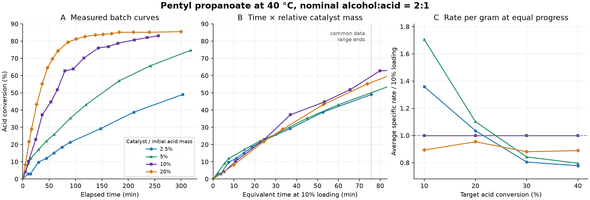
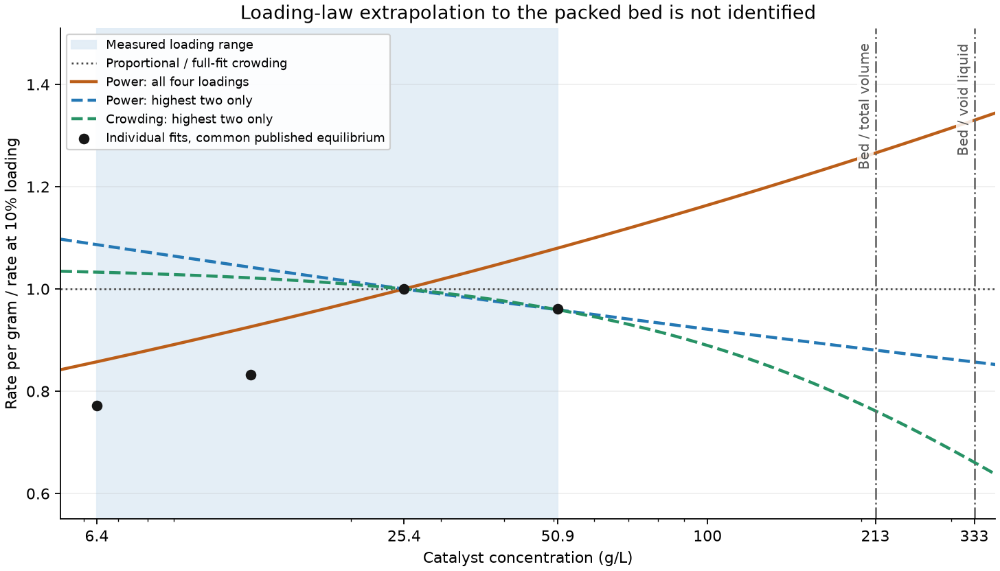

# Is the pentyl propanoate reaction rate proportional to catalyst mass?

**Bottom line.** The four 40 °C stirred-batch experiments do not
collapse exactly when corrected for catalyst mass. The departures
change with conversion. A shared power law improves held-out
whole-batch predictions, but the fitted trend across all four
loadings is mildly **superproportional**, not the loss of activity
per gram needed in the packed bed. The two highest loadings alone
show diminishing returns. Their high-concentration extrapolations
give very different reactor predictions: one crowding sensitivity
reduces the previous film-model RMSE from 9.58 to 3.79 percentage
points without using reactor measurements to derive its factor.
This is a plausible route to explaining the gap, but is **not a
validated concentration law**. We lack measurements in the
packed-bed catalyst-concentration range.

## 1. What is measured?

Lorenzo and Ortega (2026) vary the catalyst mass at the same
temperature, nominal 2:1 alcohol-to-acid ratio and 40 mL charge.
Their Section 4.1 acknowledges departures from exact linear
initial-rate scaling at 2:1, and uses a simplified correlation.
Our independent check uses the 53 positive-time measurements
from SI Table S2, including all available points from each
loading. [Article](https://doi.org/10.1021/acs.iecr.6c02375)
· [Source data and extraction checks](../../../literature/sources/lorenzo2026/README.md)

| Catalyst mass relative to acid | Nominal catalyst mass (g) | Catalyst per nominal liquid volume (g/L) |
| --- | ---: | ---: |
| 2.5% | 0.254 | 6.36 |
| 5% | 0.509 | 12.72 |
| 10% | 1.018 | 25.44 |
| 20% | 2.035 | 50.89 |

The actual catalyst inventory per interbead void liquid in the
2025 reactor is about **333 g/L** (213 g/L per total cartridge
volume). Thus even the highest measured batch concentration is
only about 15% of the bed's nominal liquid-basis concentration.
The batch catalyst mass is based on the nominal charge and
pure-acid density. The packed-bed concentration uses the
water-tracer-derived porosity; neither quantity establishes an
equivalent local environment between a dispersed slurry and a
packed bed.

## 2. Compare times at the same reaction progress, without fitting kinetics

If reaction rate were directly proportional to catalyst mass,
doubling the loading should halve the time taken to reach the
same conversion. All measurements should also follow one common
curve when time is multiplied by loading.

| Acid conversion | Time at 2.5% (min) | At 5% (min) | At 10% (min) | At 20% (min) | Speedup 10% → 20% |
| --- | ---: | ---: | ---: | ---: | ---: |
| 10% | 31.25 | 12.45 | 10.62 | 5.95 | 1.79× |
| 20% | 82.60 | 38.80 | 21.37 | 11.21 | 1.91× |
| 30% | 152.67 | 72.95 | 30.71 | 17.45 | 1.76× |
| 40% | 221.47 | 108.22 | 43.05 | 24.23 | 1.78× |

The values are linear interpolations of the printed measurements.
The complete [crossing table](reference/matched_conversion.csv)
retains the bracketing times, conversion-reading sensitivity,
and alternative composition-derived responses.
Doubling 10% to 20% gives slightly less than the ideal
twofold speedup: the average activity per gram up to these
conversions is 88–95% of the 10% case. However, at 40%
conversion the 2.5% and 5% runs are also slower per gram:
78% and 80% of the 10% run, respectively. At 10% conversion,
they are instead faster per gram. Thus there is no constant
rate ordering across reaction progress.

The descriptive mass exponent from the four times rises
from 0.74 at 10% conversion to 1.09 at 40%. This direction
change persists when using the separately re-derived
acid or ester conversion; it is not merely a choice of
printed conversion column. A shape-free leave-one-loading-out
test, using only the 27 of 53 positive-time points within
all training curves' common support, gives 2.96 points RMSE
for proportional time scaling and 3.87 points for a
training-derived power exponent. A single universal scaling
of the clock is not well determined by those common-progress
data.

The initial compositions differ slightly from exactly 2:1.
The paper reports duplicate experiments without providing the
individual traces, and reused catalyst in multiple reactions
without identifying an assay-specific exposure history.
Sampling 0.1 mL aliquots, if only liquid were removed and all
beads retained, increases the cumulative proportional
exposure by 1.7–3.0% for the four runs. The differences in
these estimates are small relative to the observed changes
in the rate order. The analysis describes apparent batch
activity, not isolated intrinsic enzyme kinetics.

## 3. Does a concentration-dependent kinetic model predict withheld loadings?

Use the previously tested reversible kinetic law and allow
only one additional loading parameter. For the power law,
at a fixed reaction state the total rate scales as
catalyst mass to exponent alpha. For the crowding law,
the specific rate decreases with higher concentration and
the total rate approaches a plateau. Both include the
proportional law as a special case. Every fold fits the
common apparent equilibrium using only the other three
loadings, including the folds that exclude the 10%
source of the published equilibrium constant.

| Withheld loading | Proportional RMSE (pp) | Power-law RMSE (pp) | Crowding RMSE (pp) |
| --- | ---: | ---: | ---: |
| 2.5% | 3.49 | 1.50 | 3.49 |
| 5% | 3.13 | 2.25 | 3.13 |
| 10% | 3.56 | 3.21 | 3.56 |
| 20% | 3.88 | 3.89 | 3.88 |
| Equal-loading aggregate | **3.53** | **2.86** | **3.53** |

The full-data power exponent is **1.111**. It implies about
8% greater specific activity when doubling concentration
and improves the equal-loading held-out RMSE by 19%,
passing the practical whole-loading prediction screen. Weighting
each curve equally, using the printed initial reactant ratio,
or substituting the acid/ester composition response gives
exponents of 1.109–1.146. The improvement is 18.6–29.8% across
the five tests. In every all-four fit and strict held-out
crowding fit the optimum is its proportional boundary (zero
crowding). The kinetic-model results support a modest loading
effect across the measured ranges; they do not provide evidence
for a uniformly decreasing rate per gram across those four
loadings. The shape-free common-progress check above cautions
against interpreting the fitted exponent as an intrinsic law.

## 4. What if loss of activity begins at the highest loading?

The two highest loadings are closest to bed operation, so fit
only the 10% and 20% curves and predict the two lower curves.
The high-pair power and crowding fits give the same in-sample
RMSE (2.2031 points); their estimated apparent specific rate
at 20% is about 95.9% of that at 10%. The power exponent is
0.940, while the normalized crowding parameter is 0.0424.
These are two different functional extrapolations of the
same observed concentration contrast; neither is independently
identified by the two high loadings.

| Fit to highest two loadings only | RMSE on the two lower loadings (pp) |
| --- | ---: |
| Proportional | 4.15 |
| Power | 5.70 |
| Crowding | 5.01 |

The two concentration-sensitive extrapolations degrade the
omitted lower-loading predictions. A distinct high-solids
regime remains possible, but the data cannot establish its
transition or shape.

If the small drop between the two highest batch concentrations
continued as a power law all the way to 333 g/L, the relative
rate per gram would be 0.857. If it continued as the saturating
crowding law, it would instead be **0.661**. Both fits describe
the high pair equally well. The latter rate loss is comparable
in scale to the previous 0.64 exposure-convention comparison,
but neither factor is a validated property of the bed.

## 5. Does it affect the packed-bed prediction?

Propagate the full-fit and high-pair diagnostic ratios separately,
keeping the actual catalyst mass at **6.0 g**. The 40 °C loading
trend is held fixed across 50–80 °C as a scenario, since other
setpoints have measurements at just the 10% loading. The table
shows the previous 2025 central liquid-film reconstruction
and, for comparison, a 2026 10%-anchored batch model with
the previous measured-water axial mixing scenario. All
predictions are saved before scoring the twenty reactor
measurements.

| Loading-law sensitivity, on void-liquid concentration basis | Rate per gram / 10% value | 60 °C, 3 mL/min conversion (film model) | Film-model RMSE (pp) | Batch-model RMSE (pp) |
| --- | ---: | ---: | ---: | ---: |
| Proportional / all-loading crowding | 1.000 | 59.00% | 9.58 | 12.27 |
| All-loading power | 1.330 | 67.33% | 14.97 | 16.34 |
| Highest-pair power (diagnostic) | 0.857 | 54.42% | 6.60 | 9.87 |
| Highest-pair crowding (diagnostic) | 0.661 | 46.82% | 3.79 | 6.21 |
| Measured | | 49.70% | | |

Using mass per total bed volume as the crowding proxy instead
of mass per void-liquid volume gives 0.762 relative rate and
4.62 points RMSE for the high-pair film model. The full set of
predictions and all scores are saved in
[bed_comparison.csv](reference/bed_comparison.csv).

The batch-supported all-loading trend worsens the bed
overprediction. If high-concentration crowding really produces
the alternative 0.661-scale loss, its magnitude **is sufficient
to explain much of the gap**. This is a useful hypothesis.
But the reactor's better score cannot establish the functional
form: both extrapolations use only 25–51 g/L high-pair evidence,
the saturation model fails the all-loading qualification, the
low-loading prediction degrades, and the packed bed may behave
differently from the slurry. Do not pick crowding because it
matches the bed better. The true mass-specific rate in the
packed inventory remains unmeasured.

## Next executable step

Seek independently published high-solids loading series for
Lipozyme 435 in solvent-free primary-alcohol/carboxylic-acid
esterification, prioritizing the same pentanol/propanoic chemistry
and concentrations beyond 50 g/L. Ideally there are at least
three distinct high concentrations, initial or matched-conversion
rate information, and specified catalyst history and measured
liquid inventory. Those data could distinguish a gradual power
law from saturation. If only different chemistry is available,
test transfer as an analogue, with separate source-specific
kinetics. Alternatively investigate a physically supported
packing/contact-dependent transport change instead of adding
another empirical rate correction. Keep the 20 reactor
measurements exclusively for prediction scoring and do not
promote an intermediate fit to a process-model validation.
