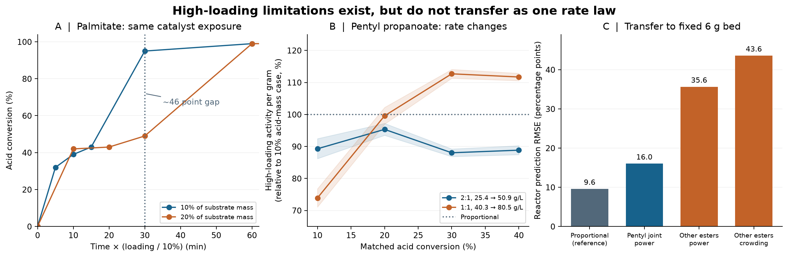

# Does published high-loading evidence explain the packed-bed rate deficit?

**Bottom line.** Several other solvent-free esterifications with Novozym
435 really do become less productive per gram of catalyst at high solids
loading, even when compared before equilibrium. The generalisation to
pentyl propanoate fails. Its newly extracted 1:1 experiments reach
80.53 g/L and show diminishing returns early in the reaction but faster
than proportional progress later. Neither a shared power law nor a
monotone crowding law passes our loading holdouts. Transferring the
strong suppression seen in the other esters grossly underpredicts the
continuous reactor. The six gram inventory and previous reference
remain unchanged; no new loading correction is qualified.



## 1. Independent published evidence

Use the supplied full-text Richetti and Paroul articles and the other primary
sources. Keep their load definitions and figure-reading limits with the
individual [source records](../../../literature/README.md).

| Study | Conditions and dosage | Data used |
| --- | --- | --- |
| [Richetti 2010](../../../literature/sources/richetti2010/README.md) | 2-ethylhexyl palmitate, acid:alcohol 1:6, 70 °C, 150 rpm, 1–20 wt% total substrates | Figure 4 through 60 min, caption rates |
| [Paroul 2010](../../../literature/sources/paroul2010/README.md) | Geranyl propionate, 3:1 alcohol:acid, 50 °C, 150 rpm, 1–10 wt% total substrates, water scavenger | Figure 4; nominally identical conditions in Figures 3 and 5 as sensitivity |
| [Sbardelotto 2018](../../../literature/sources/sbardelotto2018/README.md) | Geranyl butanoate, 5:1, 70 °C, 150 rpm, 5–15 wt% total substrates, water scavenger | Figure 3 A2; zero-catalyst control retained |
| [Kuperkar 2014](../../../literature/sources/kuperkar2014/README.md) | Isobutyl propionate, 1:1, 40 °C, 200 rpm, 2.5–10 wt% with unclear denominator | Figure 2A; within-study relative loading only |
| [Meneses 2019](../../../literature/sources/meneses2019/README.md) | Benzyl propionate fed-batch, 1:1 final molar feed, 50 °C, 150 rpm, 5–15% total fed substrates | Acid added over five hours; no common post-feed progress with all loads. Excluded from fixed-charge law |

The published percentages are masses of immobilised preparation, not
pure enzyme mass. Unknown liquid volumes/densities remain unknown;
the basis in the harmonised comparison is grams catalyst per 100 g
of starting liquid reactants. No fitted aggregate size, rheology
or intrinsic decrease in enzyme activity is claimed by the plot.

### Compare at the same conversion

At fixed chemistry and equal starting inventories, the inverse time
to a specified conversion is a measure of cumulative reaction speed.
If the catalyst doubles, a proportional rate should halve this time.
Relative cumulative mass-specific activity at target conversion X is

```
f(w, X) = (w_anchor * t_anchor(X)) / (w * t_w(X))
```

No reversible kinetic form is needed for this comparison. The values
below interpolate first crossings between adjacent plotted markers.
External targets lie after the first positive-time observation and
before the late plateau. The interpolation does not determine an
instantaneous rate or the number of available active sites. The
[crossing ledger](reference/matched_progress.csv) preserves the
bracketing times, marker-reading sensitivities and (where reported)
an additional scenario perturbation of approximately 5 conversion
points. These are not statistical confidence intervals.

| Study | Anchor → highest dosage | Matched conversions (%) | Relative activity per gram at those conversions |
| --- | ---: | ---: | ---: |
| Richetti | 10 → 20 | 55, 60, 70 | 0.549, 0.544, 0.535 |
| Paroul Fig. 4 | 5.5 → 10 | 60, 70, 80 | 0.863, 1.014, 1.163 |
| Sbardelotto | 10 → 15 | 70, 75, 80 | 0.695, 0.691, 0.688 |
| Kuperkar | 5 → 10 | 20, 35, 50 | 1.349, 1.350, 0.929 |

Richetti's direct markers are even more instructive: 10% at 30 min
and 20% at 15 min have exactly the same catalyst-mass × time.
The former reached about 95%, the latter just 49%. Even independently
shifting the readings by the digitization margins plus the reported
approximate overall deviations leaves a 30-point gap. In Sbardelotto,
15% at the printed 0.17 h has slightly more mass exposure than 10%
at 0.25 h but only about 65% versus 91% conversion. The corresponding
conservative gap is 11 points. The paper has inconsistent early time
labels; these calculations explicitly use the figure's labels.
Neither comparison requires extrapolation from the final yield.

Richetti's printed rates at 10 and 20% (3.19 and 3.37 in the
paper's units) are consistent in direction: only 5.6% more total
rate, or 53% relative mass-specific rate. However, these data do
not establish the proposed particle aggregation mechanism directly.

The Paroul paper gives a critical countercheck. At nominally identical
conditions (10%, 3:1, 50 °C, 150 rpm), the 30 min conversion is
about 99% in Figure 4, 74% in Figure 3, and 62% in Figure 5.
The printed initial rates for the Figure 4 and Figure 3 runs differ
by about twofold (2.95 versus 1.48). Replacing only the high-loading
series by Figure 3 or 5 changes the 60–80% relative activities to
0.65–0.77 or 0.52–0.55, respectively. Keep these cases distinct;
the reason for the disagreement is not reported. Likewise Kuperkar
changes the late conversion with loading, which cannot be represented
by a change in elapsed reaction time alone.

## 2. Can one loading law predict a different esterification?

Fit the existing forms to the matched-conversion times with independent
time scales for every chemistry and conversion target:

```
u = catalyst mass per nominal substrate mass / 0.10
total rate factor = u                          (proportional)
                  = u^alpha                    (power)
                  = u / (1 + s*(u - 1))        (crowding)
```

Fit only the two alternative shape parameters (one at a time),
allowing a different intercept for each reaction/progress level.
The fit minimizes log-time deviations with equal total weight per
study. Hold out one entire loading in each study for local screening
and one entire publication for cross-chemistry screening. For
cross-chemistry predictions, use the withheld paper's one designated
anchor loading to establish the time scale, not the other loadings.
The three studies with a verified denominator (Richetti, Paroul,
Sbardelotto) form the external pool; Kuperkar is not used in it.

| Model | Full external fit | External leave-paper-out log-time RMSE | Multiplicative time-error factor |
| --- | ---: | ---: | ---: |
| Proportional | — | 0.815 | 2.26 |
| Power | alpha = 0.293 | 0.300 | 1.35 |
| Crowding | s = 0.875 | 0.280 | 1.32 |

The multiplicative factor is exp(RMSE of log predicted/observed
times), not a confidence interval. Both alternatives improve
cross-paper prediction over proportional scaling on this specific
pool. Thus the slowing seen in those other esterifications cannot
simply be dismissed as equilibrium. Now use their shapes *unchanged*
on the two pentyl propanoate ratios, with only the target series'
10%-acid-mass curve fixing its scale:

| Model | 2:1 pentyl time-error factor | 1:1 pentyl time-error factor |
| --- | ---: | ---: |
| Proportional | 1.26 | 1.28 |
| External power | 2.03 | 1.86 |
| External crowding | 1.77 | 1.79 |

Both alternatives fail because they worsen predictions of both
pentyl ratios. The outcome persists when moving all external
marker readings in favor of or against a suppression trend and
when substituting either alternate Paroul series.
Full within-study and whole-paper holdouts are saved in
[scores](reference/external_fold_scores.csv) and
[predictions](reference/external_progress_predictions.csv).

## 3. Add the high-loading experiments for pentyl propanoate itself

The same [2026 paper](../../../literature/sources/lorenzo2026/README.md)
provides 54 previously unused rows in assays 5–8 (including starts).
They use 1:1 alcohol:acid, 40 °C, 40 mL nominal charge. Together with
the 2:1 series there are eight independent loading conditions,
111 rows including starts (103 positive-time observations).

| Catalyst loading (relative to acid mass) | 2:1 nominal g/L | 1:1 nominal g/L |
| ---: | ---: | ---: |
| 2.5% | 6.36 | 10.07 |
| 5% | 12.72 | 20.13 |
| 10% | 25.44 | 40.26 |
| 20% | 50.89 | 80.53 |

The 1:1 loading now reaches 24% of the packed-bed nominal
333 g/L per interbead liquid volume, rather than 15%.
The new same-chemistry matched times for doubling the two
highest doses (40.26 → 80.53 g/L) are:

| Target conversion (%) | 40.26 g/L time (min) | 80.53 g/L time (min) | Relative activity per gram |
| ---: | ---: | ---: | ---: |
| 10 | 9.54 | 6.45 | 0.739 |
| 20 | 24.51 | 12.31 | 0.996 |
| 30 | 39.30 | 17.44 | 1.127 |
| 40 | 51.75 | 23.16 | 1.117 |

At early progress the higher dose appears about 26% less productive
per gram; later it appears about 12% more productive. A fixed
mass multiplier cannot give both outcomes. The 2:1 high pair
instead gives cumulative relative activity 0.88–0.95 over the
same progress range. Some table rows have printed
compositions inconsistent with printed conversion; the 1:1
maximum acid- and ester-based differences are 2.63 and 4.74
conversion points, and the maximum mole-fraction sum discrepancy
is 0.048. Retain every printed value, and compare independently
re-derived responses rather than silently repairing it.

### Fit an apparent reversible law, then withhold whole loading curves

Reuse the existing Julia mass-specific reversible batch law:

```
dX/dt = (m_cat/n_acid,0) * k_feed * f(C/C_ref)
        * ((1-X)*(R-X) - X^2/Kx_feed) / (1+R)^2
C_ref = 25.4428025 g/L (2:1 and 10% acid-mass loading)
```

Fit separate rate and apparent equilibrium parameters for the two
feed compositions, but share a concentration-law shape; C is
nominal g/L, and R is the initial alcohol:acid mole ratio. Hold
out each entire loading and, separately, transfer shape between
ratios while learning only the target 10% anchor. Equal total
weight per curve is primary, with point-weight, initial-ratio,
conversion-reconstruction and training-only published Kx
sensitivities. The published Kx is from the same batch data,
so this last sensitivity is used only if its originating
10% run is in training.

| Whole-loading held-out RMSE (conversion points) | Proportional | Power | Crowding |
| --- | ---: | ---: | ---: |
| 2:1 only | 3.62 | 2.79 | 3.62 |
| 1:1 only | 5.44 | 5.53 | 5.44 |
| Joint eight-loading comparison | 4.62 | 4.21 | 4.62 |
| Highest loading (1:1 at 80.53 g/L) | 7.01 | 7.24 | 7.01 |

The joint full-fit power exponent is **1.134**, implying
increasing rather than decreasing activity per gram; the best
monotone crowding shape is its exactly proportional boundary.
Power misses the conservative joint screen (only 9% average
improvement, some worsening of loading folds, no improvement
at the highest withheld loading). The highest-load omission
also leaves the unrestricted 1:1 equilibrium fit essentially
unidentified: the mathematical optimum approaches the
near-irreversible limit, not the experimental equilibrium.
Expand the numerical limit to Kx = 1e6 and 1e9 and check the
selected predictions converge; this is not a measured Kx.
Fixing the reported Kx from the included 10% runs improves
the highest-omitted power prediction (5.06 vs 6.19 points),
but the exponent still exceeds 1 and the improvement is not
robust to the other sensitivities. Neither candidate qualifies.

## 4. What does transfer do to the reactor?

The actual cartridge still contains 6 g of catalyst and has
333.05 g/L per interbead void liquid (213.15 g/L per total bed
volume). With the nominal 2:1 starting-liquid density, 333 g/L
is roughly 38.9 g catalyst per 100 g liquid, whereas the
2:1 10%-acid reference is 2.97 g per 100 g. This mass-ratio
proxy is not a measured stirred-slurry volume fraction.

Apply the independently determined shape ONLY to the mass-specific
reaction term, inside the existing film balance. Keep the full
catalyst mass, bed volume, porosity, independently sourced film
correlation, internal effectiveness and mixing assumptions
unchanged. The temperature-dependent batch kinetics retain the 2:1
10% anchor for each temperature. Distinct batch and published
kinetic/film branches are retained in the machine-readable results.
All new factors and predictions are frozen before comparing the
20 continuous-reactor observations; no parameter is selected by
the reactor scores.

| Film-model scenario | Rate per gram at bed / 2:1 reference | RMSE over 20 reactor conditions (pp) | Conversion at 60 °C, 3 mL/min |
| --- | ---: | ---: | ---: |
| Previous proportional reference | 1.000 | 9.58 | 59.0% |
| Joint pentyl crowding | 1.000 | 9.58 | 59.0% |
| Joint pentyl power | 1.412 | 16.02 | 69.0% |
| External power, mass-ratio proxy | 0.162 | 35.65 | 16.3% |
| External crowding, mass-ratio proxy | 0.109 | 43.58 | 11.5% |
| Experiment | — | — | 49.7% |

These last three transfers are **diagnostic extrapolations**, not
qualified predictions. The external data imply far too much
slowing if blindly applied to this bed. The joint fitted pentyl
power law makes the original overprediction worse. This does not
rule out a bed-specific loss of effectiveness; it rules out
these particular transferable scalar loading laws as a supported
solution. The earlier two-high-loading crowding diagnostic with
3.79-point error remains an unqualified sensitivity, not a
validated rate law.

## 5. Engineering decision and next step

Do not replace the rate model with an empirical catalyst mass
correction. Stronger evidence is that the apparent rate per gram
depends on reaction state and/or catalyst–liquid contact history,
not just solids concentration. Neither the externally observed
loss nor these data isolate aggregation, internal diffusion,
wetting, acid inhibition or conditioning uniquely.

Next test a composition/progress-dependent kinetic model on the
complete 1:1 and 2:1 batch series (including the additional
temperature series where appropriate). The changing sign of the
loading effect offers a criterion stronger than any final yield.
Use independently published acid-exposure or hydration evidence
for any additional physical state, and withhold whole loadings
and feed conditions. Alternatively seek comparable fixed-feed
flow-reactor studies that vary catalyst inventory at controlled
residence/contact conditions: those are much more relevant to a
packed bed than adding more unrelated stirred-flask optima.
Only after an independent predictive test should a new rate
law be passed to the reactor; continue to keep all 20
observations outside calibration.

Numerical verification passed (see [commands and checks](README.md)).
No new OpenLB simulation, experimental validation or DWSIM transfer
is claimed for this milestone.
