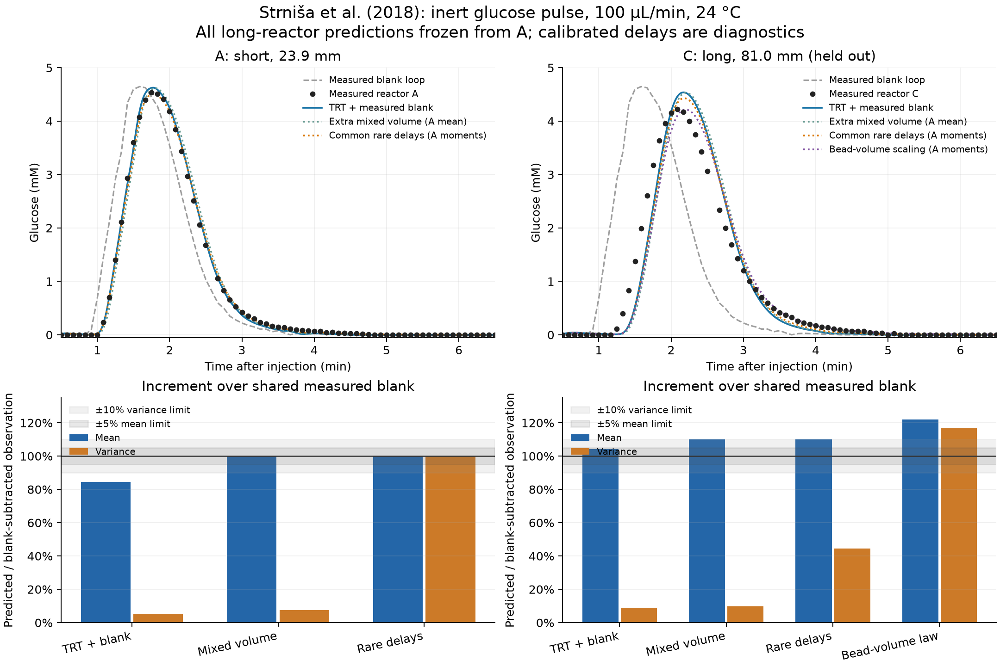

# Inert tracer qualification of Strniša's packed-bed microreactors

**Question.** Can a literature-informed monolayer of porous catalyst beads,
with a pore-scale flow field from stock OpenLB TRT, predict the measured
glucose residence-time response of a short packed microreactor and its
longer counterpart, without a length-dependent fit to the latter's data?
Only the aqueous tracer experiment is considered. Neither the
transesterification kinetics nor a DWSIM reactor is started in this work.

## 1. Evidence and experimental boundary

The primary evidence is [Strniša et al. (2018)](https://doi.org/10.1016/j.cej.2018.05.028),
Sections 2.3, 3 and 4.1, Tables 1–2 and Fig. 3, and its supplement. The
[traceable extraction](../../../literature/sources/strnisa2018/README.md)
retains all three dimensional pulse curves in Fig. 3b, the source table
entries and selected points in Fig. 3a. The glucose pulse is 10 µL of
50 mM solution (0.500 µmol), in 100 mM PBS, pH 7.4, at 24 °C and
100 µL/min. Its nominal valve duration is 6 s. The PFA-tube system has a
glucose detector in a 4 µL chip; the readings at 10 Hz were averaged over
ten successive measurements. Triplicate measurements are reported, but
the individual pulses and curve-level uncertainty are not printed. Graph
reading scenarios below are not experimental confidence intervals.

| Geometry | A (reference) | C (held out) |
| --- | ---: | ---: |
| Length, width, depth (mm) | 23.9 × 3.1 × 0.40 | 81.0 × 2.9 × 0.40 |
| Reported interbead void fraction | 0.57 | 0.59 |
| Table 2 empty / void volume (µL) | 29.9 / 17.1 | 95.3 / 56.5 |
| Geometric empty volume from dimensions (µL) | 29.636 | 93.96 |
| Synthetic sphere count | 472 | 1,428 |
| Synthetic continuous void fraction | 0.57036 | 0.59002 |
| Near-inlet glucose and total flow | Same pulse and flow | Same pulse and flow |

The assumed radius is half the reported mean sieved catalyst diameter
372.10 µm (reported spread 27.05 µm). In a 400 µm-high channel, that
leaves a nominal gap of only 27.9 µm above a bead tangent to the lower
plate. Preserve that clearance instead of assigning one sphere diameter
equal to the complete channel height. Randomized, non-overlapping
monodisperse spheres fill the full rectangular lengths; the source gave
four synthetic realizations in Fig. S1, not the actual three-dimensional
bead coordinates. The seed, bead count and gap rules are fixed in
[protocol.toml](protocol.toml) before running. No bead dimensions, inventory,
positions or porosity are adjusted to either tracer curve. The source
infers the porosity from weighed beads and a specified apparent density;
it is not an independent three-dimensional pore-space measurement. Exact
specimen packing, wet size distribution and aqueous glucose partition into
the beads are unreported. The nominal first case only transports tracer
in the interbead liquid.

The carrier uses a pure-water approximation at 24 °C, density
997.3 kg/m³ and viscosity 0.910 mPa·s, based on [IAPWS water properties](https://iapws.org/relguide/LiquidWater.pdf).
The independently measured 25 °C infinite-dilution glucose diffusivity
7.294 × 10⁻¹⁰ m²/s in water is from [Table 4 of the 2025 RSC Advances study](https://doi.org/10.1039/D5RA00669D).
An approximate absolute-temperature/viscosity correction gives the nominal
7.1 × 10⁻¹⁰ m²/s at 24 °C. The actual PBS diffusivity and viscosity for
the experiment are not reported; check ±20% diffusivity without fitting.

## 2. Why the complete blank response is essential

Let $b(t)$ be the observed glucose concentration on the loop with no
reactor, and let $E_R(t)$ be the normalized outlet age distribution
given by an impulse into the reactor. If the common apparatus is linear
and time invariant, the complete predicted concentration is

$$
c_{\mathrm{pred},R}(t)=\int_0^t b(t-s)E_R(s)\,ds .
$$

The injection waveform, tubing, chip mixing, detector response and
acquisition averaging are already in the measured `b`. Do not convolve
with the 6 s valve injection a second time. At the same flow $Q$, the
absolute observed glucose dose is $Q\int c(t)dt$. Normalize each curve
by its area only to calculate its age moments and cumulative fraction.
For a common linear loop, the reactor contributes the **difference**
between the complete-loop and blank means and variances:

$$
\Delta\bar t_R=\bar t_{b+R}-\bar t_b,\qquad
\Delta\sigma^2_R=\sigma^2_{b+R}-\sigma^2_b .
$$

This is a *conditional* separation: replacing or reconnecting the reactor
may alter the tubing, fittings or local sensor feed conditions. The paper
does not independently quantify those changes. The complete blank mean is
107.05 s; the 4 µL detector chip alone would have a nominal hydraulic
time of only 2.4 s. The apparent full-loop time-equivalent hold-up is
178.4 µL at this flow, including the injection and signal response. It
must not all be assigned to actual tubing volume. A visually satisfactory
whole-loop overlay is therefore a weak test of a bed with a 10 s mean.

### Independent reading of Fig. 3a

The paper's dimensionless comparison is particularly instructive. The
21 selected experimental triangles in Fig. 3a are consistent with the
same intensity sequence as the absolute A response in Fig. 3b: the
normalized concentrations differ by at most 0.0033. Their abscissas imply
a time scale of 118.91 s, within 0.11% of the **complete** A mean of
119.04 s. The printed reactor A residence time is 12.6 s (Table 1).
Thus, the dimensionless experimental curve appears to retain the complete
loop, with its absolute delay obscured by dividing time by its own large mean.
This is an inference from figures, not access to the authors' unpublished
processing. Separate time/peak normalization can hide a large discrepancy
in dimensional dispersion between a numerical bed and the experiment.
For example, adding a 6 s rectangular input to the H16 bed impulse
(only for this dimensionless illustration) gives a variance divided by
mean squared of approximately 0.069, close to 0.066 for the complete
measured A pulse. This numerical resemblance is possible even though the
absolute variances differ by almost two orders of magnitude. The actual
Fig. 3b prediction does **not** apply that second pulse.

The full A and C profiles in Fig. 3b and the printed Table 1 are kept
separate; their variance estimates are different. The Fig. 3b raw pulse
comparison is the primary test in this project. See the
[normalized-curve reading check](figures/dimensionless_audit.png).

## 3. Hydraulic and tracer method

The C++ application follows the stock OpenLB example lifecycle: mesh,
geometry, lattice, initial values, simulation and output. It uses stock
D3Q19 `collision::TRT` with magic parameter 3/16, second-order equilibrium,
Kupershtokh forcing, `IndicatorSphere3D`, wall bounce-back and the physical
velocity/density functors. No upstream files or numerical facilities are
reimplemented. The whole-length randomized geometry uses an axial
periodic pressure-gradient closure for the settled carrier; transverse
plates and sides are closed. Its axial seam is a clear slot, opened for
the tracer. This is a finite-bed **developed inlet/outlet approximation**,
not a geometric model of the actual tubing junctions or a prescribed
plug inlet. The pressure gradient is iterated against the measured flow,
not a measured pressure drop; it is not fitted to tracer observations.

The interstitial velocity of the short reactor is about 2.36 mm/s, so
the particle Reynolds number is approximately 0.96 and the nominal
particle Péclet number is about 1,240. A stock carrier is accepted only
after the flow, low-Mach/density and native-mask checks. Lattice cells
are independently mapped to the same sphere/plane geometry. Julia uses
the previously developed conservative shared-face projection to close
each cell's flow balance while retaining the native axial throughput.
The relative RMS change from the original face estimate must be ≤5%.
The open seam carries the measured throughput, and the molecular tracer
is reflected at solid boundaries; only positive advective outlet
crossings remove tracer. This implements a closed-vessel, zero-diffusive-
flux inlet/outlet approximation. The Julia marker calculation reuses
the verified within-cell advection and reflected Brownian diffusion
solver. Inject independent markers proportional to entering face flow
and record absolute outlet age for every marker. No reaction, irreversible
adsorption or numerical source exists. Unrecovered marker mass remains
explicit rather than normalizing it into the result.

An independent ring-projection test and an open plug-flow test verify
flow conservation, exact advective transit and the high-Péclet analytical
tracer variance $2DL/u^3$. The physical time step and mesh are checked
separately in the porous geometry; sampling errors below are eight-block
Monte Carlo standard errors, not measurement uncertainties.

### Short reactor numerical screens

`H` counts cells over the 400 µm channel depth. In the initial H12
attempt, `tau_even = 0.58` gave a maximum density departure of 1.16%,
above the declared 0.5% bound. The same geometry reconverged at 0.548;
however, its 6.87% RMS face correction is still outside the 5% bound.
Keep it as a rejected diagnostic, not a qualified tracer model.

| A case, same 1.25 ms marker step | Throughput (µL/min) | Face correction | Mean (s) | Variance (s²) | Recovery |
| --- | ---: | ---: | ---: | ---: | ---: |
| H12, diagnostic, 33.3 µm | 99.856 | 6.87% | 10.105 | 7.876 | 100% |
| H16, qualified, 25 µm | 99.936 | 4.17% | 10.128 | 8.960 | 100% |
| H20, qualified, 20 µm | 99.945 | 2.82% | 10.145 | 9.321 | 100% |
| H16 at half time step (0.625 ms) | Same H16 carrier | 4.17% | 10.155 | 8.835 | 100% |

H16 and H20 maximum density departures are 0.388% and 0.444%; both
pass the 0.5% bound. All accepted fields pass the local balance and
per-plane throughput constraints at approximately 10⁻¹⁴ relative.
The H16 pressure-gradient-equivalent channel drop is 109.15 Pa and
H20's is 110.15 Pa (not an experimental pressure validation). The H16
tracer mean differs from its liquid-volume/flow time of 10.133 s by
−0.047%. The matched-step H16→H20 mean and variance changes are **+0.17%
and +4.02%**, and the H16 time-step halving gives **+0.26% and −1.40%**.
Both qualify against the declared 5%/10% limits. H16 is then selected
for C to avoid unnecessary computational cost. The variance's block
standard error is 0.162 s² on the principal H16 run; the refinement
and experimental dispersion gaps are not inferred from sampling noise.

The ±20% diffusivity sensitivity gives variances of 9.380 and 8.609 s²
and means of 10.127 and 10.166 s at fixed H16 flow, with complete
recovery. Neither uncertainty in this independently sourced diffusivity,
nor the tested grid/time-step variation, can account for a large excess
spreading in the dimensional measured pulse.

## 4. Short-reactor comparison, before opening the holdout

The absolute concentration scale is retained. At 100 µL/min, integrating
the reconstructed blank and A pulses gives 0.5076 and 0.5064 µmol,
close to the nominal 0.500 µmol. The blank-only predicted amount is
0.5076 µmol because markers are fully recovered. No area or peak fit
is applied. Piecewise-linear interpolation of the 5 s figure markers
provides the quadrature; the common 0, 2 and 5 pixel background-removal
scenarios assess reading sensitivity.

| A comparison | Mean (s) | Variance (s²) |
| --- | ---: | ---: |
| Measured complete blank | 107.052 | 769.146 |
| Measured complete A | 119.041 | 933.194 |
| Measured A increment over blank | 11.989 | 164.048 |
| OpenLB/Julia bed + measured blank | 117.180 | 778.107 |
| OpenLB/Julia bed increment | 10.128 | 8.961 |
| Printed Table 1 reactor moments | 12.6 | 288.0 |

The complete-pulse mean and cumulative discrepancy (−1.56% and 1.78
percentage points) pass the 5%/5-point screens, **but** the complete
variance is 16.62% below measurement, outside the 10% screen. Removing
the common blank exposes a −15.52% mean error and a −94.54% variance
error. The predicted interbead standard deviation is about 3.0 s, while
the observed increment corresponds to 12.8 s. The raw increment is
not exactly the Table 1 variance; either would fail by a large amount.
At the common 2 and 5 pixel backgrounds the inferred A incremental
variance falls to 150.94 and 114.72 s²; both remain far outside the
simulation (8.96 s²). This robustness is important because the late
markers overlap and their reading is approximate.

### Separating additional hold-up from a long tail

Provided the blank subtraction is valid, the missing A mean is 1.861 s
and the missing variance 155.09 s². The mean corresponds to only 3.10 µL
of positive additional liquid hold-up. One completely mixed connection
with that mean would add variance $1.861^2=3.46$ s², not 155.09 s².
In particular, an ordinary extra mixed volume cannot resolve the
discrepancy. The correctly recovered and mesh-checked synthetic flow
does not support an independently validated A dispersion.

To test a possible explanation without fitting C, use a simple *diagnostic*
family for rare additional delays. Each marker has a Poisson-distributed
number of independent exponential pauses. With rate λ and mean pause
duration T, the extra mean and variance are λ T and 2λ T²; derive them
from only the two A residual moments:

$$
T=\frac{\Delta\sigma_{\mathrm{miss}}^2}{2\Delta\bar t_{\mathrm{miss}}},
\quad \lambda_A=\frac{\Delta\bar t_{\mathrm{miss}}}{T}.
$$

A requires T = 41.68 s and λ_A = 0.04464, equivalent to an additional
pause for about 4.37% of markers. Such a long residence-time tail with
little additional mean is compatible with a *hypothetical* slow pocket
or access resistance; these numbers do not establish where it occurs.
The complete A curve with this kernel has a maximum cumulative
discrepancy of 0.94 percentage points. Its mean/variance agree by
calibration, so it is a shape-consistent model on A but not an independent
experimental qualification of the pore geometry.

Freeze all three additional-delay possibilities on A before predicting C:

1. One extra well-mixed connection fixed at 3.10 µL (same for both).
2. Rare delays fixed at A's λ and T, as a common unmeasured loop/connection.
3. The **same** rare-delay parameters for A, but a probability rate
   proportional to the independently specified bead envelope volume for C
   (ratio 3.0254), as an idealized distributed retention law.

All predictions retain the independently measured blank and actual
complete-channel tracer travel-time distribution as the base. The two
rare-delay closures have exactly the same A curve. There is no choice of
model parameters based on C. Numerical qualification is recorded
separately from the short-curve discrepancy: the no-fit primary A
experimental gate does **not** pass. The long prediction will therefore
be a held-out diagnostic, not a claim that an independently validated
reactor model was available on A.

### Separately sourced intrabead-storage bound

As an independent engineering check, [Lorenzo et al. (2025)](https://doi.org/10.1021/acs.iecr.5c02780)
estimate a dry-sorption particle porosity of 0.22 and an aqueous-tracer
porosity of 0.40 for a related immobilized-lipase formulation on Lewatit
VP OC 1600. These are different measurements on a **different lot and
tracer system**, not wet glucose-access parameters for Strniša. The
prior [particle evidence record](../pentyl_propanoate_transport/particle/evidence.json)
also records their analytical use of a borrowed tortuosity of 5.3.
Freeze these independently sourced values as labelled moment scenarios;
do not fit any of them to either microreactor.

For external liquid flowing through packed impermeable bead envelopes of
volume $V_s$, a hypothetical fraction $\varepsilon_p$ accessible to the
tracer at equilibrium with unit partition increases the storage time by
$\varepsilon_p V_s/Q$ regardless of its diffusion rate, if the liquid is
additional to the reported interbead volume. If the same storage obeys an
ideal spherical diffusion model with no film resistance, the expansion of
its mean-concentration response gives a characteristic time $R^2/(15D_p)$,
with $D_p=D/5.3$ in this illustrative scenario. The added variance for a
plug-flow bed with independent storage is twice the added mean times
this characteristic diffusion time (17.23 s). This is a moment
sensitivity, not a solved intrabead geometry or a fitted law.

For A the missing mean would require roughly 24.35% of the synthetic
12.73 µL bead-envelope volume to provide additional accessible liquid.
That is compatible with the related-support porosity range, but the
0.22 and 0.40 scenarios give total variances of 66.86 and 114.24 s²,
still below the nominal 164.05 s². Their means are 11.81 and 13.18 s.
This is a reason to consider reversible bead access, not evidence
that it caused the measured spreading. It is crucial to test that
same positive-volume explanation against C before adopting it.

## 5. Held-out length: C, without changing A's model

The long carrier is calculated on the selected H16 grid with the same
physical fluid properties, mean bead diameter, geometry-generation
rule and marker step. Only C's independent dimensional geometry and
reported void fraction change. `tau_even = 0.54` keeps the carrier
density departure small; the physical viscosity and flow do not change.
The short decisions, including the three diagnostic kernels and their
parameter values, were saved in `frozen_A.json`. The long prediction
arrays were saved and hashed in `C_prediction_before_comparison.npz`
with that frozen record as their input. Only then did the separate
scoring command open the long experimental pulse. No long data are
used to choose a parameter, baseline or geometry realization.

### Numerical result

The stock long field contains 3,542,044 fluid nodes at 25 µm spacing
(voxel void fraction 0.58902). It converged at 99.940 µL/min, with
maximum Mach number 0.0101 and maximum density departure 0.135%.
The conservative face correction is 4.01%; the largest local imbalance
and per-plane flow error relative to their corresponding reference
flows are 6.44 × 10⁻¹³ and 1.83 × 10⁻¹⁴. The native equivalent channel
pressure drop, 336.51 Pa, is a prediction, not a tested separation of
the article's reactor and measurement-loop hydraulic resistances.

The liquid volume is 55.344 µL and its nominal transit time 33.227 s.
Every one of the 16,384 injected markers exits; the mean arrival time
33.264 s agrees with volume/throughput within 0.113%. The exit-time
variance is 39.342 s² (block standard error 0.405 s²). H16 was screened
on A; no independent H20 run was made for C. The long numerical result
passes the carrier, conservation and recovery checks but should not
be mistaken for a separate grid-convergence study of every possible
long packing.

### Experimental response

| C comparison | Mean (s) | Variance (s²) |
| --- | ---: | ---: |
| Measured complete C | 138.966 | 1,204.853 |
| Measured C increment over blank | 31.914 | 435.706 |
| OpenLB/Julia bed + measured blank | 140.316 | 808.488 |
| OpenLB/Julia bed increment | 33.264 | 39.342 |
| Printed Table 1 reactor moments | 31.8 | 504.0 |

The digitized C dose is 0.5228 µmol; the predicted dose is 0.5076 µmol
(−2.92% relative to that integrated measurement). The dimensional
whole-loop mean is within 0.97%, but the variance is 32.90% too low and
the largest cumulative discrepancy is 7.69 percentage points. The
blank-subtracted mean is 4.23% high, within the 5% screen, whereas the
variance is 90.97% low (reactor-increment standard deviations 6.27 versus
20.87 s). At two and five pixels of common baseline removal, the C measured
incremental variances are still 428.85 and 385.99 s². The short numerical
sensitivity is orders smaller than the measured spreading discrepancy
on both lengths.

| Model, all parameters fixed on A or from literature | A increment mean error | A increment variance error | C increment mean error | C increment variance error | C whole CDF discrepancy |
| --- | ---: | ---: | ---: | ---: | ---: |
| TRT + measured blank, no fit | −15.52% | −94.54% | +4.23% | −90.97% | 7.69 pp |
| One extra mixed volume (A mean) | 0.00%* | −92.43% | +10.06% | −90.18% | 10.07 pp |
| Common rare delays (A moments) | 0.00%* | 0.00%* | +10.06% | −55.38% | 8.44 pp |
| Bead-volume-scaled rare delays (A moments) | 0.00%* | 0.00%* | +21.87% | +16.72% | 10.18 pp |

\* Rounded; fitted A moment, not an independent validation. The C
whole-loop variance errors for the last two cases are −20.03% and
+6.05%. The distributed-retention transfer thus improves one statistic
but makes the mean and the shape worse. The observed C rise precedes
the model and the observed tail is broader. Adding a positive delay
does not restore the early arrival. **None** of the frozen models passes
the long experimental gates; reaction stays disabled.

### Why a further fit to a common delay cannot close the discrepancy

An additive nonnegative mean delay $m$ applied to a fixed interbead
response must satisfy the 5% mean screen for each reactor:

$$
0.95\,\Delta\bar t_{\mathrm{meas}}-\bar t_{\mathrm{bed}}
\leq m\leq
1.05\,\Delta\bar t_{\mathrm{meas}}-\bar t_{\mathrm{bed}},\qquad m\geq0.
$$

Under the common measured-blank assumption, A requires **1.26–2.46 s**
of extra mean time, while C permits only **0–0.25 s**. These intervals
are disjoint, even before testing variance or the shape of a delay law.
If the mean instead scales with the 3.0254-fold larger bead envelope
volume, C permits at most 0.081 s of the needed A delay. At the 2-pixel
background the intervals remain disjoint; at 5 pixels C already lies
above its mean upper limit even with no extra storage. Consequently
one cannot recover both central-curve residence times by adding a
common nonnegative retention kernel or one scaling directly with
bead volume. This conclusion is an algebraic check *after* making the
held-out prediction, not a refit of C.

Consistent with that result, the missing mean time translates to
**+3.10 µL** of apparent additional hold-up in A, but **−2.25 µL**
in C at the same flow. The long missing variance is 396.36 s².
An independently plausible positive internal storage in the long bed
cannot provide negative added volume. Transferring the related 0.22
and 0.40 particle-porosity scenarios with the same diffusion-time
assumption gives C means 38.35 and 42.51 s and variances 214.53 and
357.86 s². Neither is qualified. This does not demonstrate that real
beads have inaccessible pores; it demonstrates that *adding that
storage to these fixed interbead volumes with a common unchanged
loop* does not explain both central curves. Differing tubing/fittings,
detector dynamics, actual wet volume and bead geometry could alter
the assumptions. Published approximate inset mean error bars, the
unknown curve uncertainty and the source's inferred rather than
imaged porosity prevent a unique attribution.

## 6. Conclusion, limitations and next executable step

**Numerical pass, experimental fail.** The new full-length stock TRT
carriers and the conservative transport retain both measured flow and
injected tracer mass, reproduce the pore-volume transit times, and
check the short geometry against smaller time and spatial steps. We
have a reusable inert hydrodynamic model for the stated synthetic
geometry. A close visual match of the short complete pulse is not a
validation of its actual mixing: subtracting the large common blank
reveals a discrepancy of more than an order of magnitude in variance.
The held-out C result demonstrates that the missing spreading cannot be
fixed by simply transferring that short-reactor delay calibration. The
paper's time-normalized overlay did not establish this dimensional
transfer. No reacting-liquid transport, reaction conversion or new
DWSIM integration is demonstrated here.

There is a specific published avenue to investigate rather than fitting
one more arbitrary delay. [Panjan's doctoral thesis, 2018](../../../literature/sources/strnisa2018/related_detector_evidence.md)
(same collaborating group) reports a related detector step response
up to 58 s and additional narrow/wide-reactor blank-loop measurements
in Fig. 25. A first-order detector with that step response would have
a time constant near 25 s, illustrating why instrument spreading can
dwarf a 10 s bed. Do not transfer that time constant or add it a second
time to the measured blank: the thesis's detector characterization
does not establish the exact response of each experiment. It also
defines RTD delay for its R1–R4 cases by leading-edge shifts, not by
mean moments. The online primary text and reported conditions were
checked; the Fig. 25 page-image fetch was unavailable. Next:

1. Digitize the thesis Fig. 25 blank and narrow R1/R2 pulse responses,
   keeping any shared/duplicated trials explicit. Check a common-loop
   model and the published onset definition using dimensional signals;
   investigate which reactor-specific changes to the measurement chain
   are actually supported in published methods.
2. If the dimensional comparison warrants it, test the finite inlet and
   outlet fitting geometry and the reported bead-size spread/clearance
   as independently declared, conservative geometry sensitivities.
   Preserve the fixed flow and measured or stated porosity. Do not
   choose a geometry realization for each curve on the basis of its
   fit. Requalify with the same stock TRT and tracer screens.
3. Keep reaction on hold until an independently transferable RTD is
   established. If the available article/thesis data cannot distinguish
   apparatus and bead storage, choose a better-separated published tracer
   benchmark, or explicitly limit the use of this case to hydraulic and
   nominal liquid-contact-time comparisons. No new laboratory work or
   inaccessible raw dataset is required as a project gate.

## 7. Reproducible evidence

Executed on 24 November 2026 in the existing macOS arm64 environment,
using the externally built stock OpenLB 1.9r0, the project's Julia 1.11.6
and managed Python environment. The selected H16 and H20 A carriers and
long H16 C carrier are separate native runs. For C, native stepping
took 868 s (excluding geometry/initialization) and the 16,384-marker
transport took 404 s on the tested machine. These timings are run
records, not speedup claims. Independent Julia projection/open-tracer
tests passed 8 assertions, and the Python evidence/loop/geometry/
holdout-forward-only tests passed 8 tests.

See the [run/check guide](README.md), [frozen protocol](protocol.toml),
[reference summary](reference/summary.json) and
[forward prediction samples](reference/prediction_samples.csv). The
reference retains source/code hashes, numerical limits, rejected
attempts, full comparison scores for each baseline scenario, and the
hashes of the original A freeze and C prediction. Large velocity and
face fields and full marker ledgers remain in the identified ignored
local run folder, rather than being added to Git.

**Subsequent evidence:** the user supplied Panjan's doctoral thesis,
and a [separate measurement-loop audit](../panjan_tracer_audit/REPORT.md)
now assesses its likely shared blank/R1 observations, the middle-length
R2 discrepancy and the detector response test. No A/C parameters or
original carrier results were changed by that follow-up.
