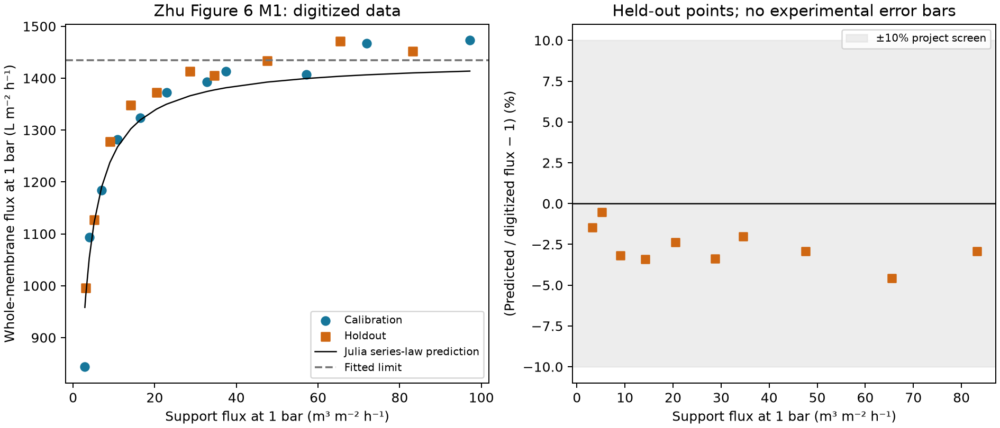

# Published membrane data: calibration, holdout and evidence limits

## Purpose

Which published hydraulic measurements can support the geometry-to-energy
workflow, and does a reduced model predict observations withheld from its fit?
This folder contains two distinct comparisons: a support-permeability closure
and a matched support/whole-membrane series model. Their materials and outcomes
must remain separate.

## Theory

### Support permeability

The first closure uses nominal powder diameter $d$ in m and porosity $\epsilon$:

```math
k_i=b\,k_{CK,i},\qquad
k_{CK,i}=\frac{d_i^2\epsilon_i^3}{180(1-\epsilon_i)^2}.
```

$k$ is in m² and $b$ is dimensionless. Equal-weight squared natural-log
residuals on calibration cases $\mathcal C$ have the exact minimizer

```math
\log b=\frac{1}{|\mathcal C|}\sum_{i\in\mathcal C}
\log\left(\frac{k_{obs,i}}{k_{CK,i}}\right).
```

Powder diameter is not interpreted as resolved hydraulic pore radius. Fitting
one multiplier cannot identify a connected three-dimensional geometry.

### Matched layers in series

For a support and coated membrane measured at the same pressure drop,
define permeance $P=J/\Delta p$ in m/(Pa s) and impedance $Z=1/P$ in Pa s/m.
Common flux through series layers gives

```math
\frac{1}{P_{tot}}=\frac{1}{P_s}+Z_f,\qquad
\widehat Z_f=\operatorname{mean}_{\mathcal C}
\left(\frac{1}{P_{tot}}-\frac{1}{P_s}\right),\qquad
J_{pred}=\frac{\Delta p}{1/P_s+\widehat Z_f}.
```

$Z_f$ is an effective **non-support** impedance, potentially including
intermediate layers and interface/access effects. It is not a separately
identified intrinsic selective-layer resistance. Using $Z=\mu R$ avoids
assigning an unreported measurement viscosity.

At target flux $J_t$ and efficiency $\eta$, the conditional energy translation is

```math
\Delta p_t=J_t(Z_s+Z_f),\qquad
e=\frac{\Delta p_t}{\eta\,3.6\times10^6},\qquad
\phi_f=\frac{Z_f}{Z_s+Z_f}.
```

The fixed contribution exceeds 50% when $Z_f>Z_s$ and reaches 90% when
$Z_f\ge9Z_s$. These relations presume linear clean-water behavior.

## Sources and comparison design

[Biesheuvel and Verweij (1999)](https://doi.org/10.1016/S0376-7388(98)00335-4),
Table 2, supplies nine alumina support permeability/porosity cases. The same
table was corroborated in the author's thesis; this is not a second dataset.
Rows 2–4 fit $b$; rows 5–7 are the primary same-powder holdout. Other powders
are transfer/out-of-domain diagnostics. The predeclared project screen is
maximum held-out absolute relative error ≤25%.

[Zhu et al. (2021)](https://doi.org/10.1016/j.ceramint.2021.01.088), Figure 6,
supplies 21 matched M1 support/coated-membrane points at 1 bar. Odd support-flux
ranks (11 points) fit $Z_f$; even ranks (10) are withheld. The physical support
coefficient stays one. The screen is maximum held-out flux error ≤10%.
Both splits are retrospective same-study checks, not blind independent studies.

The original PDF's native Figure 6 raster supports a clearer second reading
than the earlier converted JPEG. ±2-pixel marker/±1-pixel anchor scenarios
measure reading sensitivity, not experimental uncertainty. Measurement
temperature, viscosity, replicate structure and pointwise uncertainty remain
unavailable where the articles do not report them.

## Results

| Support-closure quantity | Result |
| --- | ---: |
| Fitted $b$ | 2.98437863044 |
| Calibration log RMSE | 0.243971 |
| Holdout row 5 error | +30.89% |
| Holdout row 6 error | −13.48% |
| Holdout row 7 error | −18.95% |
| Primary 25% screen | **Fail** |

| Matched M1 quantity | JPEG reading, retained | PDF reading |
| --- | ---: | ---: |
| $Z_f$ (Pa s/m) | $2.51170\times10^8$ | $2.50947\times10^8$ |
| Held-out mean absolute flux error | 2.44% | 2.66% |
| Held-out maximum error | 4.53% | 4.56% |
| Worst reading-corner error | 10.78%, fail | 7.88%, pass |
| Lowest-flux training residual | +11.04% | +13.56% |

The PDF fit puts 90% fixed-impedance dominance at a support flux of 12.91 m/h
measured at 1 bar. At 100 LMH and 75% efficiency, its declared 3.12→97.53 m/h
support scenarios give 30.49% transmembrane energy saving. These are model
translations, not measured pump energies. The paper's M1 endpoint gain would
translate to 42.86% under the same linearity assumption; the mismatch remains.



## Discussion

The failed support closure shows that a fitted multiplier does not capture
all processing effects, even within one powder family. It is not used as a
validated law to fabricate a native pore geometry.

The PDF result improves the reading-sensitivity screen, not nominal prediction
accuracy. All ten nominal held-out predictions remain below the observations,
and a low-flux calibration discrepancy persists. Passing the declared screen
supports a bounded effective hydraulic reference, not universal layer properties.

[Mo et al. (2022)](https://doi.org/10.1016/j.watres.2022.118658) and its Word
supplement provide structural/model context and leads to original sources;
their model layer resistances are not experimental calibration data.
[Jan et al. (2025)](https://doi.org/10.1016/j.desal.2025.119085) changes the
selective coating, and its uncoated sample already has a selective layer.
Whole-membrane measurements from these different specimens are not subtracted
to invent a selective resistance.

## Conclusions

The support-only closure fails its prediction screen. The PDF-refined matched
M1 series supports a conditional non-support impedance for subsequent design
scenarios, with its bias, reading bounds and unknown conditions retained.
The [graded-support example](../graded_support/REPORT.md) transfers native shape
ratios through one common literature anchor; it does not fit every design.

## Reproduction and evidence

[Commands and frozen protocols](README.md) · [Support reference](../../../docs/experimental_calibration_reference.json)
· [PDF reference](../../../docs/zhu_pdf_reference.json) ·
[Source ledger](../../../literature/sources.json).
The detailed [support](../../../docs/experimental_calibration.md),
[JPEG](../../../docs/zhu_matched_validation.md) and
[PDF](../../../docs/zhu_pdf_refinement.md) records retain source locations,
figure readings, split definitions and separate run IDs. This step uses Julia
fits and saved data; it does not itself run new OpenLB or DWSIM simulations.
