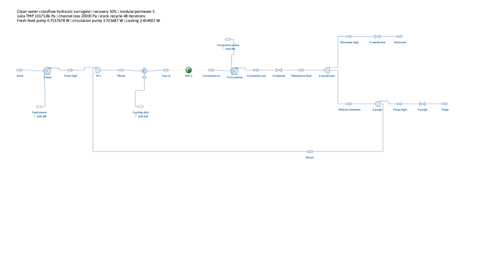

# Crossflow recycle: separate feed and circulation energy

## Research question

How does circulation dilute the energy benefit of improving a membrane support,
when a pressurized return is recycled instead of depressurized after every
pass? This example adds a real DWSIM recycle, a separate circulation pump and
temperature control. It quantifies hydraulic cost under prescribed flux.

## Theory and model assumptions

Clean water has prescribed permeate flux $J$ through area $A_m$. The membrane
pressure requirement retains the native support ratios and common Zhu anchor:

```math
Q_p=JA_m,\qquad \mathrm{TMP}=J(Z_s+Z_f),\qquad
Z_s=c_i/P_{s,0},\quad Z_f=2.5094652448872787\times10^8\ \mathrm{Pa\ s/m}.
```

$P_{s,0}=(3.12/3600)/10^5$ m/(Pa s); $c_i$ is the measured body-resistance
ratio for a 4/5/6 µm interior with 4 µm mouths. The fixed non-support impedance
may include interfaces. A common structural multiplier, rather than a separate
fit to each design, maps the synthetic pore ratios to the literature baseline.

Define overall recovery $y=Q_p/Q_f$ and module/permeate ratio $C_m=Q_m/Q_p$.
All reference volumes use fresh-feed density, so these also define mass ratios:

```math
Q_f=Q_p/y,\quad Q_m=C_mQ_p,\quad
Q_{return}=Q_m-Q_f,\quad Q_{purge}=Q_f-Q_p.
```

Positive purge and return require $0<y<1$ and $C_m>1/y$. The membrane split
is $1/C_m$; purge fraction of its retentate is $(1/y-1)/(C_m-1)$.
The recycled fraction of module flow is $\beta=1-1/(yC_m)$. Its mass-balance
fixed point checks, but does not replace, DWSIM's stock recycle iterations.

The feed pump lifts only fresh feed to chamber pressure. The return retains
that pressure. After mixing and temperature control, a circulation pump
supplies a separate upstream channel loss:

```math
\Delta p_c=R_cQ_m,\qquad
W_f\simeq Q_f\mathrm{TMP}/\eta_f,\qquad
W_c\simeq R_cQ_m^2/\eta_c,\qquad
e=\frac{W_f+W_c}{3.6\times10^6Q_p}.
```

$R_c$ is in Pa s/m³ and $e$ in kWh/m³ permeate. Each actual DWSIM pump is
checked more precisely using $W=\dot m\Delta p/(\rho_{in}\eta)$ at its own
inlet density. Reference and actual flashed volumes remain distinct.

The thermodynamic energy balance includes cooling separately:

```math
\dot H_p+\dot H_{purge}-\dot H_f-(W_f+W_c)+\dot Q_{removed}=0.
```

Cooling duty is heat, not cooling electricity. No COP or motor efficiency is
assumed. The channel is a lumped upstream loss, not a resolved axial flow field.

## Results

At 298.15 K, 100 LMH, 1 m², $y=0.5$ and efficiencies 0.75, the nominal
$R_c=1.44\times10^8$ Pa s/m³ gives 20 kPa at $C_m=5$. Fresh/permeate/purge/
module/return flows are 0.2/0.1/0.1/0.5/0.3 m³/h.

| Interior radius | Total shaft energy at $C_m=5$ (kWh/m³) | Saving |
| --- | ---: | ---: |
| 4 µm | 0.04457454 | 0% |
| 5 µm | 0.04397422 | 1.35% |
| 6 µm | 0.04372277 | 1.91% |

| $C_m$ | Channel loss | Baseline energy (kWh/m³) | Circulation share | 6 µm saving |
| --- | ---: | ---: | ---: | ---: |
| 5 | 20 kPa | 0.04457454 | 83.09% | 1.91% |
| 10 | 40 kPa | 0.15568515 | 95.16% | 0.55% |
| 15 | 60 kPa | 0.34086948 | 97.79% | 0.25% |

The baseline at $C_m=5$ has 0.753768 W feed duty, 3.703687 W circulation duty
and 2.454001 W removed heat. Run `20261108T233356Z-b884df5e` passes 25 actual
DWSIM solve/save/reload cases, including four seed/tolerance variants. A
one-iteration recycle is rejected. Maximum relative mass and enthalpy residuals
are $2.12\times10^{-11}$ of feed and $2.45\times10^{-5}$ of shaft work.
The unchanged upstream support measurements are historical BGK evidence.



## Discussion

At fixed $R_c$, doubling module flow quadruples circulation duty. Only fresh
feed pays the TMP lift, so recycling does not repeatedly pay that whole
pressure rise. Nevertheless, circulation can dominate the total and reduce
the support's 11.30% transmembrane saving to 1.91%, or less.

The channel resistance is an uncalibrated scenario, not a measured membrane
module. This example assigns no transport or fouling benefit to increased
circulation; it therefore cannot establish a useful optimum circulation rate.
Pure-water splits do not predict rejection or concentration polarization.
The [literature benchmark](../literature_benchmark/REPORT.md) adds an explicit,
conditional capacity constraint instead of inventing that benefit.

## Conclusions

Membrane resistance share and whole-process energy share are different.
Separating feed and circulation duties makes the distinction measurable in
actual saved DWSIM flowsheets and explains why material savings can become small.

## Reproduction and evidence

[Commands and protocol](README.md) · [Detailed record](../../../docs/crossflow_recycle.md)
· [Compact reference](../../../docs/crossflow_recycle_reference.json).
The membrane anchor derives from
[Zhu et al. (2021)](https://doi.org/10.1016/j.ceramint.2021.01.088), Figure 6;
the channel law and operating matrix are explicit scenarios.
