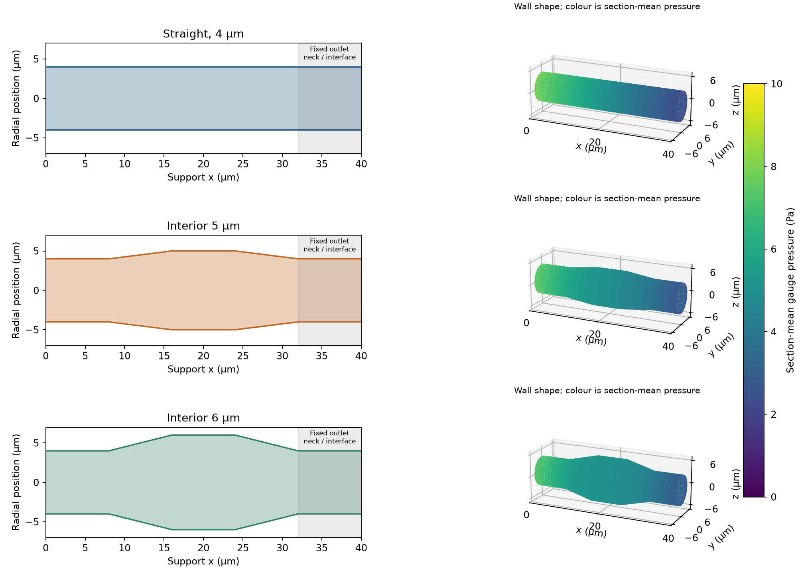

# Fixed openings, wider interior: a controlled support comparison

## Research question

How much can widening a support pore's interior reduce transmembrane pumping
energy while preserving its surface openings and the effective impedance of
the other membrane layers? This controls the interface limitation of the
earlier whole-pore radius sweep.

## Geometry, theory and native measurement

Each synthetic body is 40 µm long within a 20 × 20 µm representative cell.
At axial knots 0, 8, 16, 24, 32 and 40 µm, radii are
$(4,4,r_b,r_b,4,4)$ µm, with $r_b=4,5,6$ µm. Thickness, both terminal necks,
both mouths and cell area remain fixed. Porosity changes; equal strength and
coating feasibility are not imposed.

OpenLB constructs the case with stock cylinder/cone indicators and follows
the official mesh–geometry–lattice–boundary–solve–results lifecycle. Body
pressure taps exclude the external development sections. Julia calculates

$$
\mathcal R_b=\frac{\Delta p_b}{Q}\quad[\mathrm{Pa\ s/m^3}],\qquad
k_b=\frac{\mu L_b}{A_{cell}\mathcal R_b}\quad[\mathrm{m^2}].
$$

Positive flow is axial $+x$; pressure is gauge Pa. For comparison only,
locally developed Poiseuille flow gives

$$
\mathcal R_{lub}=\frac{8\mu}{\pi}\int_0^{L_b}\frac{dx}{r(x)^4}.
$$

For a linear-radius segment of length $\ell$ and endpoint radii $a,b$, the
integral is $\ell(a^2+ab+b^2)/(3a^3b^3)$, including $a=b$. This is exact for
the straight pore and approximate for a taper. OpenLB solves three-dimensional
flow independently of this expression.

## Scale translation and process metric

The matched [Zhu M1 calibration](../calibration/REPORT.md) supplies baseline
support permeance $P_{s,0}=(3.12/3600)/10^5$ m/(Pa s) and fixed impedance
$Z_f=2.5094652448872787\times10^8$ Pa s/m. For design $i$,

$$
c_i=\frac{\mathcal R_{b,i}}{\mathcal R_{b,0}},\qquad
Z_{s,i}=\frac{c_i}{P_{s,0}},\qquad
\mathrm{TMP}_i=J(Z_{s,i}+Z_f).
$$

The common baseline anchor assumes that the measured native shape ratio
transfers through the same unresolved structural multiplier for every design.
It is not an absolute pore-to-specimen permeance prediction. The raw straight
pore impedance is about 141777 Pa s/m, whereas the anchored value is
$1.15385\times10^8$ Pa s/m: the multiplier is 813.84 and remains explicit.

At 100 LMH, 1 m² and pump efficiency 0.75, DWSIM receives $Q=JA_m$ and the
Julia pressure rise. Specific shaft energy is independently checked against
$e=\mathrm{TMP}/(\eta\,3.6\times10^6)$ kWh/m³. This stage has a pump-load
flowsheet; feed recovery and circulation are added in subsequent examples.

## Results

The original run `20261108T222740Z-26e9f37b` contains historical BGK native
evidence, 24 native cases and nine actual DWSIM design/reading-scenario cases.

| Interior radius | Native resistance reduction | TMP (bar) | Shaft energy (kWh/m³) | Energy saving | Fixed impedance share |
| --- | ---: | ---: | ---: | ---: | ---: |
| 4 µm | 0% | 0.10176 | 0.0037688 | 0% | 68.50% |
| 5 µm | 25.29% | 0.09365 | 0.0034687 | 7.96% | 74.43% |
| 6 µm | 35.88% | 0.09026 | 0.0033429 | 11.30% | 77.23% |

N32→N40 resistance changes are 0.00036%, 0.02558% and 0.00795%. The largest
pressure/domain/time-step change is below 0.164%; fine-grid all-plane mass
spread stays below 0.075%. The straight analytical error is 0.0820%.
Tapered resistances differ from the lubrication approximation by 0.75% and
2.33%; that difference is not treated as error against an exact taper solution.

The later current porous implementation was revalidated with stock TRT in
support run `20261109T153749Z-bd772ca1`. It gives a 35.89% resistance reduction
for the 6 µm design and supplies the
[explicit-channel process study](../star_channel/REPORT.md). This later evidence
is separate from the original table's BGK snapshot.

## Discussion

Fixed necks retain a large fraction of pore resistance, so interior widening
has diminishing returns. In the anchored membrane, the fixed non-support
contribution already dominates and becomes more dominant as the support improves.
The widest original design has support flux about 4.87 m/h at 1 bar, below
the 12.91 m/h needed for 90% fixed dominance. Eliminating support resistance
entirely could save at most 31.50% of this baseline transmembrane load.

Reading-bound scenarios give 11.13–11.50% savings for the 6 µm design; they
describe digitization sensitivity, not experimental confidence intervals.
Neither three shapes nor a common calibration establishes an optimum material.
The effective fixed impedance may include interface/intermediate contributions;
it cannot be uniquely assigned to a selective layer. Temperature/viscosity of
the source flux measurements are not invented to remove that limitation.

## Conclusions

Widening the interior at fixed mouths yields a verified synthetic resistance
reduction, whose process benefit is bounded by the unchanged layers. The next
question is how much of that benefit survives pressurizing the full feed and
paying other hydraulic costs; the
[once-through flowsheet](../once_through/REPORT.md) addresses that boundary.

## Reproduction and evidence

[Commands and protocol](README.md) · [Original full record](../../../docs/graded_support_study.md)
· [Compact original reference](../../../docs/graded_support_reference.json)
· [TRT continuation](../../../docs/star_channel_reference.json).
Source: [Zhu et al. (2021)](https://doi.org/10.1016/j.ceramint.2021.01.088),
Figure 6 M1 paired series; its fitted impedance is transferred as described above.
