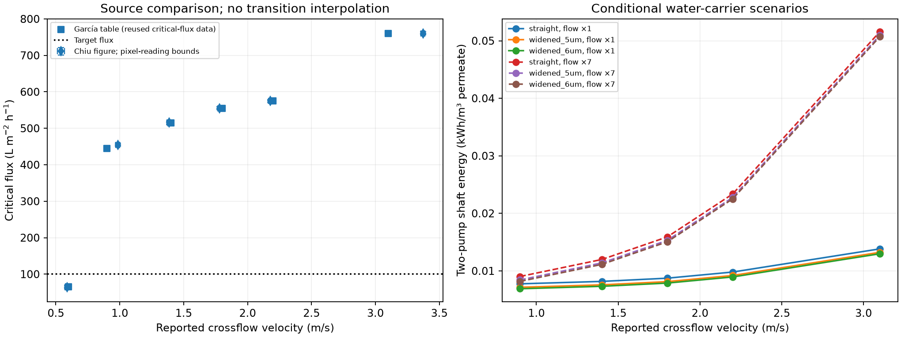

# Literature-constrained crossflow: paying for a capacity requirement

## Research question

At fixed filtration duty, which tested circulation condition has the lowest
pump energy while meeting a declared published critical-flux constraint? How
does ambiguity in the paper's total-flow convention affect that conclusion?
This stage gives circulation an empirical performance role, rather than only
an assumed hydraulic cost.

## Theory and transfer boundary

For each support design, $\mathrm{TMP}=J(Z_s+Z_f)$ with native body-resistance
ratios, baseline $P_{s,0}=(3.12/3600)/10^5$ m/(Pa s) and
$Z_f=2.5094652448872787\times10^8$ Pa s/m. The paired Zhu calibration and
synthetic 4/5/6 µm interiors with fixed 4 µm mouths are retained. This is a
conditional cross-paper transfer, not one matched experimental system.

At membrane area $A_m$, prescribed $Q_p=JA_m$, recovery $y$ and reference
module flow $Q_m$, the recycle balances give

$$
Q_f=Q_p/y,\quad Q_{return}=Q_m-Q_f,\quad Q_{purge}=Q_f-Q_p.
$$

Actual stock DWSIM equipment supplies feed and circulation shaft duties.
Their incompressible references and the reported process metric are

$$
W_f\simeq Q_f\mathrm{TMP}/\eta_f,\qquad
W_c\simeq Q_m\Delta p_c/\eta_c,\qquad
e=\frac{W_f+W_c}{3.6\times10^6Q_p}\quad[\mathrm{kWh/m^3}].
$$

The source's own hydraulic energy definition is reproduced separately:

$$
E_{source}=\frac{\Delta p_c Q_{source}}{J_{crit}S}
\quad[\mathrm{J/m^3}].
$$

It uses source critical flux and source area $S$, excludes pump efficiency and
TMP work, and is not the same boundary as total two-pump energy at fixed $J$.

Two capacity policies are applied to tested velocities. The nominal policy
requires $J\le J_{crit,table}(u)$. The cross-source monotonic policy uses
reading bounds from the related experimental plot and no interpolation through
its sharp transition: definite observations on either side bound capacity.
Within those bounds a decision can remain indeterminate. No extrapolation is used.

An external passive-solute balance assumes $C_p=(1-R)C_m$, then obtains
$C_r=(Q_mC_m-Q_pC_p)/(Q_m-Q_p)$ and
$C_f=(Q_mC_m-Q_{return}C_r)/Q_f$. Here $C_m$ denotes inlet concentration,
not a circulation ratio. $R=1$ and $C_m=0.01$ kg/m³ preserve the declared TiO₂
module condition; fresh concentration adjusts with recycle. This solute is
not a DWSIM species or a rheological/thermal model.

## Published evidence and assumptions

[García García and Chiu (2008)](https://doi.org/10.1016/j.memsci.2008.08.033),
Table 1, provides six pressure/flow/critical-flux rows and credits
[Chiu and James (2005)](https://doi.org/10.1016/j.memsci.2005.01.037) for the
critical-flux data. They are related evidence, not independent validation.
The table-versus-figure discrepancy and unresolved per-channel/bundle flow
basis are retained. Both literal $Q$ and a hypothetical $7Q$ interpretation
are evaluated; seven is not an accepted correction to the paper.

The 298.15 K DWSIM water carrier receives empirical pressure drops unchanged.
Unreported filtration viscosity/temperature are not replaced with temperatures
from unrelated measurements. Parallel area normalization and unchanged
per-element pressure loss are declared transfer assumptions.

## Results

At 100 LMH, 1 m² and 50% recovery, the nominal table policy selects 0.9 m/s
among tested points. The monotonic policy leaves that point indeterminate and
selects 1.4 m/s. The 0.6 m/s point fails the capacity requirement.

| Flow interpretation | Policy / selected speed | 4 µm energy (kWh/m³) | 6 µm energy | Saving |
| --- | --- | ---: | ---: | ---: |
| Literal $Q$ | Table / 0.9 m/s | 0.00775064 | 0.00689885 | 10.99% |
| Literal $Q$ | Monotonic / 1.4 m/s | 0.00817286 | 0.00732107 | 10.42% |
| $7Q$ scenario | Table / 0.9 m/s | 0.00902841 | 0.00817662 | 9.43% |
| $7Q$ scenario | Monotonic / 1.4 m/s | 0.01198395 | 0.01113216 | 7.11% |

The six source energy rows are reproduced within 0.912% of their rounded
reported values. Run `20261109T005324Z-230bef0c` passes 32 actual DWSIM
solve/save/reload cases and separate failed-iteration rejection. Maximum
relative mass residual is $1.80\times10^{-11}$; maximum normalized enthalpy
residual is $8.12\times10^{-4}$, below the unchanged $10^{-3}$ screen.
No new native OpenLB solve is claimed; original support evidence is preserved.

## Discussion

At unchanged source head, using $7Q$ multiplies circulation work by seven,
not 49. The latter scaling applies to a different experiment: holding a
linear channel resistance fixed while changing flow. Distinguishing these
boundaries prevents a misleading cross-example energy comparison.

Selection depends on how sparse evidence is transferred. An indeterminate
point is not proven physically infeasible, and the chosen point is not a
continuous optimum. Chosen capacity fractions are policy scenarios, not
experimental safety factors. Critical flux from a short protocol does not
establish indefinite sustainable operation or fouling time.

## Conclusions

Circulation can be compared against an explicit capacity requirement, but
absolute module energy remains conditional on the unresolved source flow
basis. The [synthetic star-channel example](../star_channel/REPORT.md) next
defines its own geometry and velocity convention and measures native resistance.

## Reproduction and evidence

[Commands/protocol](README.md) · [Full report](../../../docs/crossflow_benchmark.md)
· [Compact reference](../../../docs/crossflow_benchmark_reference.json)
· [Source review](../../../literature/crossflow_papers_review.md).
The impedance anchor is from
[Zhu et al. (2021)](https://doi.org/10.1016/j.ceramint.2021.01.088), Figure 6.
