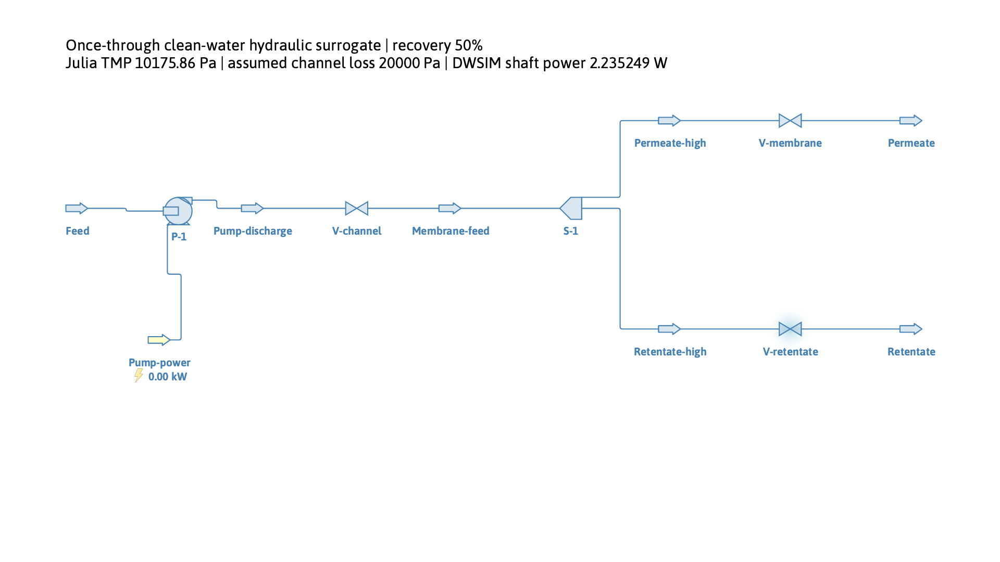

# Once-through filtration: recovery and non-membrane pressure loss

## Research question

Does a support improvement save the same fraction of energy once the pump
pressurizes the entire feed, including retentate, and supplies a separate
channel loss? This example turns a membrane-load calculation into an explicit
feed/permeate/retentate DWSIM hydraulic circuit.

## Theory and process boundary

The three synthetic supports retain 4 µm mouths and 4/5/6 µm interiors.
Their previously measured native body-resistance ratios $c_i$ are translated
through one literature baseline permeance:

$$
P_{s,0}=\frac{3.12/3600}{10^5}\quad[\mathrm{m/(Pa\ s)}],\qquad
Z_{s,i}=c_i/P_{s,0},\qquad
\mathrm{TMP}_i=J(Z_{s,i}+Z_f).
$$

$Z_f=2.5094652448872787\times10^8$ Pa s/m is the unchanged effective
non-support impedance from Zhu's matched M1 series. It includes possible
interface effects and is not an identified intrinsic selective resistance.
The shape-ratio transfer and retaining this impedance at the scenario
temperature are assumptions; the geometry is not the experimental specimen.

Let $A_m$ be membrane area, $J$ flux, and $y$ the permeate/feed mass recovery.
Reference volumetric rates all use the same fresh-feed density:

$$
Q_p=JA_m,\qquad Q_f=Q_p/y,\qquad Q_r=Q_f-Q_p.
$$

A stock DWSIM pump supplies $\mathrm{TMP}+\Delta p_c$ to the full feed. A
channel-loss valve precedes a prescribed split; permeate and retentate valves
return both products to external pressure. These stock units are a hydraulic
surrogate with imposed recovery, not a separation/rejection prediction.

The independent incompressible reference is

$$
W=\frac{Q_f(\mathrm{TMP}+\Delta p_c)}{\eta},\qquad
e=\frac{\mathrm{TMP}+\Delta p_c}{\eta y\,3.6\times10^6}
\quad[\mathrm{kWh/m^3\ permeate}].
$$

For equal channel loss, recovery and efficiency, the fractional design saving is

$$
1-W_i/W_0=\frac{\mathrm{TMP}_0-\mathrm{TMP}_i}
{\mathrm{TMP}_0+\Delta p_c}.
$$

Hydraulic work separates into membrane dissipation, retentate letdown and
upstream loss:

$$
\eta W=Q_p\mathrm{TMP}+Q_r\mathrm{TMP}+Q_f\Delta p_c.
$$

DWSIM's thermodynamic check instead balances full stream enthalpy flows
against shaft work; the hydraulic terms are not added a second time.

## Conditions and results

The scenario is clean pure water at 298.15 K, external pressure 100000 Pa,
100 LMH, 1 m² and efficiency 0.75. Recoveries 0.25/0.5/0.75 and prescribed
channel losses 0/20000 Pa give 18 actual DWSIM cases. No new native solve
or literature fit is made in this stage.

At 50% recovery, $Q_p=0.1$ m³/h and $Q_f=0.2$ m³/h:

| Support interior | Energy, zero channel loss | Energy, 20 kPa channel loss | Saving with 20 kPa loss |
| --- | ---: | ---: | ---: |
| 4 µm | 0.00753768 kWh/m³ | 0.02235249 kWh/m³ | 0% |
| 5 µm | 0.00693734 kWh/m³ | 0.02175216 kWh/m³ | 2.69% |
| 6 µm | 0.00668588 kWh/m³ | 0.02150070 kWh/m³ | 3.81% |

Run `20261108T231207Z-316d61cb` passes every stock-unit and overall balance,
saved connector inspection and save/load/solve check. Maximum exported mass
residual is zero at recorded precision; maximum enthalpy residual is
$2.64\times10^{-5}$ of shaft power. Water-property departures remain below
the declared 0.1% screen. Upstream native evidence is the preserved historical
graded-support study; it is not silently relabelled as a new TRT execution.

## Discussion

At 50% recovery the pump handles twice the permeate reference flow. Without
another head loss, energy therefore doubles relative to the permeate-only
load example, while its 11.30% widest-support saving is retained. Adding
20 kPa of independent head reduces the fractional benefit to 3.81%.

Raising recovery from 25% to 75% divides specific energy by three in this
fixed-head comparison. It does not predict channel friction at three different
feed flows: channel pressure loss is prescribed, not calculated from geometry.
The [recycle example](../crossflow_recycle/REPORT.md) adds a flow-dependent law.

The pressure chamber is uniform. Axial pressure profiles, concentration
polarization, osmosis, fouling, motor losses and pressure recovery from the
retentate are outside scope. Shaft energy per reference filtrate volume is
not total electricity per product volume in a plant.

## Conclusions

The same support improvement has a smaller whole-circuit benefit when fixed
hydraulic loads dominate. Recovery and the location of pressure letdown must
be stated before comparing energy savings.

## Reproduction and evidence

[Commands and protocol](README.md) · [Scientific/verification record](../../../docs/process_filtration.md)
· [Compact reference](../../../docs/process_filtration_reference.json)
· [Native support theory](../graded_support/REPORT.md).
The baseline impedance comes from
[Zhu et al. (2021)](https://doi.org/10.1016/j.ceramint.2021.01.088), Figure 6;
the recoveries and separate losses are declared scenarios, not paper measurements.
