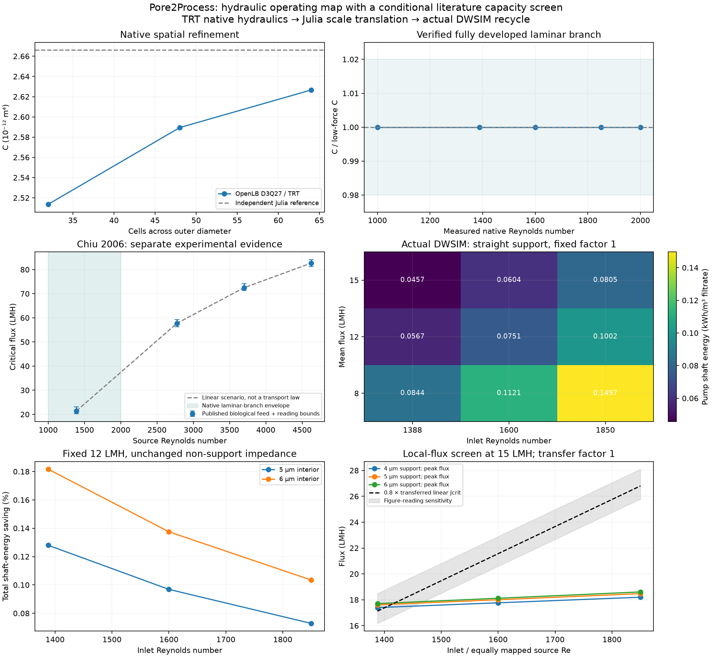

# Filtration operating map: material resistance versus circulation duty

## Research question and purpose

At fixed filtration flux, recovery and effective non-support impedance, how
much does support geometry reduce total pumping energy? Which material/operating
pairs meet a declared literature-capacity screen, and when does the fixed
membrane contribution dominate? This is the closing hydraulic example, with a
separately verified higher-Re laminar branch and actual DWSIM process duties.

## Geometry and governing equations

The synthetic channel is a straight 12-vertex star with alternating 2.3/1.4 mm
radii: area $A_c=9.66\times10^{-6}$ m², wetted perimeter
$P=0.01552039566$ m and hydraulic diameter $D_h=4A_c/P=0.00248962725$ m.
Its active length is 0.3 m; parallel replication gives 1 m² membrane area.
Velocity is channel flow divided by open area, and $Re=\rho uD_h/\mu$.
The horizontal channel has uniform external permeate pressure and no gravity.

Native stock D3Q27/TRT with magic parameter $3/16$ resolves periodic,
fully developed flow. Measured gradient $G$ and channel flow supply
$\mathcal C=\mu Q_c/G$ in m⁴. An independent cross-sectional Poisson
solution verifies the duct conductance; it does not supply process input.

The support family has fixed 4 µm mouths and 4/5/6 µm interior radii in a
40 µm body and 20 µm square cell. Separately verified TRT body-resistance
ratios $c_i$ give

$$
Z_{s,i}=\frac{c_i}{P_{s,0}},\qquad
P_{s,0}=\frac{3.12/3600}{10^5}\ \mathrm{m/(Pa\ s)},\qquad
Z=Z_{s,i}+\gamma Z_f,
$$

where $Z_f=2.5094652448872787\times10^8$ Pa s/m is Zhu's paired M1
effective non-support impedance and $\gamma$ is a declared scenario multiplier.
The common permeance anchor transfers shape ratios, not absolute specimen
geometry. $Z_f$ may include interfaces and intermediate layers.

For TMP $p(x)$ and channel flow $q(x)$, Julia solves

$$
p'=-\mu q/\mathcal C,\qquad q'=-Pp/Z,\qquad
J(x)=p(x)/Z,\qquad p''=\frac{\mu P}{\mathcal C Z}p.
$$

Inlet Re and prescribed mean flux set the hyperbolic solution; outlet TMP
must remain positive. The model is a slowly varying fully developed
approximation, with no resolved entrance, turbulence or fouling physics.
A native velocity-profile bound $\beta_m\le u_{max}/\bar u$ screens the
omitted axial momentum term relative to friction:

$$
\frac{2\beta_m\rho\mathcal C P J_{max}}{\mu A_c^2}<0.02.
$$

This is a reduced-model screen, not validation against permeating-wall CFD.

## Process and capacity metrics

DWSIM solves the real stock feed/circulation pumps, recycle, cooler and
hydraulic port representation. Feed rises to outlet TMP and circulation
supplies the axial drop. The independent hydraulic references are

$$
Q_p=\bar J A_m,\qquad Q_f=Q_p/y,\qquad
W_f\simeq Q_fp_{out}/\eta_f,\quad
W_c\simeq Q_{in}(p_{in}-p_{out})/\eta_c,
$$

$$
e=\frac{W_f+W_c}{3.6\times10^6Q_p}\quad[\mathrm{kWh/m^3\ filtrate}].
$$

Actual pump checks use the individual inlet densities. Cooling heat, motor
electricity and shaft work are not combined as one utility. COD is an external
conserved tracer with assumed local rejection 0.65, not a DWSIM reaction/species.

[Chiu et al. (2006)](https://doi.org/10.1016/j.seppur.2005.11.028), Figure 6,
supplies a short-step biological-effluent critical-flux series at source
Re=1388/2776/3701/4626. Its endpoints include 21.4/72.5 LMH; intermediate
points have recorded digitization bounds. Source 20–25 °C conditions do not
supply a measured feed viscosity for this transfer. The source crosses flow
regimes; its curve is not a laminar constitutive law.

Within the source range, chosen equal-Re or equal-velocity mappings evaluate
piecewise-linear capacity or shape-free monotonic brackets. A capacity fraction
$f_c$ and transfer factor $t_c$ give the conditional local requirement

$$
J_{max}\le f_ct_c J_{crit,source}.
$$

Comparing maximum local model flux with source module-average critical flux
is itself a transfer assumption. No extrapolation or indefinitely sustainable
flux claim is made. Reading bounds and policy factors are not confidence intervals.

[Frédéric et al. (2018)](https://doi.org/10.1016/j.memsci.2018.09.021) provides
multichannel porous-cross-section modelling context, but its chosen fouling
coefficient does not supply a measured physical-time or circulation-capacity
law. The related TiO₂ studies in the
[literature benchmark](../literature_benchmark/REPORT.md) are not independent
biological-feed validation.

## Results

Sixteen native cases verify the periodic laminar branch near measured
Re=1000–2000. Accepted $\mathcal C=2.626622470254\times10^{-12}$ m⁴;
N48/N64 change is 1.4358%, difference from the independent reference −1.4796%,
and maximum lattice Mach 0.077399. Time-step and domain changes are tiny;
separate stationarity and initial-state checks pass. A stationary laminar
branch does not establish real transition behavior at the same Re.

At 12 LMH, inlet Re=1388, 50% recovery, 25 °C, $\gamma=1$ and efficiencies 0.75:

| Interior radius | Mean TMP (kPa) | Shaft energy (kWh/m³) | Saving | Fixed impedance share | Circulation power share |
| --- | ---: | ---: | ---: | ---: | ---: |
| 4 µm | 1.221104 | 0.056703822 | 0% | 68.5026% | 98.7234% |
| 5 µm | 1.123836 | 0.056631254 | 0.12798% | 74.4316% | 98.8489% |
| 6 µm | 1.083071 | 0.056600813 | 0.18166% | 77.2330% | 98.9017% |

The fixed share is $\phi_f=\gamma Z_f/(Z_s+\gamma Z_f)$. Equal contributions
occur at $\gamma=0.459798,0.343516,0.294783$ for the three designs; above each
crossing the fixed contribution dominates. All sampled factors 0.5/1/2 are
above these crossings. The reference fit reaches 90% dominance at support
flux 12.91 m/h at 1 bar; these synthetic shapes do not reach that value.

At 12 LMH, $\gamma=1$ and capacity fraction 0.95, the straight design's
linear nominal policy selects Re=1388 under equal-Re mapping (0.056703822
kWh/m³), but Re=1850 under equal-velocity mapping (0.100151975 kWh/m³).
For the 6 µm design at 15 LMH, $\gamma=0.5$ and fraction 0.8, the equal-Re
linear policy selects Re=1600; the monotonic-lower policy certifies no grid
point. That absence need not mean physical infeasibility.

The full grid and seed check comprise 91 actual DWSIM solve/save/reload cases.
Maximum relative mass residual is $2.23\times10^{-13}$, normalized enthalpy
residual $1.62\times10^{-6}$, and omitted-momentum upper screen 1.3175%.
Saved replay checks 1620 capacity comparisons and 1458 discrete selections.

## Discussion

The native support improvement persists, but almost all baseline shaft work
pays for circulation. A 35.89% support-resistance reduction therefore saves
only 0.18166% of total shaft energy here. A dominant fixed membrane impedance
and dominant circulation duty describe different partitions of the problem.
The earlier low-Re case's 11.20% saving uses a different verified numerical
configuration and operating range, rather than a strict controlled Re-only sweep.

Selection depends strongly on empirical transfer. Zhu's clean-water membrane
and Chiu's biological-feed membrane are different materials; combining them
is a scenario. Conditional minima on a discrete grid are not continuous or
validated physical optima. A 1.2× hydraulic-viscosity sensitivity increases
energy about 1.72× because Re is held fixed and circulation also rises; it is
not measured effluent rheology. Illustrative COD retention does not invent a
circulation-dependent quality benefit or a regulatory threshold.

## Conclusions

Support design can lower membrane pressure requirements, yet the largest
process saving may require addressing circulation or another dominant duty.
The bounded hydraulic demonstration is complete and closed for now. Reaction,
thermal behavior, physical fouling time and long-term economics remain separate
research questions, not conclusions of this map.

## Reproduction and evidence

[Commands/protocol](README.md) · [Full record](../../../docs/operating_window.md)
· [Compact reference](../../../docs/operating_map_reference.json)
· [Source/condition ledger](../../../literature/operating_window_evidence.json).
Native/process run IDs are `20261109T205248Z-d6fa71dd` and
`20261109T233235Z-1baf9ec0`. The CLI map adds no new Panel browser claim.
The support calibration is from
[Zhu et al. (2021)](https://doi.org/10.1016/j.ceramint.2021.01.088), Figure 6.
