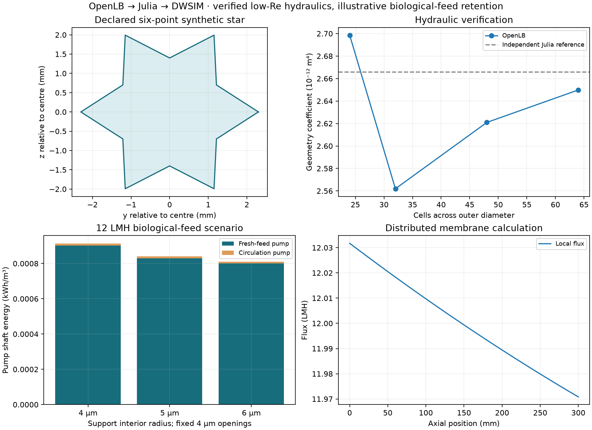

# Explicit star channel: distributed filtration and a biological-feed scenario

## Research question

With channel geometry and flow conventions defined explicitly, how much does
support widening reduce total two-pump energy at fixed filtration flux and
circulation? Can a conservative biological-feed tracer be added without
confusing hydraulic verification with validated separation or reaction?

## Geometry and native hydraulic theory

A straight channel has a 12-vertex star cross-section, alternating radii
$R=2.3$ mm and $r=1.4$ mm at angles $n\pi/6$. Its area, wetted perimeter and
hydraulic diameter are

```math
A_c=3Rr=9.66\times10^{-6}\ \mathrm{m^2},\quad
P=12\sqrt{R^2+r^2-2Rr\cos(\pi/6)}=0.01552039566\ \mathrm m,\quad
D_h=4A_c/P=0.00248962725\ \mathrm m.
```

Flow is axial $+x$ and mean speed is explicitly $u=Q_c/A_c$. Seven 0.3 m
channels give $7PL=0.03259283$ m² active area; parallel replication normalizes
the process to 1 m². Fractional equivalent channel counts are area scaling,
not a fabricated integer plant.

OpenLB measures fully developed, no-slip flow in a short periodic window under
equivalent pressure gradient $G>0$. Its stock TRT/forcing and geometry
facilities give a geometry coefficient

```math
\mathcal C=\frac{\mu Q_c}{G}\quad[\mathrm{m^4}],\qquad
-\frac{dp}{dx}=\frac{\mu Q_c}{\mathcal C}.
```

An independent Julia oracle solves $-\nabla_\perp^2w=1$ with $w=0$ at the wall;
then $u_x=(G/\mu)w$ and $\mathcal C=\int w dA$. It is a numerical check,
not the production hydraulic input or a native initial field. The native
periodic density field is not interpreted as a full physical module pressure.

## Distributed membrane and process equations

Let $p(x)$ be TMP relative to uniform permeate pressure, $q(x)$ channel flow,
and $Z=Z_s+Z_f$ a uniform local membrane impedance in Pa s/m:

```math
\frac{dp}{dx}=-\frac{\mu}{\mathcal C}q,\qquad
\frac{dq}{dx}=-\frac{P}{Z}p,\qquad J(x)=p(x)/Z.
```

Consequently $p''=\lambda^2p$, with $\lambda^2=\mu P/(\mathcal C Z)$.
Prescribed inlet Re fixes $q(0)$; prescribed mean flux fixes
$q(0)-q(L)=\bar JPL$. Julia evaluates the hyperbolic solution and rejects
nonpositive outlet TMP. The through-thickness support impedance is assigned
as a scalar to every local wall normal; channel $x$ is axial, whereas native
support $x$ is through-thickness. No anisotropic tensor is inferred.

The supports have identical 4 µm mouths and 4/5/6 µm interiors. Current native
TRT resistance ratios give $Z_s=c_i/P_{s,0}$, where
$P_{s,0}=(3.12/3600)/10^5$ m/(Pa s). Zhu's paired M1 fit gives
$Z_f=2.5094652448872787\times10^8$ Pa s/m. This common calibration transfers
synthetic shape ratios; it is not an absolute specimen prediction.

DWSIM receives outlet TMP, total inlet flow and the full axial pressure drop.
Its feed pump lifts fresh flow to outlet pressure; the circulation pump
supplies the axial drop. Recycle, purge, cooler, splitters and valves are
actual stock units. The distributed hydraulic port identity per channel is

```math
q_{in}(p_{in}-p_{out})+q_p p_{out}
=\int_0^L\left(\frac{\mu}{\mathcal C}q^2+\frac{P}{Z}p^2\right)dx.
```

The lumped valves preserve the port work; their individual losses are not
claimed to resolve distributed dissipation. Actual pump checks use inlet
density, $W=\dot m\Delta p/(\rho_{in}\eta)$. Specific shaft energy is
$(W_f+W_c)/(3.6\times10^6Q_p)$ kWh/m³; removed heat stays separate.

## Biological-feed balance

[Chiu et al. (2006)](https://doi.org/10.1016/j.seppur.2005.11.028), Table 2,
reports activated-sludge-system effluent COD with mean 68.7 mg/L. Table 3
reports rejection 0.65 for another membrane/operating condition. Here that
value is an explicitly transferred local rejection $r_C$, not a fitted law.
For a conserved COD-equivalent tracer,

```math
c(x)=c_{in}\left(q_{in}/q(x)\right)^{r_C},\qquad
c_p=\frac{q_{in}c_{in}-q_{out}c_{out}}{q_p}.
```

Mixer and purge balances determine fresh-feed concentration. COD is not a
DWSIM compound, a measured rheology or a reaction. “Removal” denotes diversion
to purge, not degradation. Chosen rejection 0.5/0.8 sensitivities are not
experimental uncertainty.

## Results

Seventeen native channel cases give $\mathcal C=2.6498554841352223\times10^{-12}$
m⁴, 0.6082% below the independent Julia reference. N48→N64 change is 1.1019%.
The accepted native operating Re envelope is 4.9414–34.5896; the process is
bounded to inlet Re=10–30 and 8–12 LMH. Twenty-four native TRT support cases
separately revalidate the geometry comparison; the widest reduces resistance
by 35.89%.

At 12 LMH, Re=20, 25 °C, 1 m², 50% recovery and both efficiencies 0.75:

| Interior radius | Mean TMP (kPa) | Actual shaft energy (kWh/m³) | Saving | Fixed impedance share |
| --- | ---: | ---: | ---: | ---: |
| 4 µm | 1.221104 | 0.000912569 | 0% | 68.50% |
| 5 µm | 1.123836 | 0.000840519 | 7.90% | 74.43% |
| 6 µm | 1.083071 | 0.000810323 | 11.20% | 77.23% |

Baseline feed/circulation powers are 0.0108278663/0.0001229635 W; circulation
is 1.123% of the total. Nominal module/fresh/permeate/purge COD values are
68.7/53.53185/26.04984/81.01385 mg/L. These are conservative scenario outputs.

Twenty-eight actual DWSIM solve/save/reload cases pass. Maximum normalized
mass and enthalpy residuals are $1.97\times10^{-12}$ and $1.95\times10^{-6}$.
The stock forced-liquid IAPWS route is used within explicit phase guards;
no solver output is repaired to close a balance. The existing Panel interface
and exports have a separate browser verification record.



## Discussion

The fixed non-support contribution already dominates membrane resistance, yet
circulation is cheap at this low Re, so support widening still saves 11.20%
of total modelled shaft energy. The source critical-flux point at Re=1388
lies outside this verified range and is not used to declare these low-Re
cases below critical flux. Sustainable flux and physical fouling time are unavailable.

The axial model assumes slowly varying fully developed laminar sections.
Entry losses, transition, turbulence, resolved permeating-wall CFD and physical
retention transfer remain outside its verification. The low-flow native image
is not relabelled as a new velocity solve when process controls change.

## Conclusions

An unambiguous synthetic channel, native TRT support measurements and actual
process balances establish a bounded hydraulic/trace-solute demonstration.
The [higher-Re operating map](../operating_map/REPORT.md) separately extends
the native range before applying literature-capacity policies.

## Reproduction and evidence

[Commands](README.md) · [Full record](../../../docs/star_channel_showcase.md)
· [Compact reference](../../../docs/star_channel_reference.json)
· [Browser checks](../../../docs/browser_checks.md).
Membrane anchor: [Zhu et al. (2021)](https://doi.org/10.1016/j.ceramint.2021.01.088),
Figure 6. Biological extraction: [source/conditions ledger](../../../literature/chiu2006_bio_extraction.json).
