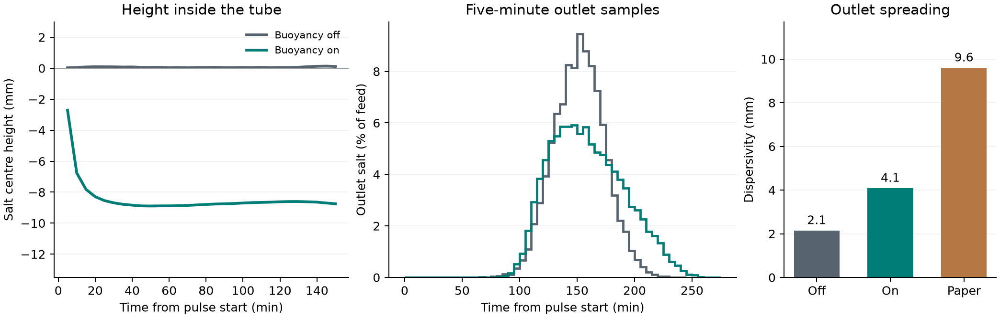

# Salt sinking and outlet spreading in the horizontal 4 mm bead bed

**The salt sank and the outlet pulse broadened.** After one hour, 94.9% of the injected salt was in the lower half of the tube with buoyancy on, compared with 49.6% with it off. At 200 mm, buoyancy raised apparent dispersivity from **2.15 to 4.09 mm**. This closes **26% of the gap** to the published 9.6 mm. The simulated pulse still falls 57% below that estimate. All 0.75 mg passed the outlet in each run.

| Quantity in the matched 0.3 mL/min runs | Buoyancy off | Buoyancy on |
| --- | ---: | ---: |
| Salt centre height at 60 min, relative to the tube centre | +0.04 mm | −8.88 mm |
| Mean salt concentration in the lower / upper liquid halves at 60 min | 13.3 / 13.3 mg/L | 25.3 / 1.36 mg/L |
| Mean time spent in the bed | 149.3 min | 156.6 min |
| Time by which 10% / 90% of the salt had exited, from injection start | 123.5 / 179.7 min | 119.7 / 203.9 min |
| Outlet arrival-time standard deviation, after pulse-width correction | 21.9 min | 31.7 min |
| Apparent longitudinal dispersivity at 200 mm | 2.148 mm | 4.086 mm |

At one hour the entire dose was still inside both beds. The bottom half contains 49.7% of the connected liquid volume, so the split with buoyancy off is consistent with the available space. With buoyancy on, the salt centre moved 8.92 mm downward relative to the control. The central 80% of the salt then took **84 minutes** to pass the outlet, compared with **56 minutes** without buoyancy. The paper's coefficient would imply a timing standard deviation of about 46 minutes at the nominal water residence time. It supplies an independent comparison for pulse width. [Berkowitz et al., section 2, paragraph 14](https://doi.org/10.1029/2008WR007342)

The height curves cover the part of the run with at least half of the dose still in the tube. The brown bar is the published estimate for the homogeneous bed. The outlet curves are the two predictions.

## Experimental comparison

Berkowitz and colleagues reported a fitted longitudinal dispersivity of **9.6 mm** for a homogeneous bed of 4 mm glass beads at 0.3 mL/min. Their paper gives that scalar estimate for the coarse bed. Its published breakthrough curves are for the two-layer column. The paired calculation here uses the reported 1.5 mL pulse of 500 mg/L NaCl, delivered over five minutes at 23 °C and followed by fresh water. The 9.6 mm value enters the comparison after the simulations. [Berkowitz et al., section 2, paragraphs 9–14](https://doi.org/10.1029/2008WR007342) · [Source extraction](../../../literature/sources/berkowitz2009/evidence.toml)

The horizontal tube has a 27 mm inside diameter. Every case uses the same synthetic packing of 292 glass beads per 28 mm repeat. Nine repeats provide a continuous pressure domain, with first passage measured 200 mm from the inlet. OpenLB calculates water motion with stock TRT. Julia transports the entire finite salt pulse using that water velocity and molecular diffusion. In the buoyant run, the evolving salt concentration feeds back into the water solve. The dilute-salt density relation gives a feed 0.360 kg/m³ denser than the incoming fresh water. The salt-rich liquid can descend as it pushes lighter liquid aside. [Density source, Table I](https://doi.org/10.1021/ja01146a043) · [Geometry, coupling and reproduction commands](README.md)

## Measuring the two effects

Sinking is measured from the salt mass on either side of the horizontal centreline and its mean height. A negative height is below the centreline. Upper and lower concentrations use their respective connected liquid volumes across the complete hydraulic domain. The outlet pulse gives a separate measure of longitudinal spreading. For the actual entry and exit times, the apparent dispersivity is

$$
\alpha_{\rm app} =
\frac{L\,[\operatorname{Var}(t_{\rm out})-\operatorname{Var}(t_{\rm in})]}
     {2\,[\overline{t_{\rm out}}-\overline{t_{\rm in}}]^2}.
$$

The mean difference removes the injection delay and the variance difference removes the width of the scheduled injection. With a buoyant pulse the expression retains the covariance between entry time and transit time. Its value describes this dose and length. The numerical moments use individual arrival times. The plot collects those same arrivals into five-minute samples. No outlet width, time shift or mixing parameter was estimated from the published dispersivity.

## Numerical checks

- **Gravity direction.** On the six-cells-per-bead grid, the share of salt below the centreline after an hour was 96.0% with downward gravity, 50.0% with buoyancy off and 4.1% when gravity was reversed. The orientation control distinguishes settling of the salt-rich liquid from an inherent preference of the packing for its lower half. In a separate single-period test, uniformly filling the bed with feed-strength brine produced a final change in mean vertical water velocity of 0.21% of the axial velocity. At one-tenth feed strength the change was 0.021%.
- **Flow and mass.** Both primary pulses used 12,288 equal-mass markers. The shared-face water discharge held 0.300 mL/min with a maximum relative plane error below 2 × 10⁻¹³ in the buoyant run. Before the flow correction, the maximum native discharge deviation was 0.217%. The reconstructed density field conserved salt volume to 3 × 10⁻¹⁶ of the dose. The local redistribution required to keep the concentration below the feed value involved at most 0.214% of the dose per update.
- **Passive control.** The twelve-cell control gave 2.148 mm. The earlier passive transport method, run independently on the same saved lower-compressibility carrier, gave 2.216 mm, a 3.1% difference. Interleaved subsets of the markers gave within-run standard errors of 0.021 mm with buoyancy off and 0.042 mm with it on. These measure sampling variability conditional on each simulated water field.
- **Pressure relaxation.** Independent native water solves held the actual plume fixed at 9.5 and 59.5 minutes. At 9.5 minutes the salt-weighted downward water speed was 6.47 µm/s in the coupled run and 6.45 µm/s after extended relaxation. At 59.5 minutes the values were 0.356 and 0.358 µm/s. The weighted RMS differences across all velocity components were 1.68 and 0.24 µm/s, respectively. These checks support using the faster water response between slower salt updates at the two sampled stages.
- **Time and spatial resolution.** With a bounded concentration, eight and twelve cells per bead gave 4.066 and 4.086 mm at the outlet, a 0.5% change. On the eight-cell grid, halving the coupling interval from 60 to 30 s gave 4.144 mm. Narrowing the concentration-averaging width from 2 to 1.5 mm gave 4.237 mm. Removing the upper bound on the density interpolation gave 4.064 mm and allowed local estimates above the feed concentration. The bounded estimate is used for the physical comparison.
- **Remaining numerical limits.** The finest coupled run used a lower TRT relaxation time of 0.60. Its largest lattice-density departure was 0.81%, compared with 13.8–24.2% in the initial downward runs at 0.85. On the finest grid the underlying carrier still required a 9.1% RMS correction to represent flow on the six pore faces, above the 5% screen used in the preceding study. Corner-only cells exclude 0.178% of the hydraulic pore volume and carry 0.014% of axial flow. The stable direction and size of the paired change support the mechanism. An absolute, fully grid-qualified dispersivity remains open. [Passive-carrier verification](../berkowitz_homogeneous/REPORT.md) · [Case-by-case numerical record](reference_summary.json)

## What to test next

The salt did much of its separating near the entrance. In the buoyant run, apparent dispersivity was 4.94 mm at 50 mm, 4.64 mm at 100 mm and 4.09 mm at 200 mm. Both the earliest and latest tenth of the dose exited low in the tube, with mean heights of 8.36 and 9.85 mm below centre. The fitted coefficient alone cannot distinguish inlet effects from spreading farther inside the experimental packing.

During the simulated injection, backward water flow across parts of the inlet plane reached 16.8% of the net pump flow. Some salt travelled as far as 13.3 mm upstream before returning. The 52 mm guard kept it clear of the periodic outlet image. The experiment delivered salt through a confined end space and a nylon screen. The current source distributes the fixed dose over forward-flowing pores at an internal plane. The next comparison should put a confined inlet ahead of the same packing and bracket the screen's flow distribution while holding the dose and discharge fixed. The reverse flow, one-hour height split and 200 mm outlet width give three independent observations to compare. A longer nonrepeating packing would then isolate the contribution of persistent paths in the current repeated geometry. [Experimental apparatus, section 2](https://doi.org/10.1029/2008WR007342)
