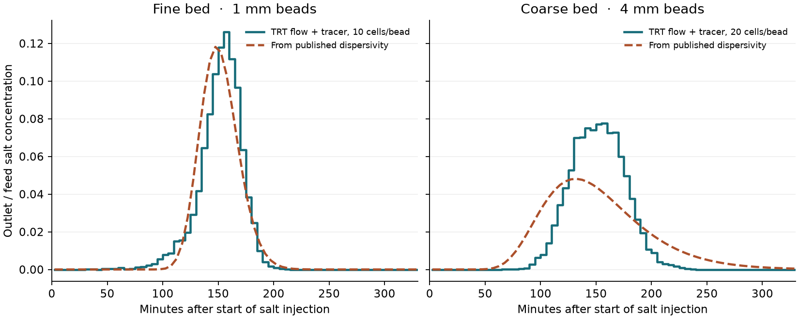

# Can the pore-scale flow predict how much a salt pulse spreads?

**The model reproduces the travel time implied by the water inventory and misses the change in spreading between the two materials.** Switching from 1 mm to 4 mm beads increased the predicted dispersivity by a factor of 1.53. The published estimates differ by a factor of 7.38. The comparison uses 200 mm of transport at 0.3 mL/min.

| Glass beads | Predicted dispersivity | Published dispersivity | Predicted mean arrival | Predicted arrival-time SD | SD implied by published fit |
| --- | ---: | ---: | ---: | ---: | ---: |
| 1 mm | 1.63 mm | 1.30 mm | 149.3 min | 19.1 min | 17.0 min |
| 4 mm | 2.49 mm | 9.60 mm | 149.2 min | 23.6 min | 46.1 min |

A larger dispersivity means more separation between the salt that takes fast paths and the salt that takes slow ones. Berkowitz and colleagues fitted each dispersivity to a separate homogeneous-column experiment. Their published outlet curves belong to the layered column. Both single-bed estimates were reserved for comparison. [Berkowitz et al., section 2, paragraph 14](https://doi.org/10.1029/2008WR007342)

The solid steps show predicted salt concentrations averaged over five-minute samples. Dashed curves apply the same injection and sampling schedule to the published dispersivities using the nominal water inventory.

## Fine glass beads

Mesh refinement gave 1.51, 1.67 and 1.63 mm at nominally six, eight and ten cells per bead. The last two estimates differ by 2.4% of the finest value. The finest result lies 26% above the published fit. Its timing spread is 2.1 min wider than the 17.0 min implied by that fit. Its dispersivities after 50, 100 and 200 mm were 1.08, 1.38 and 1.63 mm. A finite column length must accompany this estimate.

On the finest mesh, balancing liquid flow between adjacent pores required a 14.0% correction. The six-face tracer grid excluded 0.221% of the native pore volume and 0.029% of native axial flow. At eight cells per bead a second packing at the same porosity gave 2.22 mm, 33% above the first packing. Halving the tracer time step gave 1.62 mm, raising the salt diffusivity by 5% gave 1.55 mm, and lowering lattice compressibility gave 1.65 mm. The sensitivity to packing and the size of the flow correction limit how closely a single result represents the laboratory bed.

Doubling the native fine-bed period at the same eight-cell resolution gave **1.33 mm**, within 2.3% of the published 1.30 mm. This is an example of a packing that reproduces the reported spreading without fitting. The three tested fine geometries at that same resolution span **1.33 to 2.22 mm**. The corresponding coarse geometries span **1.85 to 2.16 mm**, all well below 9.60 mm.

## Coarse glass beads

The 4 mm beads gave 2.49 mm after 200 mm of travel at the finest resolution, 74% below the published 9.6 mm. The predicted mean exit time was 149.2 min. The predicted standard deviation of exit times was 23.6 min. Combining the published dispersivity with the nominal water inventory gives an implied 46.1 min. The water volume explains the mean transit time. The coarse-bed pulse has only about half the timing spread implied by the paper.

Across five mesh resolutions the model gave 2.08, 2.16, 2.19, 2.31 and 2.49 mm. The last two used 16 and 20 cells across a bead. Their estimates differed by 7.5% of the finest value. At that resolution the correction needed to conserve local liquid flow fell to 3.69%, and the pore volume excluded by face connectivity fell to 0.099%. The finite transport length still matters. The same finest field gave 1.86, 2.14 and 2.49 mm after 50, 100 and 200 mm.

At eight cells per bead, changing the packing seed gave 1.85 mm and doubling the native period gave 1.96 mm, compared with 2.16 mm for the baseline. Halving the tracer time step gave 2.16 mm again. Raising the salt diffusivity by 5% gave 2.11 mm. Lowering the carrier relaxation time reduced its maximum lattice-density departure from 1.35% to 0.11% and gave 2.09 mm. These tests leave a large gap to the experimental estimate. They cover a limited family of synthetic packings.

## What the checks establish

The baseline flow cells contain 3,502 fine spheres or 292 coarse spheres and include the full 27 mm tube diameter. Their geometric pore fractions are 39.00% and 38.96%. A marker follows its path across successive copies of the native flow field until it reaches the outlet. Doubling the native cell builds a new arrangement with twice the number of beads. This checks sensitivity to both the repeat distance and the particular realization. The 50, 100 and 200 mm readings on each saved field isolate the effect of travel distance.

The water volume fixes the nominal mean transit time at 148.86 min. It provides an independent inventory check. The authors did not publish a measured single-bed mean or a numerical uncertainty for either fitted dispersivity.

The engineering screens are 0.2% for flow matching, 5% for mean travel time and local face-flow correction, 0.1% for disconnected pore volume, 10% for sensitivity of the inferred dispersivity, and 20% for agreement with a published estimate. These tolerances describe this comparison. Each 4,096-marker run also gives a Monte Carlo standard error from 16 batches. Changes in packing and discretization are reported separately from this sampling error.

The outlet estimate uses the first two moments of an impulse passing through the bed. The plotted concentration integrates a five-minute injection over five-minute collection bins. Treating the injection and collection as ideal rectangular averages adds 15,000 s² of variance in total, equivalent to only **0.019 mm** of dispersivity at the nominal 200 mm transit time. Unknown end spaces, screens and inlet flow distributions are outside this calculation.

All 4,096 markers reached 50, 100 and 200 mm in each of the 18 tracer runs. The flow was within 0.195% of the specified value throughout. Mean exit times were within 0.44% of each run's connected water inventory divided by its achieved throughput. The maximum relative cell imbalance and plane-flow error were below 6.1 × 10⁻¹⁴ after projection. Each finest-bed finite pulse returned its full normalized dose on integration. The finest-run Monte Carlo standard errors for dispersivity were 0.067 mm for fine beads and 0.051 mm for coarse beads.

The Julia transport checks passed for exact drift, reflection, periodic crossing and the known exit-time moments of uniform flow with diffusion. An independent raster of the spheres and tube reproduced every native fluid-voxel index for all 14 flows. A second native run reproduced the coarse six-cell field byte for byte. Repeating the coarse eight-cell tracer with a different Julia thread count reproduced all 4,096 arrival histories byte for byte. The underlying Berkowitz source audit passed its 56 regression checks.

## Physical interpretation and next experiment in the model

The physical tube was horizontal. A 500 mg/L salt solution is slightly denser than fresh water, so the concentrated part of the pulse can descend as it moves downstream. Using the limiting apparent molar volume of NaCl at 25 °C as an approximation at 23 °C gives a feed density contrast of about **0.36 kg/m³**. This gives a maximum vertical buoyancy force per unit volume of about **3.5 Pa/m** before dilution. The finest coarse-bed TRT field required an axial driving gradient of **0.52 Pa/m**. The force ratio is about **6.8**. It compares two directions and describes the undiluted feed only. It cannot establish how much the outlet pulse actually broadens. Independent horizontal porous-medium displacement experiments observed that dispersion and density-driven segregation can coexist. [Harned and Hildreth, Table I](https://doi.org/10.1021/ja01146a043) · [Chhatwal et al.](https://doi.org/10.1029/WR009i005p01369)

The feed density contrast gives a maximum vertical driving gradient of about 3.5 Pa/m. The axial gradient from the finest TRT field was 0.52 Pa/m in the coarse bed and 8.16 Pa/m in the fine bed. The ratio is about 6.8 in the coarse bed and 0.43 in the fine bed. The gradients act in different directions and the salt pulse dilutes as it travels. The inlet ratio therefore provides a screen for the possible importance of gravity.

The next discriminating test is to run the same 4 mm packing and inlet pulse twice, with constant density and with a published dilute-salt density relation and transverse gravity. Keep flow, geometry, salt inventory and molecular diffusivity fixed. Compare lower- and upper-half salt concentrations as well as the outlet width. If the bed shows little segregation or the width barely changes, test a longer nonrepeating packing and inlet distribution. The layered flow-reversal result and enzyme reaction remain separate holdouts.

The [run guide](README.md) specifies the geometry, units, interfaces and reproduction commands. The [numerical record](reference_summary.json) retains the individual cases, checks, material and field hashes, and outlet curves.
