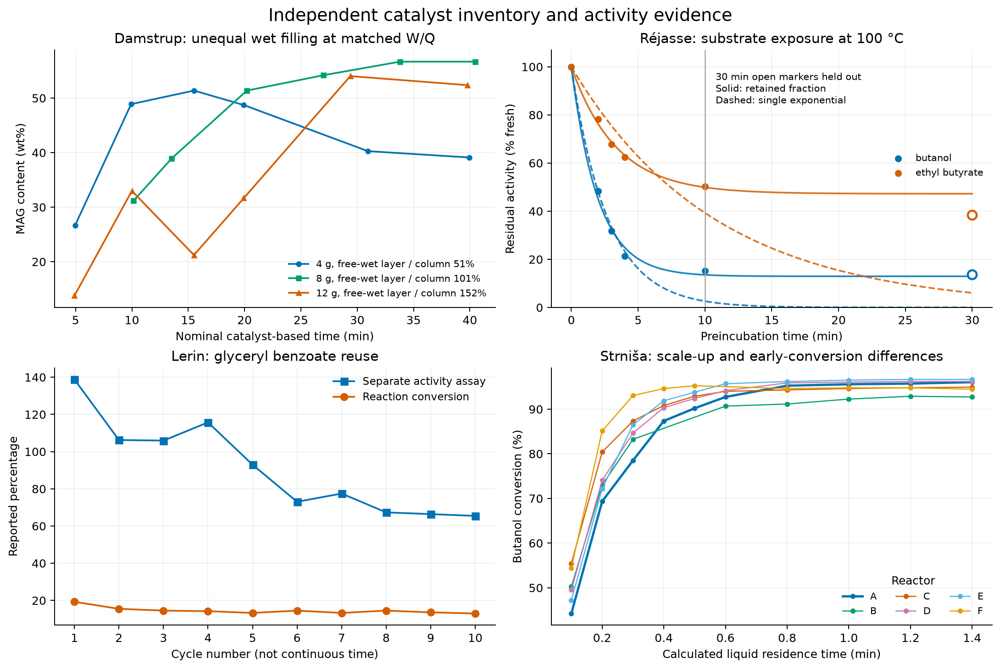

# Independent catalyst inventory and activity evidence

**Bottom line (24 November 2026).** The new papers establish that the
amount of immobilized catalyst, the liquid's access to the catalyst and
the catalyst's measured remaining activity are different quantities.
Changing the dry charge in the same column can markedly change reaction
performance even at the same catalyst-normalized feed rate, whereas
enlarging a similarly filled reactor can preserve performance. A
single exponential loss fitted to early residual activity also fails
to predict later activity in the independent storage experiments.
These are genuine tests of the proposed mechanisms, but different
chemical systems. They do not provide a validated loading correction
or deactivation coefficient for the fixed-6 g pentyl-propanoate bed.
All 40 target-reactor measurements remain held out.

The four supplied articles and Strniša's supplement have been audited.
Source conditions, reported uncertainty, approximate native figure-marker
readings and PDF hashes are retained separately in
[Damstrup](../../sources/damstrup2007/README.md),
[Réjasse](../../sources/rejasse2004/README.md),
[Lerin](../../sources/lerin2011/README.md) and
[Strniša](../../sources/strnisa2018/README.md).
Private files are not required to rerun the numerical comparisons.



## 1. Does catalyst mass alone determine packed-bed performance?

[Damstrup et al. (2007)](https://doi.org/10.1021/jf063366p) varied the dry
Novozym 435 charge in a 35.3 mL, 15 mm ID, 200 mm column during
glycerolysis at 40 °C. Crucially, its nominal reaction time is
`tau = W/(rho_bulk,dry Q)`, so equal plotted times mean equal dry
catalyst mass per volumetric feed, even when the absolute charge
and flow differ. A mass-proportional, otherwise unchanged packed-bed
model would predict the same product composition at the same W/Q.
This does not by itself isolate intrinsic enzyme kinetics because
hydrodynamic contact changes when the column filling is changed.

Table 2 independently reports free bead-layer expansion to
191.9 ± 2.8% of its dry volume, already reached at the first 30 min
observation (triplicate SD; different liquid from our target).
Using the reported 0.430 g/mL dry bulk density gives:

| Dry charge | Dry layer / column | Free wetted layer / column | Interpretation |
| ---: | ---: | ---: | --- |
| 4 g | 26.4% | 50.6% | Substantial unfilled space |
| 8 g | 52.7% | 101.1% | Approximately fills column |
| 12 g | 79.1% | 151.7% | Free expansion exceeds available volume |

The last number is a volume-ratio diagnostic, not a physical packed
porosity greater than one. Constrained swelling, compaction or blockage
are plausible; their magnitude in the reactor is not measured. The
authors suggest poor contact in an underfilled bed and restricted
access in an overloaded bed. The reported dry percentages in the
paper and recalculated percentages are retained separately.

Keep the 8 g Figure 2 curve as the reference and interpolate it at
the other charges' overlapping plotted times. No parameters are fitted
to the 4 g and 12 g experiments. Only five matched positive-time
points for each charge are used (the 5 min points are outside the
8 g series). The numbers below are weight percentage of monoacylglycerol
(MAG) in the analyzed reaction product, **not acid conversion**.

| Nominal time | 4 g observed | 8 g matched reference | 12 g observed |
| --- | ---: | ---: | ---: |
| ~10 min | 48.9% | 31.2% | 33.0% |
| ~20 min | 48.7% | 50.9% | 31.7% |
| ~40 min | 39.1% | 56.7% | 52.4% |

The full reference comparison gives RMSE 13.71 and 13.04 MAG
weight-percentage points for 4 and 12 g, respectively. The largest
absolute discrepancies are 17.73 and 21.41 points. Four of five
and three of five points, respectively, differ even when moving both
curves within the stated marker-reading scenarios (±0.3 min and
±1 weight-percentage point per curve). This is not a statistical
significance test: the plotted experimental SDs and any correlating
bed-history errors are not quantified by the reading scenario.
Some plotted times and the overall range of flow given by the paper
are also not exactly consistent under Eq. 1; retain the times rather
than inventing a per-point flow ledger.

Conversely, the separate Table 1 scale-up series holds dry
loading density (220 kg/m³) and nominal time (20 min) fixed.
Its inferred charges range from 7.77 to 99.88 g (12.86-fold).
MAG content varies from 50.2 to 55.6 wt%. The largest reactor's
`Q × MAG mass fraction` proxy is 13.52 times the smallest's
under this matched feed. This is consistent with near-proportional
scale-up when packing quality is maintained, not a proof that
the instantaneous intrinsic rate always scales with catalyst mass.

## 2. Does that mean our 6 g pentyl bed is overpacked?

Not necessarily. The [Lorenzo geometry](../../../examples/biocatalysis/pentyl_propanoate_history/REPORT.md)
has 16 mm bore and 140 mm length (28.15 mL column volume). In the
explicitly conditional scenario using Damstrup's dry bulk density and
expansion factor, 6 g initially occupies 49.6% of the column; the
uncrowded wet layer would occupy 95.1%. Varying only the analogue
expansion by its reported ±SD gives 93.7–96.5%; the nominal factor
required to fill the full column is 2.017. These are **scenario values**,
not observed target wetting or target uncertainty bounds. The catalyst
lot and liquid differ; exact swelling, voidage and clearance under
reacting conditions are not known. The analogy does not demonstrate
gross overfilling of the actual pentyl bed and does not justify
adjusting its catalytic mass or effectiveness.

## 3. Does a single deactivation constant predict later activity?

[Réjasse et al. (2004)](https://doi.org/10.1039/B4011459) independently
preincubated 25 mg Novozym 435 in neat butanol or ethyl butyrate
at 100 °C with initially zero water activity, then added the other
reactant and measured a short initial-rate assay. Only conventional
heating is used here. The two liquids have different effects on the
same catalyst.

An important source convention: Figure 4 fits only 0–4 min and
uses base-10 log percentage activity. The Table 1 printed slopes
(10.04 and 3.10 h⁻¹) correspond to natural-log loss coefficients
0.3853 and 0.1190 min⁻¹ after multiplying by ln(10)/60. The
reported half-lives (0.030 and 0.097 h) corroborate that convention.
Independently reading Figure 3's early data gives 0.3811 and
0.1223 min⁻¹, in close agreement. Extrapolating those early laws
predicts only 0.001% and 2.55% activity at 30 min, respectively.
The article reports 13 and 39%. Thus the early exponential is
not an adequate law for the full exposure.

Compare two common rate-state forms using **only the 0–10 min
activity readings** and holding out the 30 min marker/printed result:

```text
single exponential: a(t) = exp(-k t)
fast plus retained: a(t) = f + (1-f) exp(-k t), 0 <= f <= 1
```

| Exposure liquid | Reported activity at 30 min | Single exponential prediction | Fast plus retained prediction |
| --- | ---: | ---: | ---: |
| Butanol | 13% | 0.002% | 12.94% |
| Ethyl butyrate | 39% | 6.07% | 47.26% |

The retained-fraction model captures butanol's late observation at
this single held-out age. For ethyl butyrate it still overpredicts
by 8.26 percentage points. Varying each fitted training-marker
activity by ±0.10 µmol/(mg min) yields late predictions of
10.74–15.16% and 43.78–50.21% for the retained model, respectively.
These are reading scenarios, not statistical confidence intervals.
The held-out printed and digitized values are both retained. A
slower second decay or another conditioning mechanism could be
involved; the data do not identify a unique long-time law.

The same paper's Fig. 5 conventional reacting-reuse series gives
about 49.5% of the first-run initial **production rate** on the
second run after one six-hour reaction/recovery cycle, whereas
neat-substrate exposure leaves far less activity after only
30 min. This supports distinguishing the reacting state from
pure-substrate exposure, but the reused rate is not an independent
per-recovered-mass activity measurement.

## 4. Does conversion tell us how much activity remains?

No. [Lerin et al. (2011)](https://doi.org/10.1590/S0104-66322011000200002)
measure both product conversion and a separate lauric-acid/propanol
esterification rate after the catalyst is recovered from each batch.
All figures contain nonmonotone residual-activity observations; the
reported ratios occasionally exceed 100%. For example, the palmitate
series rises from about 75% to 101% during the first three uses.
The ascorbyl series decreases to 38% after cycle 5 and rises to
55% after cycle 6. A strictly irreversible, non-increasing activity
state cannot reproduce these sequences. Recovery, drying, substrate
effects and the assay itself are part of the experimental history.

For glyceryl benzoate:

| Observation | Cycle 4 | Cycle 10 |
| --- | ---: | ---: |
| Independently assayed residual activity | 115.7% | 65.5% |
| Measured use-reaction conversion | 14.2% | 13.0% |

Only 56.6% of the activity ratio at cycle 4 remains at cycle 10,
but 91.1% of the conversion remains. The figure reports a common
Tukey group for conversion after the first cycle. This demonstrates
why a conversion curve cannot be relabelled an enzyme survival curve.
The assay occurs after washing, drying and rest, and the 0.2 g aliquot
removed at each cycle is not continuously in the bed. The exact
per-cycle recovered catalyst masses are not reported. The ascorbyl
plot contains only eight cycles despite the general ten-cycle
procedure: no data are fabricated for cycles 9–10.

## 5. Independent microreactor scale-up case

[Strniša et al. (2018)](https://doi.org/10.1016/j.cej.2018.05.028)
provide a more data-rich alternative for Pore2Process. Six plate-type
microreactors have one or two layers of sieved 372.10 ± 27.05 µm
Novozym 435 beads. The experiments include independent water tracer
and pressure data, an initial specific-activity assay and a separate
organic-phase conversion series at 24 °C. The reaction is vinyl
butyrate + butanol → butyl butyrate + acetaldehyde, not
pentyl-propanoate synthesis.

Invert Table 2's mass/void-volume convention using the authors'
0.555 mg/µL bead density. The reconstructed inventories span
7.10–148.46 mg, and the resulting volumetric activity values agree
with the printed U/µL void column within 0.014 U/µL. These are
not new independently measured masses.

| Reactor | Reconstructed inventory | Conversion at 0.1 min | Conversion at 1.4 min | BB production at 1.4 min, reconstructed from BPN |
| --- | ---: | ---: | ---: | ---: |
| A | 7.1 mg | 44.2% | 96.1% | 0.413 mmol/h |
| B | 14.6 mg | 50.2% | 92.7% | 0.796 mmol/h |
| C | 21.5 mg | 55.5% | 94.9% | 1.232 mmol/h |
| D | 76.4 mg | 49.5% | 96.2% | 3.986 mmol/h |
| E | 147.1 mg | 47.2% | 96.7% | 7.970 mmol/h |
| F | 148.5 mg | 54.4% | 94.5% | 8.927 mmol/h |

Here the measured conversion markers are of butanol disappearance;
the production column uses the separately reported Table 2
butyl-butyrate BPN (mmol/g CALB). It is reconstructed from BPN,
the assumed 10% CALB mass fraction and nominal residence time, not
calculated by forcing one-to-one stoichiometry on the conversion.
The two reconstructions differ: product from BPN is 87.6–97.8%
of the stoichiometric butyl-butyrate flow inferred from butanol
disappearance. This is a source-consistency sensitivity (rounded
volumes, figure reads and separate chemical measurements), not a
measured side-reaction yield. Keep both measured quantities in a
later mass-balance comparison rather than silently substitute one.

The roughly 20.9-fold increase of inventory A → F delivers a
21.6-fold increase in reconstructed product throughput at the long
nominal residence time. However, near-complete conversion can
hide accessibility or kinetic differences. Use A alone as an
empirical contact-time reference and hold out the selected nonzero
conversion markers of all five other geometries, correcting their
nominal times to match W/Q using the reported void-volume convention.
The zero-time anchor is the analytical zero-contact limit, not
another measurement. No reaction rate law or target conversion is fitted.

| Held-out geometry | Marker count | RMSE after matching W/Q | Max early error (<= 0.3 min) | Max late error (>= 0.8 min) |
| --- | ---: | ---: | ---: | ---: |
| B | 8 | 3.99 pp | 6.21 pp | 4.06 pp |
| C | 10 | 8.00 pp | 15.21 pp | 0.92 pp |
| D | 10 | 3.25 pp | 6.16 pp | 0.64 pp |
| E | 10 | 4.12 pp | 8.69 pp | 1.19 pp |
| F | 9 | 9.73 pp | 18.21 pp | 1.48 pp |

Thus similar nominal specific exposure is not sufficient to reproduce
early performance. The independent batch anchor, 13.31 ± 0.27
µmol/(mg immobilized catalyst min) at the feed conditions, is not
a complete kinetic curve. Reactor-average butanol consumption at
0.1 min is lower (6.39–8.73 µmol/(mg min)); the reacting liquid's
composition also changes substantially along the bed, so this
ratio is not an observed activity or catalyst-accessible fraction.

## 6. Next executable milestone

The pentyl-propanoate history and all its tests remain intact. The
new analogues strengthen the hypothesis of distinct packed contact
and exposure-dependent activity, but cannot determine either for
the current chemistry. A further ad hoc loading or decay correction
chosen by the 40 target measurements would invalidate their holdout.

**Recommendation: qualify Strniša's microreactor as a separate,
better-observed packed-bed benchmark.** The user-supplied supplement
confirms four synthetic packings and the visualization grid; no
experimental three-dimensional bead coordinates or exact wet size
are available or required.

1. Digitize the complete Fig. 3b blank-loop, A and C pulse curves,
   including their late tails. Use the same instrument/loop response
   model for both rather than assigning tubing dispersion to the beads.
   Fig. 3a normalized peak curves cannot establish tracer recovery.
2. Use existing stock OpenLB TRT facilities in a separate project
   case for a one-layer random synthetic geometry, with the reported
   porosity and bead-size variability. The experimental 400 µm channel
   depth exceeds the mean bead diameter by 27.9 µm; the source
   simulation used a depth of one sphere diameter. Test clearance
   and resolution instead of copying the historical BGK model.
3. Reuse the conservative Julia advection/diffusion handoff, first
   qualify the short reactor A and then predict long reactor C
   with no tracer fitting. At 100 µL/min, nominal void-volume
   times 0.171 and 0.565 min compare with reported Table 1 means
   0.21 and 0.53 min and variances 0.08 and 0.14 min², respectively.
   Moment-derived dispersion and Fig. 6 water loss are separate
   constraints, not organic-liquid measurements. Audit common
   hydraulic resistance and the pressure-sensor measurement chain.
4. Only then qualify the reaction independently of the held-out
   geometry curves. The companion
   [Pohar et al. (2012)](https://doi.org/10.1016/j.cej.2012.02.035)
   study uses the same reaction but principally ionic liquids;
   check what n-heptane batch kinetics it actually reports.
   If only the one initial-rate anchor is available, explicitly
   distinguish a reference-calibrated geometry prediction from a
   chemistry-independent prediction.

This milestone offers independent validation of fluid transport and
an experimentally supported scale-up/productivity metric for
the subsequent Julia-to-DWSIM translation. No OpenLB, new reacting
bed, or DWSIM calculation has been run as part of the present audit.

**Subsequent implementation (24 November 2026).** The separate
[Strniša inert tracer example](../../../examples/biocatalysis/strnisa_tracer/REPORT.md)
has performed the dimensional blank-loop comparison and full-length
TRT/Julia A-to-C prediction. Numerical conservation passes, but
experimental spreading and fixed A-only delay transfer do not. The
associated [Panjan detector and additional tracer evidence](../../sources/strnisa2018/related_detector_evidence.md)
identifies a next literature-based measurement-loop audit. Reaction
is deliberately not initiated in the new case.
