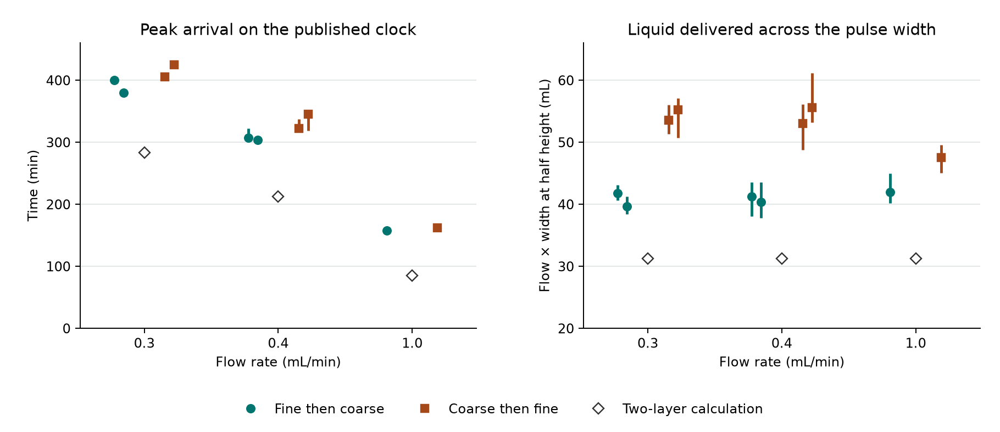

# Glass-bead flow reversal as a tracer benchmark

**Benchmark decision, 26 November 2026.** Use the change in outlet pulse width when the *same packing* is run in reverse. At 0.3 and 0.4 mL/min, coarse beads first took about 12–16 mL more flushing liquid than fine beads first between the two half-height crossings. At 1.0 mL/min the difference was 5.6 mL. The reported homogeneous-bed dispersivities provide independent targets for a first pore-scale calculation. Absolute transit time and recovered salt mass have weaker experimental support. [Original paper](https://doi.org/10.1029/2008WR007342)

## What the experiments establish

| Quantity | Published conditions and source |
| --- | --- |
| Packing | Horizontal 400 mm long, 27 mm ID column. One 200 mm section contains 1 mm borosilicate spheres, the other 4 mm spheres. A nylon mesh separates the beds and meshes retain both ends. Approximate porosity 0.39 from packing mass. Section 2, ¶9–10 and Fig. 1. |
| Input | 1.5 mL of 500 mg/L NaCl, followed by fresh water at 23 °C. The injected dose was 0.75 mg. At 0.3, 0.4 and 1.0 mL/min the injection and sample collection intervals were 5, 3.75 and 1.5 min. Section 2, ¶11–12 and Fig. 2 caption. |
| Output | Effluent electrical conductivity (EC), plotted in µS against minutes. Open markers indicate fine then coarse, filled markers coarse then fine. Two runs per direction at the lower two flows and one at the highest flow. The caption describes each point as the average of three measurements. |
| Equipment | Small end spaces, peristaltic pump, flow dampener and switched reservoirs. The authors say they corrected for tubing and inlet dead volume. The correction value, algorithm, time origin relative to the injection, EC calibration coefficients and blank response are unavailable in the paper. The 1% specification applies to the conductivity meter. |
| Homogeneous controls | Separate 200 mm columns at 0.3 mL/min gave fitted longitudinal dispersivities of 1.3 mm for the fine beads and 9.6 mm for the coarse beads. Paragraph 14 supplies the estimates. Figure 2 contains only the composite-column experiments. Figure 3 shows computed, dimensionless internal concentration profiles. |

The geometry gives 89.32 mL of pore liquid. The corresponding bed mean times are 297.7, 223.3 and 89.3 min. Including the centroid of the rectangular injection gives 300.2, 225.2 and 90.1 min from injection start. The published pulse volume, durations and Fig. 2 caption support this injection convention. Paragraph 11 also describes a steady conductivity measurement. [Source conditions](evidence.toml)

## Measured spreading

Full width at half maximum is the time from the rising half-height crossing to the falling half-height crossing. Multiplying that width by flow gives the amount of liquid delivered while the tracer signal is above half height. A common time shift leaves this measure unchanged. The following ranges span the separately plotted symbol series within each direction. The nominal conductivity background is 5 µS.

| Flow (mL/min) | Width, fine first (min) | Width, coarse first (min) | Fine first (mL delivered) | Coarse first (mL delivered) |
| ---: | ---: | ---: | ---: | ---: |
| 0.3 | 132–139 | 179–184 | 39.7–41.8 | 53.6–55.2 |
| 0.4 | 101–103 | 133–139 | 40.4–41.3 | 53.0–55.6 |
| 1.0 | 41.9 | 47.5 | 41.9 | 47.5 |

Fine beads first gave about 40–42 mL across the pulse at all three flows. The decrease in **directional** broadening at high flow therefore persists when measured in liquid volume. At each of the two lower flows the difference also survives the background and marker-reading check below. At high flow, the margin between the most conservative width bounds is only 0.04 min, well below the 1.5 min collection interval. The paper describes the two high-flow curves as similar.



In the left panel each symbol represents a plotted run, with the vertical line covering peak locations compatible with tied or multiple marker readings. The right panel uses the nominal background for the symbols and the full reading envelope for the vertical lines. Diamonds use the printed bed inventory and the two single-packing dispersivities.

## Extraction and reading sensitivity

The private PDF contains vector graphics. The extractor reads the centers of the marker fills, including white markers and markers hidden by other series. The color, shape and axis assignments were checked on a rendered overlay. All 13 major time ticks and 11 EC ticks enter the axis calibration. Its largest tick residuals are 0.113 min and 0.00073 µS. [Reviewed coordinates](fig2_markers.toml)

There are 700 marker positions across ten symbol series and 589 distinct within-series times. At 0.4 mL/min, 111 time positions contain two vertically distinct markers of the same symbol. Their maximum separation is 6.02 µS. Both readings are retained. The nominal calculation takes their midrange, and the bounds allow either extreme at every such time. The caption gives the run count, without identifying the origin of this extra within-symbol multiplicity.

For each series the analysis linearly interpolates the trace through the samples. With any constant background between 0 and 10 µS, the signal at half height is halfway between that background and the peak. The upper and lower signal envelopes and the extrema of the corresponding threshold bound both crossings of the main peak. The minimum coarse-first minus fine-first width over these choices is **25.5 min at 0.3 mL/min and 13.0 min at 0.4 mL/min**. These bounds quantify figure-reading and background choices. Experimental scatter is represented separately by the two published runs at each lower flow.

Peak times are less stable than widths. At 0.4 mL/min the conservative peak-time ranges overlap, although the pulse widths remain separated. The calculation retains possible peak times within 0.1 µS of the largest admissible reading to allow for symbol-coordinate rounding. The [per-series results](reference.toml) also give first moments over the visible time window and over the shared window at each rate. The end signals can still be appreciable, for example 17.1 µS on the 1.0 mL/min coarse-first trace. Integrating these windows supplies a partial moment. Full salt recovery would require a documented baseline, tail coverage and numerical EC-to-concentration calibration.

## Independent two-layer calculation

The Julia reference uses independent advection–dispersion transit times for the two homogeneous sections in series, as in the transfer construction in Eq. 3 of the paper. Each section has the same interstitial speed. Its axial dispersion coefficient is the printed dispersivity times this speed. At 0.3 mL/min the speed is 1.344 mm/min, giving 1.747 and 12.90 mm²/min for fine and coarse media. At the other two rates the calculation assumes the same dispersivities. Every composite-column marker was excluded from parameter estimation.

Let $z=t/(V_p/Q)$, $f=L_i/L$ and $d=\alpha_i/L$. The flux first-passage density of one section is

$$
g_i(z)=\frac{f}{\sqrt{4\pi d z^3}}\exp\!\left[-\frac{(f-z)^2}{4dz}\right].
$$

The two densities and the rectangular inlet pulse are convolved in each order. This particular series model gives the same outlet history in either direction. Its predicted mean is $V_p/Q$ plus half the injection duration. A sensitivity calculation averages the signal over a collection interval and labels the sample at its midpoint.

| Flow (mL/min) | Model peak (min) | Published peak, fine first (min) | Published peak, coarse first (min) | Model width (min) |
| ---: | ---: | ---: | ---: | ---: |
| 0.3 | 282.9 | 380–400 | 405–425 | 104.2 |
| 0.4 | 212.2 | 300–322 | 319–349 | 78.1 |
| 1.0 | 84.9 | 157.3 | 160–164 | 31.2 |

At the independently characterized flow of 0.3 mL/min even the earlier measured peak is about 97 min later than this prediction. The predicted width corresponds to 31.25 mL at every flow, below the measured widths in both directions. Averaging over the collection interval moves the modeled half-height width by less than 0.06 min at the slowest rate. A shift of the time origin could affect the peak-time comparison, while the width discrepancy would persist. The available data leave unresolved how much of the absolute delay originates in the apparatus or in transport through the packing.

The figure's peak and width differences test the outlet response. The authors proposed transient tracer accumulation at the interface and identify direct internal concentration measurements as future work in ¶31. Independently, Giacobbo and coauthors observed stronger directional effects in particular confined bead packs. Only 6.75 coarse beads span the diameter here, compared with 27 fine beads. This gives a physical reason to resolve the cylinder wall when investigating the effect. [Giacobbo et al. (2019), independent column experiments](https://doi.org/10.1155/2019/8348175)

Order symmetry in the calculation above follows from convolving independent transit times. In a separate infinite-domain model, Appuhamillage and coauthors obtained different directional properties for resident and flux-averaged concentrations and discussed the influence of finite boundaries. For a comparison with collected effluent, the simulation should use an inlet flux pulse and measure tracer mass passing through the outlet per unit liquid flow. [Appuhamillage et al. (2010)](https://doi.org/10.1029/2009WR008258)

## Pore-scale comparison and flow-reversal sequence

The [homogeneous-bed calculation](../../../examples/hydraulics/berkowitz_homogeneous/REPORT.md) implements the first two steps below. It records the effect of mesh spacing, synthetic packing and tracer travel distance on the comparison.

1. Use stock OpenLB TRT water flow and conservative Julia tracer transport for each single bead size at 0.3 mL/min. Match the 27 mm ID, approximately 0.39 porosity, 200 mm transport length and 1.344 mm/min interstitial speed. Preserve radial confinement when using shorter numerical domains for scale translation.
2. Derive the equivalent longitudinal dispersivity from the computed homogeneous outlet transport. Check mesh, domain length, mass conservation and packing-realization sensitivity against the published 1.3 and 9.6 mm targets. The estimates are independent of the layered Figure 2 experiments.
3. Use the same confined composite geometry in both directions and score the half-height widths without adjusting to Figure 2. At low flow the model must explain why coarse beads first give the broader pulse. At high flow a single curve per direction supports a check on the smaller contrast.

This assessment completes source qualification for the directional comparison. Native pore-flow prediction of the two dispersivities and transfer to an enzyme reactor are future stages.

## Reproduction

From the project root on macOS arm64, using Julia 1.11.6 and the existing project Python 3.12.9 environment:

```sh
source scripts/env.sh
julia --startup-file=no --threads=1 --project=julia literature/sources/berkowitz2009/audit.jl /tmp/berkowitz-screen.toml
cmp /tmp/berkowitz-screen.toml literature/sources/berkowitz2009/reference.toml
julia --startup-file=no --threads=1 --project=julia literature/sources/berkowitz2009/test_audit.jl
uv run --locked --offline python literature/sources/berkowitz2009/plot.py --reference /tmp/berkowitz-screen.toml --output /tmp/berkowitz-comparison.png
```

All 56 Julia assertions and 30 relevant Python regression tests passed on the audit machine. The Julia tests check the figure axes, interval crossings, partial moments, marker counts, mass and analytical first two moments of the calculated pulse. With 32 steps per injection interval, numerical mass is within $6\times10^{-16}$ of unity. Refining from 16 to 32 steps changes the modeled width by 0.00061%. Independently repeating the extraction and the Julia calculation reproduced the archived marker and result files byte for byte.

To repeat the PDF extraction, use Python with pdfplumber 0.11.9. The optional overlay also uses pypdfium2 and Pillow. The extractor checks the private original against the SHA-256 in the source metadata. The local extraction and overlay used bundled Python 3.12.14.

```sh
python3 literature/sources/berkowitz2009/extract_fig2.py --output /tmp/berkowitz-markers.toml --overlay /tmp/berkowitz-marker-check.png
cmp /tmp/berkowitz-markers.toml literature/sources/berkowitz2009/fig2_markers.toml
```
